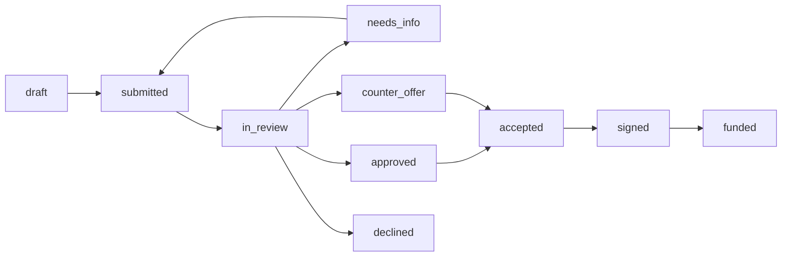
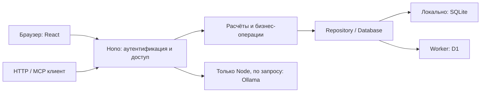

# Debitus-Kreditus — полное руководство пользователя и техническая документация

**Версия продукта: 0.8.0. Дата актуализации: 26 октября 2026 года.** Поведение описано по исходному коду и контрактам версии 0.8.0. Точные версии зависимостей закреплены в [`package.json`](package.json) и [`pnpm-lock.yaml`](pnpm-lock.yaml). Документ предназначен для пользователя кабинета, банковского специалиста, администратора, разработчика интеграции и человека, который запускает или обслуживает приложение.

Официальная документация для скачивания: [руководство в формате DOCX](docs/technical-manual.docx).

Debitus-Kreditus — автономный веб-прототип кредитного кабинета малого бизнеса. Он связывает задачу предпринимателя, финансовые расчёты, заявку, документы, банковское рассмотрение и моделируемое обслуживание после выдачи. Клиент и банковский сотрудник работают с одной сохранённой заявкой; это не набор независимых экранов с несвязанными примерами.

В этой версии все компании, аккаунты, документы-примеры, проверки регистрации и кредитной истории синтетические. Приложение не подключается к реальным банкам, ФНС или БКИ; не создаёт юридическую электронную подпись, не выдаёт реальный кредит и не переводит деньги. Подписание, выдача, очередной платёж и досрочное погашение требуют явных подтверждений имитации. Для изучения сервиса используйте вымышленные сведения и подготовленные тестовые документы.

Основной путь работает без языковой модели и внешнего inference API. Расчёты, скоринг, навигатор, планы действий и сравнения выполняются по определённым правилам. Необязательная локальная модель помогает выбрать проверенные пояснения к собственной заявке.

## Оглавление

- [1. Назначение, особенности и способы чтения документа](#s-1)
- [2. Установка и запуск](#s-2)
- [3. Руководство пользователя: страницы и рабочие сценарии](#s-3)
- [4. Финансовые правила, аналитика и локальный помощник](#s-4)
- [5. Архитектура, данные, HTTP API, MCP и безопасность](#s-5)
- [6. Эксплуатация, обновление, проверка и диагностика](#s-6)
- [7. Ограничения, словарь и справочные материалы](#s-7)

<details>
<summary>Развёрнутое оглавление по функциям и техническим темам</summary>

- [1. Назначение, особенности и способы чтения документа](#s-1)
  - [1.1. Какой результат можно получить](#s-1-1)
  - [1.2. Как пользоваться этим руководством](#s-1-2)
  - [1.3. Что считается сохранённым](#s-1-3)
- [2. Установка и запуск](#s-2)
  - [2.1. Выбор способа](#s-2-1)
  - [2.2. Готовый автономный комплект: запуск пользователем](#s-2-2)
  - [2.3. Исходники на Windows: запуск двойным щелчком](#s-2-3)
  - [2.4. Исходники: ручной запуск](#s-2-4)
  - [2.5. Локальная production-сборка](#s-2-5)
  - [2.6. Docker Compose](#s-2-6)
  - [2.7. Локальная проверка Worker/D1](#s-2-7)
  - [2.8. Настройка окружения](#s-2-8)
  - [2.9. Подготовка необязательной Ollama](#s-2-9)
- [3. Руководство пользователя: страницы и рабочие сценарии](#s-3)
  - [3.1. Вход, роли и навигация](#s-3-1)
  - [3.2. Профиль бизнеса и подбор условий](#s-3-2)
  - [3.3. Создание и ведение заявки](#s-3-3)
  - [3.4. Документы, повторные запросы и распознавание](#s-3-4)
  - [3.5. Работа сотрудника банка](#s-3-5)
  - [3.6. Четыре практических сценария на исходном наборе](#s-3-6)
  - [3.7. Поиск, уведомления и персональные настройки](#s-3-7)
  - [3.8. Импорт, экспорт и журнал через интерфейс](#s-3-8)
  - [3.9. Руководство администратора платформы](#s-3-9)
  - [3.10. Репетиция заявки и денежный сценарий](#s-3-10)
  - [3.11. После выдачи: платежи и досрочное погашение](#s-3-11)
  - [3.12. Локальный помощник: выбор темы и объяснение](#s-3-12)
  - [3.13. Типичные затруднения и восстановление работы](#s-3-13)
- [4. Финансовые правила, аналитика и локальный помощник](#s-4)
  - [4.1. Как читать результаты](#s-4-1)
  - [4.2. Единицы измерения и границы чисел](#s-4-2)
  - [4.3. Каталог и точные ограничения продуктов](#s-4-3)
  - [4.4. Аннуитет: формула, округление и календарь](#s-4-4)
  - [4.5. Свободный поток и три разных ограничения платежа](#s-4-5)
  - [4.6. Прозрачный скоринг](#s-4-6)
  - [4.7. Четыре исхода кредитной политики и их порядок](#s-4-7)
  - [4.8. Документы, форма бизнеса и актуальность](#s-4-8)
  - [4.9. Персональный подбор продуктов и стресс-сценарий](#s-4-9)
  - [4.10. Обратный расчёт от комфортного платежа](#s-4-10)
  - [4.11. Альтернативы той же задачи](#s-4-11)
  - [4.12. Денежный поток: два сценария на 6 или 12 месяцев](#s-4-12)
  - [4.13. Анализ CSV-выписки: формат и классификация](#s-4-13)
  - [4.14. Выписка: средние, регулярность и наблюдения](#s-4-14)
  - [4.15. Сопровождение: исходный график и отметка платежа](#s-4-15)
  - [4.16. Досрочное погашение: два режима и ограничения](#s-4-16)
  - [4.17. Версии, повторы запроса и экспорт сопровождения](#s-4-17)
  - [4.18. Объяснимость, происхождение и история изменений](#s-4-18)
  - [4.19. Текстовый навигатор задачи](#s-4-19)
  - [4.20. Необязательный локальный помощник](#s-4-20)
  - [4.21. Помощник выбирает подтверждённые факты, а не ведёт свободный чат](#s-4-21)
  - [4.22. Проверяемость и границы этого описания](#s-4-22)
- [5. Архитектура, данные, HTTP API, MCP и безопасность](#s-5)
  - [5.1. Архитектура и границы исполнения](#s-5-1)
  - [5.2. Модель данных и сохранение](#s-5-2)
  - [5.3. Роли и серверные права](#s-5-3)
  - [5.4. Аутентификация, Host, Origin и интеграционные токены](#s-5-4)
  - [5.5. Общий HTTP-контракт](#s-5-5)
  - [5.6. Примеры HTTP без изменения реальных данных](#s-5-6)
  - [5.7. MCP: транспорт, инструменты и ошибки](#s-5-7)
  - [5.8. Эксплуатация, резервные копии и работа с данными](#s-5-8)
  - [5.9. OpenAPI и фактический сервер: результат сверки](#s-5-9)
- [6. Эксплуатация, обновление, проверка и диагностика](#s-6)
  - [6.1. Какие файлы нужно сохранять](#s-6-1)
  - [6.2. Резервная копия локального приложения](#s-6-2)
  - [6.3. Резервная копия Docker и восстановление](#s-6-3)
  - [6.4. Обновление без потери досье](#s-6-4)
  - [6.5. Как начать с отдельной чистой базой](#s-6-5)
  - [6.6. Сборка автономного комплекта разработчиком](#s-6-6)
  - [6.7. Справочник команд проекта](#s-6-7)
  - [6.8. Устройство набора проверок](#s-6-8)
  - [6.9. Браузерные проверки](#s-6-9)
  - [6.10. Smoke и проверка сохранности после перезапуска](#s-6-10)
  - [6.11. CI и воспроизводимость](#s-6-11)
  - [6.12. Диагностика запуска и данных](#s-6-12)
  - [6.13. Диагностика пользовательских функций](#s-6-13)
  - [6.14. Какие сведения собирать при сообщении об ошибке](#s-6-14)
- [7. Ограничения, словарь и справочные материалы](#s-7)
  - [7.1. Что находится за пределами этой версии](#s-7-1)
  - [7.2. Словарь](#s-7-2)
  - [7.3. Контракты и исходники для углублённого изучения](#s-7-3)
  - [7.4. Лицензии](#s-7-4)

</details>

<a id="s-1"></a>

## 1. Назначение, особенности и способы чтения документа

<a id="s-1-1"></a>

### 1.1. Какой результат можно получить

Предприниматель может оценить допустимый платёж, сравнить продукты и варианты суммы/срока, собрать досье, отправить заявку на локальное рассмотрение, понять результат и пройти положительный путь до моделируемой выдачи. После выдачи доступны календарь, история и расчёт досрочного погашения.

Банковский специалист видит отправленную заявку, проверяет документы, запускает детерминированные проверки, сохраняет решение с причинами и сравнивает дополненный пакет с историческим снимком. Администратор видит состояние платформы и управляет приёмом первых заявок по продуктам, сохраняя отдельную границу доступа к досье.

| Возможность | Практическая польза | Важная граница |
| --- | --- | --- |
| Навигатор из короткого запроса | Извлекает сумму, срок и цель, затем предлагает проверить параметры | Разбор не создаёт заявку и не проставляет согласие |
| Персональный подбор | Объясняет ограничения продукта для конкретного профиля | Рекомендация не является банковским решением |
| Репетиция заявки | Показывает график и изменение нагрузки до отправки | Расчёт не резервирует предложение кредитора |
| Денежный сценарий | Сравнивает остатки с кредитом и без него на 6/12 месяцев | Эффект покупки задаётся пользователем, а не обещается сервисом |
| План следующего действия | Приводит причину, источник и переход к нужному месту | Неполные и устаревшие данные остаются обозначенными |
| OCR и сверка | Помогают перенести проверенный текст и выбранные месячные показатели | Не устанавливают подлинность и не меняют анкету без выбора |
| Анализ CSV-выписки | Отделяет выручку от кредита и переводов, показывает средние и расхождения | Находка не доказывает мошенничество |
| Альтернативы финансирования | Сравнивают сумму, срок, платёж и полную стоимость возврата | Выбор создаёт параметры новой анкеты, сохраняя исходное досье |
| Сравнение «Было / стало» | Показывает изменения после запроса сведений | Отсутствующий исторический снимок не восстанавливается догадкой |
| Сопровождение кредита | Моделирует очередные платежи и досрочное погашение | Это учёт имитаций, без приёма реальных денег |
| Общие HTTP/MCP-контракты | Позволяют читать и рассчитывать по тем же правилам, что в интерфейсе | Личный токен не даёт права менять заявку или отмечать платежи |
| Локальные ресурсы | Шрифты, OCR и основной кредитный процесс входят в подготовленную сборку | Первичная установка исходников и получение весов требуют отдельной подготовки |

<a id="s-1-2"></a>

### 1.2. Как пользоваться этим руководством

- Для первого знакомства выберите способ запуска в разделе 2 и пройдите сквозной сценарий раздела 3.
- Для повседневных операций используйте руководство по страницам и состояниям в разделе 3.
- Для понимания цифр, ограничений, находок и локального помощника откройте раздел 4.
- Для разработки интеграции используйте раздел 5, OpenAPI и примеры HTTP/MCP.
- Для резервного копирования, обновления, проверки сборки и поиска ошибки откройте раздел 6.

Статус заявки, результат проверки, результат предварительного расчёта и состояние обслуживания — разные вещи. Например, закрытие обслуживания не стирает факт выдачи и не меняет заявку `funded` в новый кредитный статус. Аналогично высокий балл не отменяет отсутствующий документ или стоп-фактор.

<a id="s-1-3"></a>

### 1.3. Что считается сохранённым

| Данные | Где находятся | Что переживает перезапуск |
| --- | --- | --- |
| Профиль, сохранённая заявка, документы, решения и история | SQLite либо D1 | Сохраняются в соответствующей базе |
| Серверный черновик заявки | База после явного сохранения | Сохраняется |
| Несохранённые поля мастера при переходе в калькулятор и возврате | Временный контекст интерфейса и записи навигации | Не являются постоянным хранилищем; reload очищает временную память |
| Предпросмотр OCR, импорта, альтернативы и досрочного погашения | Текущий интерфейс/ответ расчёта до подтверждения | Не равнозначны записи операции |
| Настройки темы, плотности и персонализации | Настройки конкретного аккаунта | После успешного автосохранения сохраняются |
| Скачанный JSON/CSV/TXT | Папка загрузок пользователя | Живёт отдельно от базы и сам её не восстанавливает |

Нажатие «проверить», «рассчитать» или открытие справки не означает, что заявка отправлена. Перед изменяющими состояние действиями следите за названием операции, актуальной версией и подтверждением её результата.

<a id="s-2"></a>

## 2. Установка и запуск

<a id="s-2-1"></a>

### 2.1. Выбор способа

| Вариант | Для кого | Что требуется заранее | Адрес по умолчанию |
| --- | --- | --- | --- |
| Готовый автономный комплект Windows x64 | Пользователь, которому нужен запуск распакованной программы | Полный комплект, Windows x64, установленный браузер, права записи в папку | `http://127.0.0.1:3000` |
| Исходники через `Start-Debitus.cmd` | Разработчик или пользователь исходного репозитория на Windows | Исходники; сеть для первоначальной подготовки отсутствующих инструментов и пакетов | `http://127.0.0.1:5173` |
| Исходники через терминал | Разработка на системе с подходящими Node/pnpm | Node `>=24.19.0 <25`, pnpm `11.25.0`, установленные зависимости | `http://127.0.0.1:5173` |
| Локальная production-сборка | Проверка собранного приложения без Vite | Подготовленные исходники и Node поддерживаемой версии | `http://127.0.0.1:3000` |
| Docker Compose | Воспроизводимый контейнерный запуск | Работающий Docker с Compose; сеть для первой сборки образа | `http://127.0.0.1:3000` |
| Worker/D1 | Разработка и проверка облачного профиля | Зависимости проекта и подготовленная Worker-сборка | Локальный preview: `http://127.0.0.1:4173` |

Готовый офлайн-комплект и исходный репозиторий имеют разные требования. Одинаковое имя `Start-Debitus.cmd` не означает одинаковый режим: в корне репозитория запускается среда разработки; в распакованном комплекте — уже собранный сервер с комплектным runtime.

<a id="s-2-2"></a>

### 2.2. Готовый автономный комплект: запуск пользователем

1. Полностью распакуйте ZIP. Не запускайте `.cmd` прямо из просмотра архива.
2. Выберите папку Windows x64, в которую можно записывать данные. Сетевой/защищённый каталог и запуск без прав записи могут помешать созданию SQLite и журналов.
3. Откройте `Start-Debitus.cmd`. Комплект проверит целостность файлов, запустит сервер и откроет браузер.
4. Если вкладка не появилась, откройте `http://127.0.0.1:3000` вручную.
5. Выберите готовый синтетический аккаунт. Регистрация, телефон, SMS и банковские ключи не нужны.
6. Оставьте окно запуска открытым, пока пользуетесь кабинетом.
7. Для завершения откройте `Stop-Debitus.cmd` либо нажмите `Ctrl+C` в окне запуска.

Для этого режима не требуются системный Node.js, npm, pnpm, Docker или интернет. Шрифты и OCR входят в сборку. Модель Ollama/Qwen3 в основной комплект не входит и не нужна для кредитного пути.

Команды ниже относятся **к папке готового комплекта**:

```powershell
.\Start-Debitus.cmd --check
.\Start-Debitus.cmd --smoke
.\Start-Debitus.cmd --no-browser
.\Start-Debitus.cmd --port 3001
.\Stop-Debitus.cmd
```

| Параметр | Действие |
| --- | --- |
| `--check` | Проверить комплект по `bundle.json`, не запуская кабинет |
| `--smoke` | Запустить с обычной папкой `data/`, дождаться готовности и остановить; не заменяет полный тест пользовательского пути |
| `--no-browser` | Запустить без автоматического открытия вкладки |
| `--port 3001` | Выбрать свободный порт; разрешены целые 1024–65535 |
| `--stop` | Остановить только собственный экземпляр этого комплекта |

Заявки и документы сохраняются в `data/debitus-kreditus.sqlite`. Диагностика сервера — `data/server.log`. Повторный запуск использует работающий экземпляр; занятый чужим процессом порт не освобождается принудительно. Перенос папки выполняйте после остановки.

Проверка `--smoke` готового комплекта может применить миграции и начальный набор к его обычной базе. Это отличается от корневого launcher исходников с отдельной тестовой SQLite. Если собственный экземпляр уже работает, launcher переиспользует его; такой повтор не является самостоятельным smoke-запуском и не останавливает ранее работавший кабинет.

<a id="s-2-3"></a>

### 2.3. Исходники на Windows: запуск двойным щелчком

Из корня исходного репозитория откройте [`Start-Debitus.cmd`](Start-Debitus.cmd). Скрипт использует штатный Windows PowerShell, ищет подходящие инструменты и запускает Vite вместе с API.

Если Node.js и pnpm отсутствуют или не подходят по версии, обычный запуск подготовит их внутри `.cache/runtime` проекта. Для Node используется официальный архив Windows x64 и сверка SHA-256. pnpm устанавливается в проектную папку через npm комплектного Node. Права администратора и изменение системного PATH не нужны; первый запуск требует доступа к `nodejs.org` и `registry.npmjs.org`. Затем зависимости устанавливаются по существующему lock-файлу.

Проверка версии не означает, что любой Node 24 подходит: минимальная версия — **24.19.0**, верхняя граница — **ниже 25**. pnpm должен быть именно **11.25.0**. Подготовленные локально инструменты повторно используются.

Команды из корня **исходников**:

```powershell
.\Start-Debitus.cmd
.\Start-Debitus.cmd -NoBrowser
.\Start-Debitus.cmd -WebPort 5273 -ApiPort 8887
.\Start-Debitus.cmd -Check
.\Start-Debitus.cmd -Smoke
.\Start-Debitus.cmd -NoInstall
.\Start-Debitus.cmd -Stop
```

| Параметр | Действие и ограничение |
| --- | --- |
| `-Check` | Проверка имеющихся инструментов/зависимостей; ничего недостающего не скачивает, серверы не запускает |
| `-Smoke` | Подготовка, запуск и проверка готовности интерфейса/API с отдельной SQLite в `.cache/launcher/` и последующей остановкой |
| `-NoBrowser` | Не открывать браузер автоматически |
| `-NoInstall` | Не подготавливать недостающие инструменты и не устанавливать пакеты; при нехватке — понятная ошибка |
| `-WebPort` | Порт интерфейса, по умолчанию 5173 |
| `-ApiPort` | Порт API, по умолчанию 8787; должен отличаться от web-порта |
| `-Stop` | Остановка принадлежащего этому проекту экземпляра; если состояния нет — успешное действие без запуска |

Порты запуска исходников должны быть разными целыми числами 1024–65535. После запуска откройте `http://127.0.0.1:5173`. Состояние экземпляра и журналы находятся в `.cache/launcher/`; файл состояния связан с папкой проекта и идентичностью процесса. Не удаляйте его вслепую при живом сервере и не завершайте все процессы Node на компьютере ради освобождения порта.

Если этот launcher уже запущен, повторный `-Smoke` обнаружит существующий экземпляр, а не создаст отдельную тестовую сессию. Для самостоятельной проверки нужен остановленный экземпляр launcher в этой папке проекта.

<a id="s-2-4"></a>

### 2.4. Исходники: ручной запуск

Установите Node поддерживаемой ветки и pnpm закреплённой версии, откройте терминал в корне проекта:

```sh
node --version
pnpm --version
npm install --global pnpm@11.25.0
pnpm install --frozen-lockfile
pnpm dev
```

Если pnpm уже установлен нужной версии, его повторная установка не требуется. `--frozen-lockfile` сохраняет зафиксированное разрешение зависимостей и завершает установку ошибкой при несогласованности manifest/lock вместо их скрытого обновления; поведение описано в [официальной документации pnpm](https://pnpm.io/cli/install).

`pnpm dev` запускает Node API на `127.0.0.1:8787` и Vite на `127.0.0.1:5173`. Браузер обращается к API через proxy Vite. Исходники сервера перезапускаются при изменениях, клиент обновляется средствами Vite. Остановите общий процесс через `Ctrl+C`.

Для выбора портов на время текущей PowerShell-сессии:

```powershell
$env:WEB_PORT = '5273'
$env:API_PORT = '8887'
pnpm dev
```

При таком запуске адрес кабинета — `http://127.0.0.1:5273`. Переменные текущего окружения имеют приоритет над `.env`. Изменённые порты API и proxy должны совпадать; не открывайте API-порт как замену Vite-интерфейсу разработки.

<a id="s-2-5"></a>

### 2.5. Локальная production-сборка

```sh
pnpm build:local
pnpm start
```

Сборка проверяет соответствие локальных и облачных миграций, подготавливает ресурсы OCR, собирает клиент в `dist/client` и Node-сервер в `dist/local/index.js`. Запуск создаёт/открывает SQLite, применяет ещё не применённые миграции и подготавливает синтетические исходные данные. Адрес по умолчанию — `http://127.0.0.1:3000`.

`pnpm build` и `pnpm build:cloud` собирают **облачный** профиль. Они не создают `dist/local/index.js` для `pnpm start`. Каждая обычная сборка пересоздаёт `dist/`; после cloud-сборки для локального production-запуска снова выполните `pnpm build:local`. Пользовательская SQLite по умолчанию находится вне `dist/`, в `data/`.

<a id="s-2-6"></a>

### 2.6. Docker Compose

Из корня проекта:

```sh
docker compose up --build -d
docker compose ps
docker compose logs -f cabinet
```

Откройте `http://127.0.0.1:3000`. Образ собирает приложение на Node 24.19.0; runtime запускается от пользователя `node`, использует `/data/debitus-kreditus.sqlite`. Compose публикует порт только на loopback хоста, а не на всех сетевых интерфейсах.

Для обычного перезапуска и остановки:

```sh
docker compose restart cabinet
docker compose stop cabinet
docker compose up -d
docker compose down
```

Данные находятся в именованном volume с логическим именем `cabinet-data`; фактическое имя может иметь префикс Compose-проекта. `docker compose down` без удаления volumes сохраняет этот том. Флаг `--volumes` удаляет объявленные именованные тома, поэтому он не подходит для обычной остановки с сохранением данных; см. [официальное описание Compose down](https://docs.docker.com/reference/cli/docker/compose/down/).

Файл `.env` может участвовать в подстановке Compose, но не все его поля автоматически попадают в контейнер: передаются только явно объявленные переменные из `compose.yaml`. Например, изменение `PORT` в `.env` само по себе не перенастраивает опубликованные порты Compose. Для альтернативной схемы подготовьте явную конфигурацию сервиса и соответствующий доверенный адрес приложения.

<a id="s-2-7"></a>

### 2.7. Локальная проверка Worker/D1

Облачный профиль использует тот же Hono API и доменные правила, но хранит данные в D1 вместо `node:sqlite` и получает статические ресурсы через ASSETS. Необязательная локальная LLM в Worker не вызывается.

```sh
pnpm build:cloud
pnpm validate:artifact
pnpm db:migrate:cloud:local
pnpm preview:cloud
```

Проверочный адрес Vite preview по умолчанию — `http://127.0.0.1:4173`. В другом терминале можно выполнить `pnpm test:cloud`: эта команда создаёт синтетическую заявку на локальном стенде и не предназначена для проверки произвольного внешнего адреса.

`db:migrate:cloud:local` применяет миграции к локальной D1 с сохранением в `.wrangler/state`, используя сгенерированный `dist/server/wrangler.json`. Поэтому сначала нужна cloud-сборка. `validate:artifact` проверяет структуру Worker, клиента, D1 binding и миграций; сам по себе успешный validator не означает работающую публикацию или прохождение бизнес-сценария.

Сборка не заполняет пользовательскую базу. Миграции D1 подготавливают схему; синтетический начальный набор Worker добавляет при первом запросе API, включая `/api/health`, после готовности схемы. Повторный запуск не сбрасывает сохранённые заявки.

Для разработки Worker существует `pnpm dev:cloud`. Публикация на внешнем хостинге — отдельная операция с подготовленными binding, миграциями и доступом; приведённые команды ничего не публикуют. Корневой `hosting.config.json` содержит несекретную конфигурацию ресурсов; служебный manifest создаётся в артефакте сборки. Для изучения и локального Node-запуска учётная запись облачного хостинга не нужна.

<a id="s-2-8"></a>

### 2.8. Настройка окружения

При необходимости создайте локальный `.env` в корне проекта. Минимальный пример конфигурации:

```dotenv
HOST=127.0.0.1
PORT=3000
API_PORT=8787
WEB_PORT=5173
LOCAL_AI_ENABLED=0
```

`pnpm dev` и `pnpm start` читают его через Node `--env-file-if-exists`; прямой вызов `node server/...` сам этот флаг не добавляет. Переменные уже существующего окружения сохраняют приоритет.

Корневой `Start-Debitus.cmd` также читает `.env`, но затем принудительно подставляет loopback `HOST`, точный `APP_ORIGIN` интерфейса и порты из `-WebPort`/`-ApiPort`. Для смены его портов используйте параметры launcher, а не `PORT`/`WEB_PORT`/`API_PORT` в `.env`. Другие настройки, например `DATABASE_PATH` и `LOCAL_AI_*`, применяются; `-Smoke` отдельно заменяет путь базы тестовым.

| Переменная | Значение по умолчанию | Применение |
| --- | --- | --- |
| `HOST` | `127.0.0.1` | Bind локального Node-сервера; `pnpm dev` задаёт loopback явно |
| `PORT` | `3000` | Порт локального production-сервера |
| `API_PORT` | `8787` | API в режиме разработки |
| `WEB_PORT` | `5173` | Vite в режиме разработки |
| `DATABASE_PATH` | `data/debitus-kreditus.sqlite` | SQLite локального профиля; относительный путь считается от рабочей папки |
| `STATIC_DIRECTORY` | `./dist/client` | Каталог собранного клиента локального production-сервера |
| `APP_ORIGIN` | Не задана | Явный дополнительный доверенный origin; dev по умолчанию подставляет адрес Vite |
| `LOCAL_AI_ENABLED` | `0` | Включение необязательного локального помощника |
| `LOCAL_AI_URL` | `http://127.0.0.1:11434` | Разрешённый локальный адрес Ollama |
| `LOCAL_AI_MODEL` | `qwen3:0.6b` | Разрешённый профиль весов |

При обычном локальном same-origin запуске `APP_ORIGIN` не требуется. Если Node явно слушает `0.0.0.0`, эта bind-настройка не разрешает произвольный HTTP Host: для доступа через LAN-адрес или отдельное имя укажите конкретный `APP_ORIGIN`. Loopback-имена остаются разрешёнными. `Forwarded` и `X-Forwarded-Host` не являются способом расширить список. В приложении общие учебные аккаунты, поэтому сетевой доступ за пределами доверенного тестового окружения требует отдельной модели аутентификации и эксплуатации.

В готовом автономном комплекте общий `.env` launcher не читает. Используется отдельный `local-ai.env`, из которого читаются только три `LOCAL_AI_*` поля. Это не универсальная замена `.env`: HOST, PORT и пути данных задаёт сам launcher. Порт готового комплекта меняется параметром `--port`.

<a id="s-2-9"></a>

### 2.9. Подготовка необязательной Ollama

Этот шаг нужен только для локального помощника; его можно полностью пропустить. Установите Ollama для своей системы из [официального источника](https://ollama.com/download) и заранее подготовьте разрешённые локальные веса. Учётная запись внешнего inference-провайдера и API-ключ приложению не требуются.

Если Ollama уже работает как приложение/служба, не запускайте второй сервер на том же порту. Для отдельного CLI-процесса в PowerShell можно использовать локальный режим:

```powershell
$env:OLLAMA_NO_CLOUD = '1'
ollama serve
```

В другом терминале при доступной сети подготовьте модель:

```sh
ollama pull qwen3:0.6b
ollama list
```

Затем в `.env` для `pnpm dev`/`pnpm start`:

```dotenv
LOCAL_AI_ENABLED=1
LOCAL_AI_URL=http://127.0.0.1:11434
LOCAL_AI_MODEL=qwen3:0.6b
```

В готовом комплекте вместо этого создайте `local-ai.env` по его примеру. Корневой Windows launcher читает `.env` и подхватывает `LOCAL_AI_*`, сохраняя приоритет переменных уже существующего окружения; собственные порты, Host и Origin он задаёт отдельно, как описано выше. После изменения конфигурации перезапустите соответствующий кабинет; для изменения переменных самой Ollama перезапустите именно Ollama.

Проверка адаптера без генерации и отдельная явная генерация на синтетическом контексте:

```sh
node --env-file-if-exists=.env --import tsx scripts/smoke-local-ai.ts
node --env-file-if-exists=.env --import tsx scripts/smoke-local-ai.ts --generate
```

После подготовки весов запросы выполняются локально. `OLLAMA_NO_CLOUD=1` задаётся процессу Ollama, а не является переменной кабинета; назначение и перезапуск описаны в [официальном FAQ](https://docs.ollama.com/faq). Сервис кабинета дополнительно проверяет разрешённый адрес, тег и метаданные модели. Подробные пороги памяти, формат и ограничения объяснений приведены в разделе 4.

В Docker `127.0.0.1` относится к контейнеру. Для Ollama на том же хосте поддержан `host.docker.internal`, но служба должна быть отдельно настроена как доступная контейнеру; одной замены URL недостаточно, если она слушает только host-loopback. Не расширяйте публичную сеть доступа к runtime ради необязательного помощника без отдельной настройки границы. Проверить функцию проще в локальном Node-профиле.

<a id="s-3"></a>

## 3. Руководство пользователя: страницы и рабочие сценарии

<a id="s-3-1"></a>

### 3.1. Вход, роли и навигация

Debitus-Kreditus объединяет три рабочих места: предпринимателя, сотрудника банка и администратора платформы. Клиент и банк работают с одной сохранённой заявкой, но выполняют разные действия. Администратор управляет приёмом новых заявок и видит разрешённые сведения о платформе.

Все приведённые ниже компании, аккаунты, документы и показатели относятся к синтетическому набору. Используйте вымышленные сведения: общедоступные демонстрационные аккаунты не предназначены для конфиденциальных данных. Проверки реестров, подписание, выдача и платежи выполняются как имитация внутри приложения. Действия в интерфейсе не заключают реальный кредитный договор и не переводят деньги.

<a id="s-3-1-1"></a>

#### Вход и выбор роли

На начальной странице нажмите «Выбрать бизнес» или «Войти», чтобы перейти к выбору сценария. Для предпринимателя доступны карточки трёх компаний. Отдельно расположены «Рабочее место банка» и «Управление платформой».

1. Выберите компанию или рабочую роль.
2. Прочитайте описание выбранного сценария справа.
3. Для компании нажмите «Открыть кабинет».
4. Для банка или администратора нажмите «Открыть рабочее место».
5. Дождитесь загрузки кабинета и проверьте имя пользователя и роль.

Вход через карточку использует готовый синтетический аккаунт; регистрироваться не требуется. Для обычной формы раскройте внизу страницы «Войти по логину и паролю». Заполните поля «Электронная почта» и «Пароль», затем нажмите «Войти».

| Аккаунт | Пользователь | Роль и сценарий |
| --- | --- | --- |
| `owner@sever.example.test` | Александр Северин | Предприниматель, «Северная мастерская»: одобрение и другие условия |
| `owner@terra.example.test` | Мария Третьякова | Предприниматель, «Терра Кофе»: дополнение документов |
| `owner@vector.example.test` | Денис Волков | Предприниматель, «Вектор Логистик»: отказ из-за синтетической просрочки |
| `bank@debitus.example.test` | Елена Орлова | Сотрудник банка: очередь, проверки и решения |
| `admin@debitus.example.test` | Анна Лебедева | Администратор: приём заявок, реестр, пользователи и журнал |

Общий пароль этих аккаунтов — `Demo2026!`. Он является открытой частью демонстрационного набора, а не секретом рабочего сервиса. При ошибке входа проверьте почту и пароль; после большого числа попыток приложение предложит повторить вход через минуту.

Сессия входа действует 12 часов. Для смены роли используйте кнопку «Выйти из кабинета» в нижней части бокового меню, затем выберите другой аккаунт. Смена роли не удаляет сохранённые заявки, документы и настройки. Перед выходом приложение дожидается сохранения настроек; при ошибке сначала повторите их сохранение.

Вкладки одного браузерного профиля используют общую cookie-сессию. Для одновременной работы клиента и банка используйте разные профили браузера или отдельное приватное окно. Страница «Знакомство с кабинетом» показывает описание сценариев, но не переключает уже авторизованный аккаунт. Кнопка «Вернуться в кабинет» на ней возвращает в текущее рабочее место.

<a id="s-3-1-2"></a>

#### Карта разделов

Маршруты ниже указаны относительно адреса запущенного приложения. Например, при локальном запуске `/applications` означает раздел по адресу `http://127.0.0.1:5173/applications`. Прямой адрес не предоставляет дополнительных прав: сервер проверяет роль и доступ к организации.

| Раздел | Маршрут | Кому доступен | Для чего нужен |
| --- | --- | --- | --- |
| Обзор | `/` | Клиенту | Маршрут выбранной заявки, деньги бизнеса, реестр и необходимые действия |
| Мои заявки | `/applications` | Клиенту | Список своих заявок, поиск и фильтры |
| Новая заявка | `/applications/new` | Клиенту | Трёхшаговый мастер и сохранение черновика |
| Досье заявки | `/applications/:id` | Клиенту — своё; банку — после отправки | Параметры, документы, решение, история и последующие действия |
| Подобрать кредит | `/products` | Клиенту; каталог также банку | Навигатор, персональный подбор и условия продуктов |
| Профиль бизнеса | `/business` | Клиенту | Исходные сведения компании и настройки задачи финансирования |
| Репетиция заявки | `/simulator` | Клиенту | Расчёт платежа и денежного потока без отправки заявки |
| Документы | `/documents` | Клиенту | Файлы своих заявок, поиск, выбор заявки для OCR |
| Для вашего бизнеса / События | `/feed` | Клиенту и банку | Материалы и события в контексте роли |
| Локальный помощник | `/assistant` | Клиенту и банку | Проверяемые пояснения; локальная модель необязательна |
| Интеграции | `/integrations` | Клиенту и банку в пределах роли | Импорт, экспорт, подключения и журнал действий |
| Настройки | `/settings` | Всем ролям | Внешний вид и настройки своего аккаунта |
| Рабочее место банка | `/bank` | Банку | Очередь отправленных заявок |
| Управление платформой | `/admin` | Администратору | Приём продуктов, реестр, пользователи и журнал |
| Знакомство с кабинетом | `/welcome` | Всем ролям | Объяснение кредитного процесса |
| О сервисе и документах | `/legal` | Всем ролям | Правила демонстрации, данные, cookie и подтверждения |

Банк скачивает документы из доступного ему досье заявки. Отдельная клиентская страница `/documents` не является банковским файловым архивом. Администратор не открывает кредитные досье даже при наличии их идентификаторов.

<a id="s-3-1-3"></a>

#### Обзор и список заявок

На обзоре клиент видит компанию, «Маршрут финансирования» и блок «Деньги бизнеса». При нескольких заявках список «Заявка для маршрута» переключает рассматриваемый маршрут. Выбор этапа маршрута раскрывает его объяснение и доступные сведения. Такой просмотр не изменяет состояние заявки и не выполняет действие за пользователя.

1. Выберите нужную заявку по номеру и цели.
2. Посмотрите подпись «Ваш ход», «Ход банка» или «Путь завершён».
3. Прочитайте следующий шаг.
4. Нажмите «Продолжить», «Открыть заявку» или «Посмотреть результат».

После отказа этапы подписания и выдачи в маршруте обзора обозначаются как неприменимые. Отдельные заявки, которым нужно внимание, появляются в блоке «Ещё требует вашего участия». Его назначение — не дать потерять другие обращения при просмотре одного маршрута.

«Деньги бизнеса» показывает исходные показатели компании за месяц. В конкретной заявке финансовые значения могут отличаться от профиля. Суммы в карточке компании не следует считать автоматически обновлённой банковской выпиской. Сводка «В кабинете» показывает заявки, запрошенную и выданную суммы и доступные сведения о платежах.

В разделе «Мои заявки» доступны четыре фильтра:

| Фильтр | Какие заявки показывает |
| --- | --- |
| Все заявки | Все доступные заявки компании |
| В работе | Заявки после отправки, кроме отказанных и выданных; черновики сюда не входят |
| Черновики | Только состояние `draft` |
| Завершены | Заявки с отказом и заявки с выдачей |

Поле «Номер или цель» ищет по номеру, цели и русскому названию состояния. Если список пуст, попробуйте другой фильтр или очистите запрос. Заявка с выданными средствами находится в «Завершены», даже когда её обслуживание ещё продолжается. Закрытие обслуживания не удаляет такую заявку из истории.

<a id="s-3-2"></a>

### 3.2. Профиль бизнеса и подбор условий

<a id="s-3-2-1"></a>

#### Какие сведения находятся в профиле

Откройте «Профиль бизнеса» → «Как устроен ваш бизнес». Название компании, город, отрасль и возраст бизнеса показываются как исходные сведения синтетического набора. Эта страница не предоставляет форму изменения наименования, ИНН, города, возраста или кредитной истории. Редактируются форма бизнеса, задача финансирования, финансовые показатели и параметры устойчивости.

| Поле | Допустимое значение | Как использовать |
| --- | --- | --- |
| Организационная форма | ИП, ООО, АО, другое юридическое лицо | Выберите форму для рекомендаций по комплекту документов |
| Налоговый режим | ОСНО, УСН, ЕСХН; для ИП также патент и НПД | Уточните подходящие финансовые документы |
| На что нужны деньги | Закупки и текущие расходы; оборудование и развитие; резерв на кассовые разрывы | Задайте основную цель подбора |
| Нужная сумма | 100 000–30 000 000 ₽, целое число | Укажите полный бюджет задачи; ограничения продуктов проверяются отдельно |
| Желаемый срок | 6–60 месяцев, целое число | Задайте предпочтение для персонального подбора |
| Выручка, расходы, действующие платежи | 0–1 000 000 000 ₽, целые рубли | Введите средние месячные показатели |
| Данные актуальны на | Существующая дата от 01.01.2000, не позднее текущей даты | Укажите дату финансовых сведений |
| Снижение выручки в слабый месяц | 0–80% | Задайте стресс-допущение при сохранении расходов |
| Доля крупнейшего покупателя | 0–100% | Укажите концентрацию выручки |
| Доступный денежный резерв | 0–1 000 000 000 ₽ | Укажите средства, доступные для покрытия обязательств |
| Средняя отсрочка оплаты | 0–365 дней | Укажите обычный срок ожидания денег от покупателей |

Средние показатели рекомендуется согласовывать за один период, например за последние шесть месяцев. В расходах учитывайте налоги, но не повторяйте кредитные платежи: для них есть отдельное поле. Нулевую отсрочку указывайте, когда покупатели оплачивают сразу. При переходе с ИП на другую форму выбранные патент или НПД заменяются на УСН; проверьте режим перед сохранением.

<a id="s-3-2-2"></a>

#### Сохранение и версии профиля

1. Измените необходимые значения.
2. Проверьте «Остаётся до нового кредита».
3. Нажмите «Сохранить профиль».
4. Дождитесь сообщения о сохранении и номера сохранённой версии.
5. Перейдите в «Посмотреть подбор».

Профиль сохраняется по явной кнопке; это отличается от автоматически сохраняемых настроек интерфейса. Пока изменения не сохранены, показывается «Есть несохранённые изменения». При переходе между разделами текущей вкладки ввод сохраняется во временной памяти. При перезагрузке или закрытии страницы браузер может предупредить о несохранённых изменениях. Для постоянного хранения всё равно нажмите «Сохранить профиль».

Если профиль изменён в другом окне, приложение не перезаписывает его молча. Прочитайте сообщение о конфликте и используйте «Загрузить сохранённые данные». При подтверждении загрузки несохранённый местный ввод будет заменён актуальной серверной версией. При сетевой ошибке поля остаются в текущей вкладке, чтобы можно было повторить сохранение.

Новый подбор использует сохранённый профиль. Уже отправленная заявка сохраняет собственный снимок контекста; изменение профиля не переписывает прежнее решение. Повторная отправка дополнений закрепляет актуальный профиль для нового рассмотрения той же заявки. Дата сохранения версии и дата актуальности финансов — разные сведения.

<a id="s-3-2-3"></a>

#### Документы в зависимости от формы бизнеса

Блок «Документы по сохранённому профилю» объясняет, какой материал подходит для финансовой категории. Для ИП не требуется баланс юридического лица только из-за названия категории «Финансовая отчётность».

| Ситуация | Подсказка по финансовому документу |
| --- | --- |
| ИП на патенте | Книга учёта доходов и патент |
| ИП на НПД | Справка о доходах НПД |
| ИП на другом режиме | Налоговая декларация или книга учёта; допустимы управленческие сведения |
| Юридическое лицо | Баланс и отчёт о финансовых результатах либо допустимая управленческая отчётность |
| Оборудование | Дополнительно счёт или предложение поставщика |
| АО | Отдельная справочная рекомендация по структуре акционеров и полномочиям подписанта |

Подсказка по АО не требует загружать реальные персональные документы в демонстрацию. Выписка и финансовая категория остаются базовым комплектом для всех трёх продуктов. Содержимое загруженного документа не проверяется на подлинность автоматически.

<a id="s-3-2-4"></a>

#### Каталог и персональный подбор

Откройте «Подобрать кредит». В разделе находятся текстовый навигатор, персональный подбор по профилю и общий каталог. Эти входы помогают подготовить параметры, но сами по себе не отправляют заявку.

| Продукт | Сумма | Срок | Фиксированная ставка модели | Базовые категории документов |
| --- | --- | --- | --- | --- |
| Оборотный капитал | 100 000–10 000 000 ₽ | 6–36 месяцев | 24,5% годовых | Выписка, финансовая отчётность |
| Развитие и оборудование | 500 000–30 000 000 ₽ | 12–60 месяцев | 21,9% годовых | Выписка, финансовая отчётность, счёт на оборудование |
| Резерв для бизнеса | 100 000–5 000 000 ₽ | 6–24 месяца | 26,9% годовых | Выписка, финансовая отчётность |

Это условия каталога прототипа, а не действующие предложения реальных кредиторов. «Резерв для бизнеса» моделируется одной полной выдачей с равными платежами; повторное использование лимита отсутствует.

В персональном подборе проверьте запрос, версию профиля и дату финансовых данных. Строка «Первым стоит рассмотреть» показывает соответствие задаче, а не вероятность одобрения. У каждой рекомендации есть «Почему в подборе», ограничения и раскрываемое «Что учесть». Сравнивайте платёж, проценты за весь срок и остаток денег в слабый месяц.

Если вариант соответствует подбору, нажмите «Продолжить с этими условиями». Если показаны ограничения, кнопка «Проверить исходные данные» ведёт к профилю бизнеса. При отсутствии подходящих условий не исправляйте вымышленные факты ради получения нужного ответа; разберите показанные причины. Сведения старше 120 дней помечаются как устаревшие и требуют актуализации.

Раскройте «Как получен подбор и какие допущения использованы» для источников и даты сохранённого рыночного ориентира. Рыночные сведения в продукте не обновляются автоматически. Нажатие «Выбрать продукт» в общем каталоге открывает мастер с выбранным продуктом и его ограничениями.

<a id="s-3-2-5"></a>

#### Кредитный навигатор: от текста к заполненной анкете

В блоке «Начните с вашей задачи» опишите одну задачу, сумму и срок. Текст ограничен 500 символами; для разбора нужно минимум три непустых символа. Кнопка «Пример запроса» подставляет пример покупки оборудования. Разбор выполняется по правилам и не требует языковой модели.

Пример: `Нужно 1 234 567 рублей на закупку материалов на 24 месяца`. Суммы в целых рублях сохраняют точность и проходят в мастер без обязательного округления до тысяч.

1. Нажмите «Разобрать задачу».
2. Прочитайте «Проверьте, правильно ли поняли» и вопросы по неоднозначным данным.
3. Проверьте «Продукт», «Сумма, ₽», «Срок, месяцев» и «Цель для анкеты».
4. Если цель или сумма не определились, заполните их вручную.
5. Нажмите «Проверить параметры черновика».
6. Сверьте рассчитанный платёж и проценты.
7. Отметьте «Проверил продукт, сумму, срок и назначение кредита».
8. Нажмите «Открыть заполненную анкету».

Под полями отображаются фрагменты исходного запроса, по которым найдены значения. Если срок в тексте отсутствует, он может быть предложен из профиля: это значение также нужно проверить. Две суммы, диапазон или неподдерживаемая валюта требуют ручного уточнения, а не выбора случайного значения.

После изменения исходного текста разберите его заново. После изменения параметров повторите их проверку: прежний расчёт и галочка подтверждения теряют актуальность. Если профиль изменился между разбором и подготовкой, приложение предложит повторить проверку.

Открытие заполненной анкеты ещё не создаёт серверную заявку. Навигатор не проставляет согласие мастера и не прикладывает документы. Финансовые показатели берутся из сохранённого профиля, после чего их можно уточнить в мастере.

<a id="s-3-3"></a>

### 3.3. Создание и ведение заявки

<a id="s-3-3-1"></a>

#### Шаг 1. Задача бизнеса

Откройте «Новая заявка» с обзора, списка заявок, каталога, навигатора или расчёта. У мастера три шага: «Задача бизнеса», «Финансы», «Проверка».

1. Выберите «Кредитный продукт».
2. Укажите сумму в целых рублях внутри диапазона продукта.
3. Укажите целый срок в месяцах внутри диапазона продукта.
4. Заполните «Цель финансирования» длиной от 3 до 500 символов.
5. Нажмите «Продолжить».

Цель можно выбрать из подсказок или написать самостоятельно. При смене продукта мастер подставляет его первую типовую цель и приводит сумму и срок к допустимым границам. После такого переключения заново проверьте все три поля. Кнопки-подсказки «Зачем: …» объясняют назначение финансовых полей.

<a id="s-3-3-2"></a>

#### Шаг 2. Финансы

На шаге «Финансовая картина» проверьте компанию и три месячных показателя. В стандартном входе они подставляются из профиля; после расчёта или навигатора могут быть переданы подготовленные значения.

| Поле мастера | Что вводить | Ограничение формы |
| --- | --- | --- |
| Выручка в месяц, ₽ | Поступления от деятельности | Целые рубли, 1–1 000 000 000 |
| Операционные расходы, ₽ | Аренда, зарплаты, закупки и другие расходы без кредитных платежей | Целые рубли, 0–1 000 000 000 |
| Текущие кредитные платежи, ₽ | Обязательства до оформления нового кредита | Целые рубли, 0–1 000 000 000 |

При необходимости используйте «Распознать документ» и перенесите только проверенные месячные значения. Суммы можно также ввести вручную. Правка финансов в анкете не меняет общий профиль компании. Чтобы вернуться к параметрам, нажмите «Назад»; для проверки итогов — «Продолжить».

<a id="s-3-3-3"></a>

#### Шаг 3. Проверка и постоянный черновик

На шаге «Всё верно?» отображаются продукт, цель, сумма, срок, выручка и свободный остаток до нового кредита. Проверьте сведения до создания записи.

1. При ошибке нажмите «Назад» и исправьте соответствующий шаг.
2. Откройте «условия сервиса», если нужно перечитать правила.
3. Подтвердите использование вымышленных данных и ознакомление с условиями.
4. Нажмите «Сохранить и перейти к документам».
5. Дождитесь карточки с номером заявки и состоянием «Черновик».

Сохранение создаёт постоянный черновик, но ещё не передаёт его банку. Если после сохранения не удалось прикрепить подготовленный OCR-текст, черновик всё равно остаётся созданным. Прочитайте сообщение и прикрепите документ из карточки; создавать дубликат заявки не требуется.

<a id="s-3-3-4"></a>

#### Несохранённая форма и переход в репетицию

В правой части мастера есть ссылка «Открыть репетицию». Она передаёт текущие продукт, сумму, срок, цель и финансовые значения в расчёт. В калькуляторе этот источник обозначается как «Параметры из анкеты». Расчёт не меняет серверный профиль компании.

Для проверки нагрузки в середине заполнения:

1. Укажите свои параметры и финансовые значения в мастере.
2. Нажмите «Открыть репетицию».
3. Проверьте источник данных и результат расчёта.
4. Используйте «Назад» браузера, чтобы вернуться в исходный мастер.
5. Убедитесь, что восстановлены шаг, сумма, цель и финансовые поля.

Это временная память текущей вкладки, привязанная к пользователю, организации и записи истории переходов. Она не является постоянным серверным автосохранением. Полная перезагрузка, закрытие вкладки или выход из аккаунта очищают такую память. Для надёжного хранения закончите мастер и сохраните черновик. Переход к новому мастеру из результата калькулятора открывает отдельную анкету для проверки; её согласие нужно дать отдельно.

<a id="s-3-3-5"></a>

#### Что находится в карточке заявки

Номер заявки помогает найти её после смены роли. Верхняя часть показывает продукт, компанию, дату создания, состояние и следующий шаг. Ниже расположены план действий, параметры, решение, варианты финансирования, выписка, документы и история. Набор блоков зависит от этапа и роли.

«Паспорт решения» содержит сохранённую оценку, факторы и версии правил после банковской проверки. До проверки он сообщает, что оценка ещё появится. В «Источниках данных» раскрываются проверки регистрации, кредитной истории и достаточности комплекта. ФНС и БКИ здесь представлены локальными симуляторами.

Финансовую сумму с символом `?` можно раскрыть. В источнике видны версия текущей анкеты и время её сохранения. Эта дата не означает, что деньги подтверждены банком. Приложение не приписывает сумме происхождение из OCR или CSV только потому, что значения совпадают.

В «Истории заявки» сохраняются событие, участник и время. «Контекст события» позволяет изучить доступные версии, исходные данные и результат оценки. У старых записей полный снимок может отсутствовать; текущее значение не выдаётся за историческое.

<a id="s-3-3-6"></a>

#### Редактирование сохранённой заявки

Кнопка «Изменить» доступна клиенту в «Черновике» и состоянии «Нужны сведения». Она открывает «Уточнить сведения». В этой форме редактируются сумма, срок и три финансовых показателя. Продукт и текст цели в этой форме не переключаются.

1. Нажмите «Изменить».
2. Уточните сумму, срок или финансовые поля.
3. Нажмите «Сохранить сведения».
4. Проверьте сообщение и обновлённую версию в связанных блоках.

Согласие на имитацию проверки хранится отдельно в разделе отправки. Его можно снять и вновь подтвердить до отправки или при дополнении. После отправки обычное редактирование закрывается до запроса уточнений от банка. Если другая вкладка уже изменила заявку, обновите данные перед повторением операции.

<a id="s-3-3-7"></a>

#### План «Что делать дальше»

План строится по текущей версии заявки и доступным данным. Он помогает найти конкретный документ, поле, условия или этап сопровождения. В банковской роли этот блок показывает действия клиента; полномочия банка остаются в «Действиях сотрудника».

| Метка | Значение | Пример |
| --- | --- | --- |
| Требует внимания | Есть ограничение или обязательное уточнение | Недостающие документы, устаревшая дата финансов, отсутствие согласия |
| Проверить | Данные нужно сопоставить | Расхождения выписки с изменённой анкетой, новый пакет документов |
| Следующий шаг | Доступный переход по процессу | Отправить черновик, изучить условия, открыть сопровождение |

Откройте «Почему и на каких данных» у нужного пункта. Проверьте причину, источник, дату и номер версии. Клиентская ссылка ведёт к конкретному блоку или полю; простое открытие ссылки действие не выполняет. План не гарантирует одобрение после выполнения всех пунктов.

Если версия изменилась, используйте «Обновить заявку». Если не загрузился только план, нажмите «Повторить загрузку плана». При выданном кредите план ведёт к обслуживанию, а после полного погашения — к истории погашения.

<a id="s-3-3-8"></a>

#### Состояния кредитного процесса



На схеме показаны состояния самой заявки. После `funded` отдельно ведётся обслуживание; его закрытие не заменяет статус заявки и не удаляет факт выдачи.

| Код | Надпись интерфейса | Кто выполняет следующий шаг | Что делать |
| --- | --- | --- | --- |
| `draft` | Черновик | Клиент | Проверить сведения, согласие и документы; отправить заявку |
| `submitted` | Заявка отправлена | Банк | Открыть очередь и нажать «Проверить заявку» |
| `in_review` | На рассмотрении | Банк | Изучить проверки и сохранить допустимое решение или запрос сведений |
| `needs_info` | Нужны сведения | Клиент | Добавить новые файлы запрошенных категорий, уточнить сведения и передать дополнения |
| `approved` | Одобрено | Клиент | Прочитать предложение и при согласии принять условия |
| `counter_offer` | Другие условия | Клиент | Сравнить запрос с предложением; принять условия либо рассмотреть отдельную новую анкету |
| `declined` | Не одобрено | Клиент | Разобрать причины; при наличии допустимых вариантов проверить новый запрос отдельно |
| `accepted` | Условия приняты | Клиент | Прочитать созданный договор и отдельно подтвердить документ |
| `signed` | Документ подписан | Клиент | Явно подтвердить имитацию выдачи |
| `funded` | Средства выданы | Клиент; банк просматривает | Открыть график и историю обслуживания |

Дополнения возвращают ту же заявку из `needs_info` в `submitted`. Номер и история сохраняются, прежнее решение остаётся в истории, а новый этап требует повторной проверки. Одобрение и другие условия не принимаются за клиента автоматически. Отказ не переводится в одобрение редактированием прежнего решения клиентом.

<a id="s-3-3-9"></a>

#### Отправка заявки

1. В карточке черновика проверьте параметры и документы.
2. Подтвердите «Согласен на имитацию проверки данных этой заявки».
3. Нажмите «Отправить заявку».
4. Проверьте состояние «Заявка отправлена» и запись в истории.
5. Запомните номер для банковского рабочего места.

Первая отправка возможна и при неполном комплекте: это может привести к запросу сведений после рассмотрения. Приостановка приёма администратором блокирует первую отправку соответствующего продукта. Сохранённый черновик от этого не исчезает. После отправки банк получает доступ к досье, а клиентское редактирование временно закрывается.

<a id="s-3-3-10"></a>

#### Одобрение, принятие условий и выдача

При `approved` или `counter_offer` найдите «Решение банка» и прочитайте причины. Для других условий блок «Что изменилось для бизнеса» сопоставляет запрошенную и предложенную суммы. Он также показывает разницу платежа, процентов и остатка денег после платежа. Проверьте, хватит ли уменьшенной суммы для исходной задачи.

1. Нажмите «Принять условия».
2. В «Подтверждении условий» прочитайте шесть основных условий предложения.
3. Отметьте ознакомление и понимание демонстрационного характера действия.
4. Подтвердите «Принять условия»; состояние станет «Условия приняты».
5. Найдите созданный текстовый договор в документах и скачайте его для полного чтения.
6. Нажмите «Ознакомиться и подписать».
7. Проверьте условия ещё раз, отметьте ознакомление и нажмите «Подтвердить документ».
8. В состоянии «Документ подписан» нажмите «Смоделировать выдачу».
9. Прочитайте сумму, срок, платёж и пояснение, затем нажмите «Подтвердить условную выдачу».

Краткое описание договора включает сумму, ежемесячный платёж, полный возврат, обеспечение, просрочку и досрочное погашение. При чтении учитывайте указанные ограничения модели по комиссиям, страховке и начислениям. Условия, подпись и выдача требуют отдельных подтверждений. После выдачи приложение показывает график и историю обслуживания; это отдельный этап после получения `funded`. Погашение обслуживания сохраняет историю выдачи и не меняет статус заявки на несуществующий кредитный статус.

<a id="s-3-3-11"></a>

#### Сравнение альтернатив одной задачи

В карточке до принятия условий доступен блок «Сравнить варианты финансирования». Он рассматривает тот же продукт, ту же цель и сохранённые финансовые суммы. Сравнение не подменяет оборудование оборотным кредитом и не увеличивает запрошенную сумму автоматически.

| Вариант | Что меняется | Что проверить |
| --- | --- | --- |
| Сохранить сумму, снизить платёж | Более длинный допустимый срок | Рост процентов за весь срок |
| Сохранить сумму, сократить проценты | Более короткий допустимый срок | Рост максимального платежа |
| Подобрать сумму под исходный срок | Сумма уменьшается с шагом 1 000 ₽, срок сохраняется | Достаточность бюджета для задачи |

Часть вариантов может отсутствовать, если они совпадают с исходным запросом или не проходят ограничения. Раскройте «Почему показаны не все варианты» либо «Почему нет подходящих вариантов». У каждого варианта показаны сумма, срок, максимальный платёж, проценты, полный возврат и остаток потока. Дополнительные ограничения документов и правил отображаются рядом; числовая доступность не равна решению банка.

Чтобы подготовить отдельный запрос:

1. Нажмите «Выбрать для новой анкеты».
2. Сверьте сумму, срок, проценты и ограничения.
3. Подтвердите, что понимаете расчётный характер варианта.
4. Нажмите «Открыть новую анкету».
5. Проверьте данные мастера, заново дайте согласие и сохраните новый черновик.

Прежняя заявка и её решение сохраняются. Документы прежней заявки в новую не копируются. До перехода проверяется актуальность заявки, профиля и условий; при изменениях вариант нужно выбрать снова. При приостановленном приёме продукта выбор нового запроса из этого блока недоступен. Для отправленного обращения используется закреплённый снимок; для черновика — текущий профиль.

<a id="s-3-4"></a>

### 3.4. Документы, повторные запросы и распознавание

<a id="s-3-4-1"></a>

#### Обычная загрузка оригиналов

Откройте раздел «Документы» внутри карточки редактируемой заявки. Добавление файлов доступно владельцу в `draft` и `needs_info`. После отправки оригиналы остаются доступны для чтения и скачивания, но редактирование комплекта закрыто до запроса дополнений.

| Параметр | Ограничение обычной загрузки |
| --- | --- |
| Форматы | PDF, PNG, JPG/JPEG, TXT, CSV |
| Размер одного файла | От 1 байта до 1 048 576 байт, то есть 1 МиБ |
| Текстовые файлы | UTF-8, без исполняемого HTML и недопустимого содержимого |
| Категории | Выписка по счёту, финансовая отчётность, счёт на оборудование, дополнительный документ |
| Комплект | При наличии 20 документов новая пользовательская загрузка отклоняется |

1. Найдите нужную категорию.
2. Нажмите «Загрузить файл» и выберите синтетический документ.
3. Дождитесь сообщения «Документ загружен».
4. Проверьте имя, размер и дату в списке категории.
5. При необходимости скачайте файл по его имени для проверки.

«Добавить образец» создаёт готовый синтетический TXT для проверки процесса. В уже заполненной категории кнопка называется «Добавить ещё образец». Образец подтверждает прохождение механики загрузки, а не достоверность выручки или выполнение реального запроса банка.

Новый файл не заменяет прежний: все вложения категории остаются в досье. Так можно добавить исправленный оригинал или материал за другой период с понятным именем. Интерфейс не предоставляет удаление и перезапись сохранённых документов.

<a id="s-3-4-2"></a>

#### Повторный запрос сведений

В состоянии «Нужны сведения» прочитайте причину вверху карточки и блок «Запрос банка» в документах. Он показывает число выполненных категорий, например «Новые вложения: 0 из 2 запрошенных категорий». Прежний документ сам по себе не закрывает новый запрос.

1. Найдите категорию с подписью «Банк ждёт новый файл в этой категории».
2. Загрузите новый оригинал либо, для проверки синтетического сценария, добавьте ещё образец.
3. Проверьте метку «Новое вложение к запросу»; прежние файлы подписаны отдельно.
4. Повторите для каждой запрошенной категории.
5. При необходимости уточните сумму, срок, финансы или дату профиля.
6. Проверьте согласие на имитацию проверки.
7. Нажмите «Передать дополнения банку».
8. Убедитесь, что та же заявка вернулась в «Заявка отправлена».

Для нового запроса фиксируется исходный список идентификаторов файлов. Ответом считается новый файл нужной категории, отсутствовавший в этом списке, даже если время загрузки совпало с точностью до миллисекунды. Для старого запроса без такого списка используется время: файл должен быть загружен строго позже решения. Если старый запрос и документ имеют одинаковое время, добавьте ещё одно новое вложение.

Кнопка передачи дополнений недоступна, пока нет новых файлов во всех запрошенных категориях или снято согласие. Наличие нового файла означает готовность комплекта к проверке; оно не доказывает, что содержание принято банком. После повторной отправки банку нужно вновь нажать «Проверить заявку» и сохранить новое решение.

<a id="s-3-4-3"></a>

#### Общая страница документов

В клиентском разделе «Документы» собраны доступные файлы всех заявок компании. Поиск учитывает имя и категорию, в том числе русские слова «выписка», «отчётность», «договор». Написание `е` и `ё` не мешает совпадению категорий. Ссылка «Заявка» рядом с файлом открывает его досье.

В блоке «Из документа — в заявку» сначала выберите адресата в списке «Куда добавить текст». В списке находятся только черновики и заявки, ожидающие сведения. Если подходящих заявок нет, используйте «Создать черновик для документа». Ссылка «Обычная загрузка оригиналов в заявке» ведёт к списку обращений для выбора нужного досье.

<a id="s-3-4-4"></a>

#### OCR: файл остаётся на устройстве до проверки

OCR распознаёт русский и английский текст в браузере на CPU устройства. Первый запуск загружает программные и языковые ресурсы с того же сайта приложения. Внешний сервис распознавания и внешняя языковая модель для этого не используются.

| Параметр OCR | Лимит |
| --- | --- |
| Исходный файл | PDF, PNG, JPG/JPEG |
| Размер | До 10 МиБ |
| PDF | До 5 страниц |
| Изображение | До 24 000 000 пикселей |
| Проверенный текст | До 100 000 символов |

Оригинал до 10 МиБ можно распознать, но это не увеличивает лимит обычной загрузки оригинала в досье. Если нужно сохранить сам PDF или снимок, отдельно загрузите его обычным способом в пределах 1 МиБ. OCR сохраняет текстовую копию и метаданные источника, а не исходное изображение.

1. Нажмите «Распознать документ».
2. Выберите «Выбрать PDF или снимок» либо скачайте пример скана.
3. Дождитесь завершения; при необходимости нажмите «Остановить распознавание».
4. Сверьте «Распознанный текст» с оригиналом и исправьте ошибки.
5. Для PDF учитывайте, что превью показывает первую страницу, а текст содержит все обработанные страницы.
6. Проверьте сопоставление месячных показателей.
7. Отметьте, что сверили текст с оригиналом.

Для сохранённой заявки выберите «Категория текстовой копии» и нажмите «Сохранить текст в заявку». Суммы анкеты при таком сохранении не меняются. После проверки можно отдельно нажать «Скачать TXT».

На шаге финансов нового мастера доступен перенос выбранных сумм:

1. Отметьте только показатели, которые нужно перенести.
2. Проверьте или вручную уточните значения.
3. Отметьте «Я сверил(а) текст и выбранные суммы с оригиналом».
4. Нажмите «Применить к черновику».
5. Проверьте финансовые поля мастера.
6. При сохранении черновика подготовленная текстовая копия будет прикреплена отдельно.

«Не прикреплять текст» отменяет последующее прикрепление копии, но не откатывает уже перенесённые значения. Если значения нужно вернуть, исправьте финансовые поля вручную. Изменение текста OCR заново извлекает суммы и сбрасывает выбор полей и подтверждение. Изменение выбранной суммы также требует повторной сверки.

Статусы сопоставления: «Совпадает», «Отличается», «Не найдено», «Нужно уточнить», «Нет значения анкеты». Пропущенное значение не превращается в ноль. Годовые суммы, тысячи, миллионы и неподходящие валюты не пересчитываются автоматически в месячные рубли. В строках отображаются исходный OCR-фрагмент, результат правки и признак ручного исправления, если они есть.

Сохранённая копия содержит имя и хеш исходника, число страниц, движок, участника и время проверки. Хеш исходника сообщается браузером и не является заключением о подлинности. OCR не подтверждает данные в ФНС, не оценивает процент достоверности и не принимает решение по кредиту.

<a id="s-3-4-5"></a>

#### Анализ структурированной CSV-выписки

Внутри заявки откройте «Что показывает выписка» → «Загрузить выписку CSV». Если отчёт уже есть, кнопка называется «Разобрать другую выписку». Добавление доступно клиенту только в черновике и при запросе дополнений.

Выписка отличается от CSV-импорта заявок: здесь одна строка описывает банковскую операцию. Нужны UTF-8, разделитель `;`, до 1 МиБ и до 5000 операций. Заголовок содержит ровно семь столбцов:

```text
date;direction;amount;counterparty_id;counterparty;kind;reference
```

| Столбец | Что указать |
| --- | --- |
| `date` | Календарную дату `YYYY-MM-DD` внутри выбранного периода |
| `direction` | `in` для поступления или `out` для списания |
| `amount` | Положительную сумму в целых рублях |
| `counterparty_id` | Стабильный идентификатор контрагента |
| `counterparty` | Понятное название синтетического контрагента |
| `kind` | Вид операции из поддерживаемого списка |
| `reference` | Идентификатор или назначение конкретной операции |

Поддерживаются `revenue`, `expense`, `debt`, `transfer`, `loan`, `refund`. Выручка `revenue` направлена внутрь, расходы `expense` и кредитный платёж `debt` — наружу. Свои переводы, займы и возвраты не становятся операционной выручкой или расходами. Кредитные платежи учитываются отдельно.

1. Укажите полный период в «Период с» и «По».
2. При необходимости нажмите «Скачать шаблон» или «Заполнить пример».
3. Выберите CSV либо отредактируйте «Содержимое CSV».
4. Нажмите «Проанализировать выписку».
5. Проверьте период, операции, месяцы и блок «Что проверить».
6. Отметьте проверку периода, категорий и результатов.
7. Нажмите «Сохранить отчёт в заявку».

Период включает дни без операций; дата первой операции не доказывает начало выгрузки. Начало не должно быть позже конца; допускается не больше 731 календарного дня включительно. После изменения CSV или периода выполните анализ заново: старый предпросмотр нельзя сохранить как актуальный.

Отчёт показывает выручку, операционные расходы и кредитные платежи за период. Месяцы отмечены как полные или частичные. Средние показатели рассчитываются только по полным месяцам; при их отсутствии показывается причина отсутствия среднего. Отдельно видны динамика последних полных месяцев, крупнейший покупатель и регулярность поступлений по дням и неделям.

«Что проверить» содержит объяснения наблюдений и номера строк, когда они определены. Раскройте «Что не вошло в операционные показатели» для своих переводов, займов, возвратов и кредитных платежей. Точные повторные строки исключаются из повторного учёта; разные операции с разными `reference` не склеиваются. Замечание не является доказательством мошенничества и не меняет решение банка автоматически.

После сохранения доступны «Исходный CSV» и «Отчёт JSON», версия заявки, дата и SHA-256. Сохранение анализа не меняет финансовые поля автоматически. В карточке показывается актуальный сохранённый отчёт; прежние отчёты остаются сохранёнными снимками.

Для переноса сумм раскройте «Перенести выбранные средние суммы в анкету». Отметьте выручку, расходы или кредитные платежи и нажмите «Применить выбранные суммы». Меняется только редактируемая анкета, а не профиль компании и не прежний отчёт. После изменения анкеты предупреждение объясняет, что старые расхождения сравнивают выписку с показателями на дату анализа.

«Проверить остаток по этим суммам» открывает денежный сценарий со средними сохранённого отчёта. Кнопка доступна клиенту, если есть полные месяцы и корректные значения для расчёта. В новом сценарии проверьте период и допущения; выписка не подтверждает будущие поступления.

<a id="s-3-5"></a>

### 3.5. Работа сотрудника банка

<a id="s-3-5-1"></a>

#### Очередь и первичная проверка

Войдите как «Рабочее место банка» и откройте «Очередь заявок». В очередь входят отправленные обращения; клиентские черновики банку недоступны. Фильтры: «Все», «Новые», «На рассмотрении», «Уточнение». Поиск «Компания или номер» учитывает также цель обращения.

1. Найдите заявку по номеру или компании.
2. Откройте досье.
3. Проверьте сумму, срок, финансовые сведения и документы.
4. В состоянии «Заявка отправлена» нажмите «Проверить заявку».
5. Дождитесь состояния «На рассмотрении».
6. Изучите «Паспорт решения», «Источники данных» и рекомендацию политики.

Проверка сохраняет результаты локальных симуляций и расчёта. Она ещё не является окончательным сохранением кредитного решения. Высокий балл не отменяет недостающие документы, ограничения регистрации, возраста бизнеса или просрочки.

<a id="s-3-5-2"></a>

#### Сравнение «Что изменилось в пакете»

Этот блок доступен только банку. В нём указаны текущая версия и исходный пакет сравнения. Основой может быть пакет запроса сведений, предыдущая банковская проверка или отправленный пакет.

| Группа | Что сравнивать |
| --- | --- |
| Анкета и финансовые сведения | Значения «Было» и «Стало» |
| Оценка текущего пакета | Исходный балл, текущий расчёт и версии правил |
| Факторы | Изменение баллов и объяснений по отдельным признакам |
| Проверки | Прежний и текущий статусы проверок |
| Новые документы | Файлы, добавленные после исходного пакета |
| Наблюдения по выписке | Сохранённые отчёты и существенные замечания по периодам |

«Текущий расчёт, без принятия решения» не перезаписывает ранее принятое решение. Если исходного снимка нет, отображается «Снимка для сравнения нет». Документы, которые нельзя точно отнести к периоду, перечисляются отдельно. Отсутствие сопоставимых изменений не означает, что неизвестные исторические сведения были восстановлены. При конфликте версии обновите заявку; при сетевой ошибке используйте «Повторить сравнение».

<a id="s-3-5-3"></a>

#### Сохранение решения или запроса сведений

В состоянии «На рассмотрении» блок «Действия сотрудника» показывает рекомендацию кредитной политики. Для обычного исхода укажите необязательный «Комментарий клиенту» и нажмите «Подтвердить решение». Комментарий ограничен 1000 символами. Вручную подменить рекомендованный результат произвольным одобрением нельзя.

Для запроса дополнительных материалов:

1. Отметьте «Запросить дополнительные сведения вместо решения».
2. Выберите одну или несколько категорий документов.
3. Напишите конкретную причину длиной не менее пяти символов.
4. Нажмите «Запросить сведения у клиента».
5. Убедитесь, что заявка перешла в «Нужны сведения».

Категории: выписка, финансовая отчётность, счёт на оборудование, дополнительный документ. Можно запросить свежую версию уже существующей категории. Обязательные категории, определённые политикой, сохраняются в запросе вместе с выбранными сотрудником. Когда клиент ещё не передал дополнения, банк видит ожидание; повторную проверку нужно начинать после возврата в очередь.

<a id="s-3-5-4"></a>

#### Как читать четыре исхода

| Исход | Практический смысл | Дальнейшее действие |
| --- | --- | --- |
| Одобрено | Запрос проходит применённые правила и комплект достаточен | Клиент изучает и принимает условия |
| Другие условия | Запрошенная нагрузка велика, но найден меньший допустимый запрос | Клиент сравнивает сумму и платёж; согласие даёт отдельно |
| Нужны сведения | Не хватает категорий или актуальных финансовых подтверждений; возможен запрос сотрудника | Клиент добавляет новый пакет и отправляет дополнения |
| Не одобрено | Есть ограничение политики, например длительная просрочка или недостаточный поток | Клиент изучает причины; новый расчёт не отменяет отказ |

В модели существенны, в частности, просрочка от 60 дней и возраст бизнеса менее шести месяцев. Финансовые сведения старше 120 дней требуют уточнения; одной правки даты недостаточно для осмысленной сверки документов. При наличии допустимых альтернатив клиент может открыть отдельную новую анкету, сохранив исходный отказ. Банк просматривает обслуживание выданного кредита, но не отмечает платежи от имени клиента.

<a id="s-3-6"></a>

### 3.6. Четыре практических сценария на исходном наборе

Сценарии ниже предполагают свежий синтетический набор. Повторный вход не сбрасывает уже выполненные действия: сначала проверьте текущее состояние заявки. Не удаляйте рабочее хранилище ради повторения примера, если в нём есть нужные данные.

<a id="s-3-6-1"></a>

#### 1. Одобрение и выдача: Северная мастерская

1. Войдите как Александр Северин.
2. Откройте черновик «Закупка древесины под новый контракт» — 1 200 000 ₽, 24 месяца.
3. Проверьте две исходные категории: выписка и финансовая отчётность.
4. Убедитесь в согласии и нажмите «Отправить заявку».
5. Выйдите и войдите как Елена Орлова.
6. Найдите ту же заявку, нажмите «Проверить заявку», затем «Подтвердить решение».
7. Вновь войдите клиентом и проверьте одобрение.
8. Пройдите отдельные подтверждения условий, документа и условной выдачи.
9. Убедитесь в `funded`, наличии договора, истории и блока обслуживания.

В исходных показателях выручка компании составляет 2 400 000 ₽ в месяц, расходы — 1 650 000 ₽, действующие платежи — 120 000 ₽. Если ранее изменить профиль или анкету, результат нужно оценивать по новым сохранённым данным.

<a id="s-3-6-2"></a>

#### 2. Другие условия: большая партия сырья

1. Под банковской ролью откройте «Большая партия сырья для расширения».
2. Исходный запрос: 8 000 000 ₽ на 12 месяцев, «Оборотный капитал».
3. Выполните проверку и подтвердите рекомендованное решение.
4. Под клиентской ролью сравните «Вы запросили» и «Банк предлагает».
5. Проверьте снижение суммы, изменение платежа и достаточность бюджета.
6. При согласии примите предложенные условия; дальнейший путь такой же, как после одобрения.

Этот пример показывает, что подходящая компания не получает любую запрошенную сумму автоматически. Выбор альтернативы через отдельную новую анкету не означает принятия предложения в исходной заявке.

<a id="s-3-6-3"></a>

#### 3. Дополнение той же заявки: Терра Кофе

1. Войдите как Мария Третьякова.
2. Откройте «Сезонная закупка кофе и упаковки» — 900 000 ₽ на 24 месяца.
3. Исходное состояние — «Нужны сведения»: отсутствует финансовая отчётность.
4. Добавьте новый файл или «Добавить образец» в запрошенную категорию.
5. Проверьте выполнение запроса и нажмите «Передать дополнения банку».
6. Под банковской ролью вновь выполните проверку и сохраните решение.
7. Убедитесь, что номер заявки сохранился, а история содержит запрос, новый документ и повторную отправку.

Если банк запросит ещё одну свежую отчётность, ранее добавленная копия не закроет следующий запрос. Для ИП используйте подходящие налоговые или управленческие сведения согласно профилю.

<a id="s-3-6-4"></a>

#### 4. Объяснимый отказ: Вектор Логистик

1. Под банковской ролью найдите «Ремонт и обслуживание автопарка».
2. Исходный запрос: 1 500 000 ₽ на 24 месяца.
3. Выполните проверку и сохраните рекомендованное решение.
4. Под клиентской ролью прочитайте причину отказа и фактор платёжной дисциплины.
5. Проверьте, что снижение суммы само по себе не устраняет синтетическую просрочку 75 дней.

Не трактуйте отсутствие вариантов как ошибку интерфейса: при ограничении политики подбор может быть пустым с объяснением. Прежнее решение сохраняется в истории независимо от просмотра новых расчётов.

<a id="s-3-7"></a>

### 3.7. Поиск, уведомления и персональные настройки

<a id="s-3-7-1"></a>

#### Поиск по кабинету

Нажмите «Найти в кабинете» или используйте `Ctrl+K`; на macOS поддерживается также `Cmd+K`. На широком экране фокус после открытия установлен в поле «Поисковый запрос». На узком экране автоматическая фокусировка поля не навязывает появление экранной клавиатуры.

1. Введите минимум два непустых символа.
2. Дождитесь списка совпадений.
3. Выберите заявку, продукт или документ.
4. Для продукта проверьте выделенную карточку «Продукт из поиска».
5. Для документа переходите в связанную заявку и скачивайте файл в её контексте.

Поиск учитывает номер и цель заявки, компанию, название/описание продукта, имя и категорию документа. Он не является полнотекстовым поиском по содержимому всех PDF и OCR-копий. Русские категории ищутся без различия `е` и `ё`. Результатов показывается до 30; уточните запрос, если нужное совпадение не попало в список. Без запроса доступны быстрые переходы по роли.

Банк получает только доступные отправленные досье, клиент — только собственную организацию. Администратору общий поиск кредитного кабинета не показывается. При ошибке соединения прочитайте сообщение и повторите поиск после восстановления доступа.

<a id="s-3-7-2"></a>

#### Важное по заявкам и персональная лента

Колокольчик открывает «Важное по заявкам». Выберите уведомление, чтобы перейти к заявке или следующему действию. Если действий нет, показывается «Всё актуально». Это внутренние подсказки кабинета: рассылки SMS, писем и браузерных push-уведомлений не создаются.

В «Для вашего бизнеса» клиент видит контекстную ленту. Фильтры по категориям помогают сузить материалы; «Почему я это вижу» раскрывает причину показа. Выбранные интересы меняют подборку. Банковская лента ориентирована на очередь, документы и правила проверки, а не на клиентские интересы.

<a id="s-3-7-3"></a>

#### Настройки внешнего вида и обзора

Откройте «Настройки» → «Ваш кабинет, ваши правила». Профиль аккаунта показывает пользователя, роль и компанию; смена роли выполняется через выход, а не через настройки.

| Настройка | Варианты |
| --- | --- |
| Тема | Светлая, тёмная |
| Акцент | Красный, ирисовый, зелёный, янтарный |
| Плотность | Комфортная — больше пространства; компактная — больше информации |
| Минимум анимации | Уменьшение движения элементов |
| Состав обзора клиента | Персональная лента; подсказка о репетиции |
| Интересы бизнеса | Развитие и оборудование; оборотные средства и денежный поток; риски и устойчивость |

Изменения применяются сразу и сохраняются автоматически в аккаунте. Проверьте статус «Настройки сохранены автоматически» после завершения операции. При «Настройки не сохранены» нажмите «Повторить сохранение». До успешного повторения изменение может существовать только в текущем окне.

Необязательные блоки можно скрыть, но заявки и необходимые действия остаются доступны. Клиентские интересы и переключатели состава обзора не используются в банковской и административной ролях. Тему можно быстро переключить кнопкой в верхней панели.

<a id="s-3-7-4"></a>

#### Клавиатура, движение и узкие экраны

Ссылка «Перейти к содержимому» позволяет перейти к основному рабочему блоку с клавиатуры. Кнопки, поля и раскрываемые пояснения имеют русские подписи и видимый фокус. `Escape` закрывает диалог; после закрытия фокус возвращается к доступному исходному элементу. Диалоги имеют доступные названия по своим заголовкам.

На узком экране навигация открывается кнопкой «Открыть меню» и закрывается отдельной кнопкой либо фоном. Широкие таблицы можно прокручивать горизонтально внутри их области. В графиках доступны текстовые значения и таблицы; цветовая линия не является единственным источником суммы. Сокращённое движение учитывается настройками интерфейса и системным предпочтением reduced motion.

<a id="s-3-8"></a>

### 3.8. Импорт, экспорт и журнал через интерфейс

<a id="s-3-8-1"></a>

#### Создание черновиков из файла

Войдите клиентом и откройте «Интеграции» → «Импорт и экспорт». Для пакета используйте «Скачать CSV-шаблон» или JSON-кнопку «Скачать шаблон». Размер выбираемого файла — до 512 000 байт; пакет содержит от 1 до 20 заявок.

1. Заполните шаблон синтетическими входными данными.
2. Нажмите «Выбрать JSON или CSV».
3. В «Проверке импорта» сверьте количество, продукт, цель, сумму, срок и финансы каждой строки.
4. Исправьте файл и загрузите снова, если найдены ошибки с номерами строк.
5. При корректном предпросмотре нажмите «Создать черновики».
6. Откройте созданные заявки по появившимся ссылкам.
7. Проверьте согласие и документы перед отдельной отправкой.

JSON может содержать массив заявок либо объект с массивом `applications`. CSV-импорт заявок отличается и от CSV-выписки, и от обзорного CSV-экспорта. Импорт не восстанавливает реальные подписи, выдачи, документы и полномочия из файла. Предпросмотр не создаёт заявок до явного подтверждения.

<a id="s-3-8-2"></a>

#### Получение своих данных и журнал

«Скачать JSON» выгружает доступные сведения компании, заявки и метаданные документов. «Скачать CSV» даёт обзорный реестр с номером, целью, суммой, сроком и состоянием. Это не резервная копия всех бинарных файлов и не готовый шаблон CSV-импорта. Оригиналы документов скачиваются из досье отдельно.

Во вкладке «Журнал действий» показаны последние 200 доступных событий. У события видны участник, описание, время и ссылка на связанную заявку, если она есть. Доступ к журналу ограничен ролью; банковская роль не получает частные клиентские черновики. Ошибки выгрузки показываются внутри кабинета, чтобы можно было повторить операцию.

Во вкладке «API и ИИ-агенты» клиент может создать именованный личный токен на семь дней. Название ограничено 80 символами; значение токена показывается один раз после выпуска. Скопируйте его в предусмотренное хранилище секретов своего клиента; в списке «Подключения» доступен отзыв. Банк не выпускает такой клиентский токен через этот экран. Технические контракты и ограничения подключений описываются отдельно от пользовательских действий.

<a id="s-3-9"></a>

### 3.9. Руководство администратора платформы

<a id="s-3-9-1"></a>

#### Границы роли и обзор

Войдите через «Управление платформой». Главный экран «Платформа под контролем» содержит показатели и четыре раздела: «Приём заявок», «Реестр», «Пользователи», «Журнал». «Обновить данные» повторно загружает состояние всех административных блоков.

Администратор видит количество организаций и пользователей, активные сессии, число продуктов на паузе и учётную сумму выдач. Распределение заявок по этапам показывает агрегированные количества. Счётчик активных сессий означает неистёкший вход, а не присутствие пользователя онлайн.

Эта роль не принимает кредитные решения и не редактирует клиентские анкеты. Она не скачивает финансовые документы, не читает частные банковские комментарии и не открывает содержимое черновиков. В текущем интерфейсе нет создания пользователей, смены их ролей, блокировки аккаунта или принудительного завершения чужой сессии.

<a id="s-3-9-2"></a>

#### Приостановка и возобновление приёма

1. Откройте «Приём заявок».
2. Найдите продукт и проверьте «Приём открыт» или «Приём приостановлен».
3. Нажмите «Приостановить приём» либо «Возобновить приём».
4. Напишите причину длиной от 5 до 300 символов.
5. Проверьте текст: причина доступна пользователям и остаётся в журнале.
6. Нажмите «Подтвердить паузу» или «Подтвердить возобновление».
7. Проверьте статус, основание и новую версию карточки.

«Отмена» закрывает несохранённое изменение. Не включайте в общедоступную причину реальные персональные сведения. При конфликте версий закройте изменение, обновите состояние и выберите действие заново.

Пауза действует на первую отправку по продукту. Она не удаляет черновики и не прерывает уже отправленные заявки. Дополнения к существующему рассмотрению, решения, принятие условий и дальнейшие этапы сохраняют доступность по своим правилам. Пауза не является удалением продукта из истории или изменением его ставки.

<a id="s-3-9-3"></a>

#### Реестр, пользователи и журнал

| Раздел | Содержимое | Доступные действия |
| --- | --- | --- |
| Реестр | Номер, компания, сумма, срок, этап и обновление отправленного обращения | Скачать JSON или CSV разрешённых метаданных |
| Пользователи | Имя, почта, роль, организация, активные/истёкшие сессии и последнее истечение | Просмотр состояния |
| Журнал | Последние 200 событий платформы с участником и временем | Скачать JSON или CSV всего доступного журнала |

Из реестра администратор не переходит в кредитное досье. Вывод «Входов нет» означает отсутствие найденных сессий, а не возможность назначить пользователю новый пароль. Экспорт административного журнала содержит весь доступный журнал, а экран ограничен последними 200 событиями. Содержание кредитных проверок и частные комментарии скрываются и в административном представлении.

После выгрузки проверьте сообщение «Выгрузка подготовлена». Операция фиксируется в журнале. При ошибке используйте «Обновить состояние», затем повторите нужное действие с актуальными данными.


<a id="s-3-10"></a>

### 3.10. Репетиция заявки и денежный сценарий

<a id="s-3-10-1"></a>

#### Репетиция заявки: расчёт от суммы

Откройте «Репетиция заявки». Она позволяет проверить параметры до создания обращения.
Если переход выполнен из мастера, сначала прочитайте блок «Параметры из анкеты»: он показывает источник финансовых значений.

1. Выберите режим «От суммы».
2. В списке «Продукт» выберите нужный продукт.
3. Введите «Сколько нужно бизнесу» или измените ползунок «Сумма кредита».
4. Введите «На какой срок» либо используйте ползунок срока.
5. Дождитесь пересчёта блока «Ваш будущий платёж».
6. Сверьте платёж, «Останется свободно в месяц», проценты и полный возврат.
7. Прочитайте сообщение о запасе для платежа или повышенной нагрузке.

Для точной суммы удобнее числовое поле, чем ползунок.
После смены продукта сумма и срок приводятся к его допустимым границам; проверьте их повторно.
Процент нагрузки может быть больше 100%; при отсутствии свободного потока доля не рассчитывается.

Если появился блок «Чуть больше времени — ниже платёж», прочитайте сравнение процентов.
«Сравнить вариант» устанавливает предложенный срок и пересчитывает результат; исходная заявка от этого не отправляется.
Для возврата к прежним параметрам введите прежний срок вручную.

<a id="s-3-10-2"></a>

#### Стресс-проверка, график и перенос в анкету

В блоке «А если выручка снизится?» доступны «Без снижения», «−10%», «−20%», «−30%».

1. Нажмите нужное снижение.
2. Проверьте строку «Выручка в сценарии».
3. Дождитесь актуального платежа и нового остатка денег.
4. Сравните результат с режимом «Без снижения».
5. Раскройте «График платежей» для помесячных сумм.
6. Нажмите «Скачать CSV», чтобы сохранить актуальный график.
7. Раскройте «Как мы считаем» для допущений расчёта.

«Создать заявку с этими условиями» открывает новый мастер с рассчитанными параметрами и финансовыми значениями сценария.
Это ещё не сохранённая заявка: проверьте анкету, отдельно дайте согласие и закончите мастер.

При изменении параметров прежний результат временно виден с сообщением о пересчёте.
Создание анкеты и экспорт прежнего графика недоступны, пока не получен актуальный результат.
При ошибке нажмите «Повторить расчёт».

<a id="s-3-10-3"></a>

#### Репетиция от комфортного платежа

Этот вход удобен, когда известен месячный бюджет, а сумму кредита ещё нужно подобрать.

1. Нажмите «От комфортного платежа».
2. Выберите продукт и срок.
3. Введите «Комфортный платёж в месяц».
4. Укажите «Оставлять свободно каждый месяц».
5. При необходимости выберите снижение выручки.
6. Дождитесь блока «Сумма под ваш бюджет».
7. Сравните обычный и самый большой платежи, минимальный остаток и проценты.
8. Прочитайте «Что ограничивает платёж».
9. Если предложение подходит, нажмите «Перенести в расчёт».
10. В открывшемся режиме «От суммы» проверьте полный график и при необходимости создайте анкету.

«В этот бюджет сумма не помещается» означает, что в заданных условиях не найден допустимый размер продукта.
Проверьте срок, показатели и размер сохраняемого запаса; сообщение показывает, чего не хватает для минимального запроса.
Не уменьшайте резерв только ради появления результата без проверки смысла такого решения для задачи.

При изменении данных прежнюю сумму нельзя перенести до нового расчёта.
Для ошибки этого режима предусмотрена отдельная кнопка «Повторить расчёт бюджета».
«Допущения расчёта» раскрывают границы результата.

<a id="s-3-10-4"></a>

#### Сравнение денежных путей: подготовка ввода

На той же странице ниже находится «Что будет с деньгами».
Перед его заполнением задайте продукт, сумму и срок в верхней части репетиции.
Если начинали от комфортного платежа, сначала нажмите «Перенести в расчёт».

В начальной подписи проверьте источник сумм: профиль, показатели из анкеты или сохранённый отчёт выписки.
Даже после перехода из выписки деньги на начало берутся из профиля и требуют отдельной проверки.
Изменения полей прогноза остаются только в расчёте; они не меняют анкету или профиль.

1. Выберите «Первый месяц» и «Горизонт расчёта» — 6 или 12 месяцев.
2. Укажите «Деньги на начало, ₽»: доступный остаток, а не месячную прибыль.
3. Проверьте «Поступления в обычный месяц, ₽».
4. Заполните операционные выплаты без кредитов и разовой покупки.
5. Отдельно укажите «Действующие кредиты в месяц, ₽».
6. В блоке «Если сделать покупку» проверьте сумму и срок нового кредита.
7. Введите «Разовая покупка, ₽» либо оставьте ноль для сценария резерва.
8. Укажите «Изменение чистого потока в месяц, ₽», включая уже предполагаемые текущие затраты.
9. Введите «С какого месяца будет эффект».

Дополнительный чистый поток — ваше предположение; можно указать отрицательное значение.
Если эффект начинается позже горизонта, он не появится на видимой части графика.
Снижение выручки в верхней репетиции и сезонность прогноза — разные настройки: для прогноза отдельно проверьте его поступления и месячные коэффициенты.

<a id="s-3-10-5"></a>

#### Сезонность, подтверждение и чтение результата

1. Раскройте «Сезонность поступлений».
2. Измените значения нужных календарных месяцев; обычному месяцу соответствует 100%.
3. Проверьте, что коэффициент относится к названию месяца, например январю, а не к порядковому месяцу горизонта.
4. Отметьте «Я проверил денежные суммы и понимаю, что эффект покупки — моё допущение».
5. Нажмите «Сравнить денежный поток».
6. Дождитесь двух линий: «Без кредита и покупки» и «С кредитом и покупкой».
7. Нажимайте кнопки месяцев под графиком, чтобы увидеть точные остатки выбранного месяца.
8. Прочитайте, когда возникает первый отрицательный остаток и какой минимум найден для каждого пути.
9. Проверьте основной долг и будущие платежи после показанного горизонта.
10. Раскройте «Движение денег по месяцам» для подробной таблицы.
11. Прочитайте «Как рассчитан сценарий».
12. Нажмите «Скачать прогноз CSV» для выгрузки актуального результата.

Кнопки месяцев доступны и с клавиатуры; при фокусе меняется текстовый показатель под графиком.
Кредит и покупка отображаются только в соответствующем пути; кредитное поступление не следует принимать за дополнительную выручку.
Положительный остаток в конце горизонта не означает, что весь будущий долг уже погашен.

После изменения допущений галочка сбрасывается, а старый график помечается как прежний расчёт.
Сверьте новые значения, подтвердите их и снова нажмите «Сравнить денежный поток».
Экспорт остаётся недоступным, пока расчёт не соответствует текущим полям.

Расчёты платежа и денежного потока не сохраняются автоматически как отдельные сценарии в истории.
Для сохранения результата скачайте CSV; для постоянного обращения закончите создание черновика.
Полная перезагрузка страницы не является способом сохранить введённые расчётные допущения.

<a id="s-3-11"></a>

### 3.11. После выдачи: платежи и досрочное погашение

<a id="s-3-11-1"></a>

#### Просмотр состояния и отметка очередного платежа

Откройте выданную заявку и блок «После выдачи»; к нему также ведёт план следующих действий.
`funded` означает состоявшуюся имитацию выдачи, а не полное погашение.
Проверьте остаток основного долга, погашенную часть, закреплённую ставку и оставшиеся платежи.

1. Прочитайте «Следующий платёж»: сумму, период, дату, основной долг и проценты.
2. Убедитесь, что хотите отметить именно этот очередной период.
3. Отметьте подтверждение имитации платежа без перевода денег.
4. Нажмите «Отметить платёж в модели».
5. Дождитесь сообщения об обновлении остатка и следующего периода.
6. Раскройте «История отметок» и проверьте новую запись.

Можно репетировать будущие периоды, поэтому такая отметка не доказывает наступление календарной даты или поступление денег.
Дата периода и время записи показываются отдельно.
Галочка подтверждения сбрасывается после успешной операции; для следующего периода требуется новое подтверждение.
Банку доступны просмотр и выгрузка, но не клиентские кнопки записи платежей.

<a id="s-3-11-2"></a>

#### Предпросмотр досрочного погашения

До первой отметки очередного платежа блок «Погасить раньше» объясняет, когда операция станет доступной.
Досрочное погашение выполняется на границе отмеченного периода; после него для следующего такого действия сначала отмечают новый очередной платёж.

1. Отметьте очередной платёж и дождитесь обновления блока.
2. Введите «Сумма досрочного погашения, ₽».
3. В «Что уменьшить» выберите «Ежемесячный платёж» или «Срок кредита».
4. Нажмите «Рассчитать досрочное погашение».
5. В «Как изменится график» сравните остаток долга, следующий платёж, число оставшихся платежей и экономию процентов.
6. Для сравнения другого режима измените «Что уменьшить» и рассчитайте заново, пока ничего не сохраняя.

Предпросмотр не меняет историю, остаток и действующий календарь.
Изменение суммы или режима удаляет прежний предпросмотр и его подтверждение.
Для полного погашения укажите весь текущий остаток основного долга: отдельного пункта «Полное погашение» в списке режимов нет.
Если взнос закрывает остаток, заголовок результата будет «Полное погашение».

<a id="s-3-11-3"></a>

#### Сохранение нового графика и закрытое обслуживание

1. Проверьте актуальный предпросмотр.
2. Отметьте подтверждение проверки нового графика и имитации досрочного погашения.
3. Нажмите «Сохранить досрочное погашение в модели».
4. Проверьте сообщение об успешном сохранении.
5. Сверьте «Календарь оставшихся платежей» и «Историю отметок».
6. Нажмите «Скачать историю и график CSV» для получения текущего состояния.

Обычные платежи и досрочное погашение сохраняются в хранилище, в отличие от несохранённого расчётного предпросмотра.
При ошибке нажмите «Обновить сопровождение», затем проверьте состояние и историю перед повторением намеренного действия.
Не пытайтесь повторно записывать операцию, пока показывается «Сохраняем…».

После полного погашения отображается «Погашено в модели» и нулевой остаток.
Календарь сообщает: «Будущих платежей нет. Основной долг погашен в модели».
Кнопки очередного и досрочного платежа исчезают, а история, выгрузка и пояснения остаются доступны.
Статус самой заявки остаётся `funded`; закрывается отдельное обслуживание кредита.
Раскройте «Как считаем и что не учитываем», если нужно проверить границы этой модели.

<a id="s-3-12"></a>

### 3.12. Локальный помощник: выбор темы и объяснение

<a id="s-3-12-1"></a>

#### Выбор заявки и разбор без модели

Откройте «Локальный помощник» → «Разобраться в заявке».
В списке «Заявка для разбора» выберите номер, компанию и сумму нужного сохранённого обращения.
Клиент видит свои заявки, банк — доступные ему отправленные досье.
Если список пуст, сообщение «Пока нечего объяснять» предлагает перейти «К заявкам».

1. Проверьте «Исходные данные»: номер, статус, сумму, срок и расчётную оценку.
2. В «На чём сосредоточиться» выберите тему.
3. Прочитайте «Коротко по данным заявки» — этот блок работает без модели.
4. При необходимости нажмите «Открыть полный расчёт», чтобы проверить досье.

| Тема | Что объясняет |
| --- | --- |
| Что влияет на оценку | Этап, причины результата и следующий шаг |
| Как читать условия | Сумму, срок, платёж и свободный остаток |
| Какие сведения нужны | Имеющиеся и запрошенные категории документов |

Это экран с выбором темы, а не поле свободного чата.
Переключение темы очищает прежний локальный ответ, чтобы не смешивать объяснения.
Для черновика краткий разбор обозначается как предварительный; при сохранённом решении указывается его источник.

<a id="s-3-12-2"></a>

#### Готовность, запуск и отмена объяснения

Верхний блок сообщает состояние необязательного помощника.
«Проверить» обновляет готовность; сама проверка не загружает модель в память.

| Состояние | Действие в интерфейсе |
| --- | --- |
| Модель готова | Можно запросить объяснение выбранной темы |
| Помощник выключен / доступен при локальном запуске | Используйте разбор по правилам; включение выполняется в настройках запуска |
| Нет связи с Ollama / модель не установлена / нужна совместимая модель | Прочитайте сообщение, устраните причину в локальной конфигурации и нажмите «Проверить» |
| Недостаточно свободной памяти / модель занята | Освободите ресурсы либо дождитесь готовности и повторите проверку |
| Проверьте настройки запуска | Исправьте указанную конфигурацию перед повторной проверкой |

1. Выберите заявку и тему, затем убедитесь в готовности модели.
2. Нажмите «Объяснить по данным заявки».
3. Во время «Готовим объяснение…» дождитесь ответа либо нажмите «Отменить».
4. После отмены проверьте сообщение: данные заявки не изменились.
5. В ответе сверяйте модель, время и версию заявки; при необходимости откройте полный расчёт.

Помощник выбирает акценты из проверенных фактов и не выполняет действий с заявкой.
Его ответ не меняет решение, не подтверждает файл и не сохраняется в истории заявки.
Если заявка или профиль обновились, прежнее объяснение удаляется: выберите тему и создайте актуальное заново.
При недоступности модели исходные данные и краткий разбор по правилам остаются доступны.


<a id="s-3-13"></a>

### 3.13. Типичные затруднения и восстановление работы

| Что происходит | Что проверить и сделать |
| --- | --- |
| Не удаётся войти | Проверьте почту и общий пароль нужного синтетического аккаунта; при лимите попыток повторите через минуту |
| Заявка не находится после смены роли | Проверьте аккаунт, организацию, фильтр и номер; банк не видит черновики |
| «Отправить заявку» неактивна | Дождитесь окончания операции и проверьте согласие; сообщение сервера также может указывать паузу приёма |
| «Передать дополнения банку» неактивна | Добавьте новый файл каждой запрошенной категории и подтвердите согласие |
| Загруженный прежний файл не закрывает запрос | Нужен документ, добавленный после конкретного запроса, а не только существующая категория |
| Оригинал больше 1 МиБ | Подготовьте подходящий синтетический файл меньшего размера; лимит OCR не меняет лимит сохранения оригинала |
| OCR не нашёл число | Проверьте читаемость, месячный период, единицы и валюту; введите проверенную сумму вручную |
| После правки OCR пропала галочка | Это защита от применения старого подтверждения к новому тексту; сверьте результат повторно |
| Нет средних по выписке | Проверьте, включает ли указанный период хотя бы один полный календарный месяц |
| Анализ выписки устарел относительно анкеты | Прочитайте предупреждение и сохраните новый анализ при необходимости; старый отчёт не переписывается |
| Вариант финансирования не предлагается | Раскройте причину отсутствия; ограничение правил может не устраняться сроком или суммой |
| Изменение отклонено из-за версии | Загрузите актуальную заявку/профиль, сверьте изменения и повторите намеренное действие |
| Настройки видны, но не сохраняются | Нажмите «Повторить сохранение» после восстановления связи; до успеха не рассчитывайте на сохранение в другом окне |
| «Не удалось загрузить данные» | Проверьте доступ к локальному серверу или сети и нажмите «Повторить» |

Не повторяйте несколько раз отправку формы, пока приложение показывает «Сохраняем…» или «Проверяем…». После неопределённого результата сначала обновите карточку и проверьте состояние и историю. Пустое значение, отсутствие исторического снимка и недоступность сервиса — разные ситуации; ориентируйтесь на конкретное сообщение.

Раздел «О сервисе и документах» содержит «Правила демонстрации», «Данные и конфиденциальность», «Cookie и настройки», «Подтверждения и запуск». Там же доступна ссылка на сведения о компонентах, лицензиях и источниках. Перед использованием функций с подтверждением перечитайте их фактический смысл в соответствующем диалоге.

<a id="s-4"></a>

## 4. Финансовые правила, аналитика и локальный помощник

Описание поведения версии 0.8.0 на 26 октября 2026 года. Все приведённые организации, платежи и операции в примерах синтетические.
Проценты каталога — параметры расчётной модели, а не персональная ставка реального кредитора. Правила ниже объясняют реализованный прототип; они не являются юридической или инвестиционной рекомендацией.

<a id="s-4-1"></a>

### 4.1. Как читать результаты

В сервисе есть несколько разных результатов, которые нельзя подменять друг другом:

| Результат | На какой вопрос отвечает | Чего не доказывает |
| --- | --- | --- |
| Аннуитетный график | Какими будут платежи при заданных сумме, сроке и ставке | Доступность кредита конкретной организации |
| Проверка доступности платежа | Укладывается ли наибольший платёж в долю указанного потока | Комплектность документов и прохождение скоринга |
| Скоринг | Как заданные факторы складываются в балл по открытым правилам | Вероятность одобрения или дефолта |
| Предварительная оценка | Какое из четырёх правил решения применимо к текущим данным | Сохранённое решение сотрудника банка |
| Подбор продукта | Какие продукты соответствуют цели и расчётным ограничениям | Проверку реальных вложений кредитного досье |
| Альтернативы | Как меняются платёж и проценты при другом сроке/сумме того же продукта | Исправление регистрации, истории или достоверности документов |
| Анализ выписки | Как распределены операции и отличаются ли они от анкеты | Подлинность выписки, нарушения или автоматическую замену финансов |
| Денежный поток | Какими будут месячные остатки при введённых допущениях | Доходность инвестиции, внутримесячную ликвидность или одобрение |
| Сопровождение | Как изменяется модель долга после отметки платежа | Реальное списание, перевод денег или банковский учёт |
| Объяснение помощника | Какие уже сформированные факты полезно показать | Новое решение, новый расчёт или свободный финансовый совет |

Финансовая арифметика выполняется программными правилами независимо от языковой модели. Основной путь от заявки до сопровождения работает при выключенном помощнике.
ФНС и БКИ представлены локальными симуляторами; внешние проверки по этим источникам не выполняются.

<a id="s-4-2"></a>

### 4.2. Единицы измерения и границы чисел

Денежные поля API задаются числами в **целых рублях**, а не копейках и не строками. Значения `100000`, `0` допустимы в соответствующих диапазонах; `100000.5`, `NaN`, `Infinity` — нет.
Проверка использует `Number.isSafeInteger`, затем границы конкретного поля. Показ валюты в интерфейсе не меняет единицу хранения.

Ставка хранится в базисных пунктах `rateBps`:

```text
100 bps = 1 процентный пункт
2450 bps = 24,50% годовых
Месячная доля ставки = rateBps / 120000
```

Три основных показателя финансов в анкете и профиле:

| Поле | Значение | Допустимый диапазон |
| --- | --- | --- |
| `monthlyRevenue` | Выручка за обычный месяц | 0…1 000 000 000 ₽ |
| `monthlyExpenses` | Операционные расходы за месяц | 0…1 000 000 000 ₽ |
| `monthlyDebtPayment` | Действующие кредитные платежи за месяц | 0…1 000 000 000 ₽ |

Сервис не выводит эти суммы из остатка на счёте. Прибыль, поступления денег и остаток денег в модели имеют разный смысл.
Денежный резерв компании не прибавляется к регулярной выручке. Показатели анкеты можно уточнить отдельно от сохранённого профиля.

Внутренняя функция аннуитета принимает сумму 1…30 000 000 ₽, срок 1…60 месяцев, ставку 0…10 000 bps. Публичная заявка и стандартный API сценария дополнительно ограничены выбранным продуктом.
Поэтому поддержка нулевой ставки внутренней функцией не означает наличие такого продукта в каталоге. Заявка также требует цель от 3 до 500 символов и логическое поле согласия.
Для черновика/расчёта согласие может быть `false`; отправка проверяет его отдельно.

<a id="s-4-3"></a>

### 4.3. Каталог и точные ограничения продуктов

Источник параметров: массив `PRODUCTS` в `server/domain.ts`.

| Идентификатор | Название | Сумма | Срок | Фиксированная ставка модели | Обязательные категории |
| --- | --- | --- | --- | --- | --- |
| `working_capital` | Оборотный капитал | 100 000…10 000 000 ₽ | 6…36 мес. | 2450 bps, 24,5% | `statement`, `financials` |
| `equipment` | Развитие и оборудование | 500 000…30 000 000 ₽ | 12…60 мес. | 2190 bps, 21,9% | `statement`, `financials`, `invoice` |
| `credit_line` | Резерв для бизнеса | 100 000…5 000 000 ₽ | 6…24 мес. | 2690 bps, 26,9% | `statement`, `financials` |

Срок — целое число месяцев; сумма — целое число рублей. Подписи целей помогают выбрать продукт, но поле цели заявки остаётся текстом, прошедшим проверку длины.
У оборотного продукта примеры целей: закупка товара, исполнение контракта, пополнение оборотных средств. У оборудования: покупка оборудования, расширение производства, открытие новой точки.
У резерва: сезонные закупки, кассовый разрыв, резерв ликвидности.

`credit_line` реализован как **одна полная выдача с аннуитетными платежами**. Возобновляемый лимит, отдельные транши и начисление на фактически выбранный остаток не реализованы.
Настоящего овердрафта в каталоге нет. Приостановка приёма продукта хранится отдельно от ставки, суммы и срока.
Пауза учитывается подбором и подготовкой/отправкой заявки, но не делает арифметику продукта недействительной.

В `MARKET_CONTEXT` есть сохранённый справочный срез с собственной датой `reviewedAt = 2026-10-20`. Этот объект не обновляется автоматически и не подставляет значения в аннуитет.
Ставки каталога не пересчитываются из ключевой ставки или средней ставки МСП. Публикация документации не является повторной проверкой актуальности сохранённого рыночного среза.

<a id="s-4-4"></a>

### 4.4. Аннуитет: формула, округление и календарь

Метод: `annuity-rub-bigint-v1`, функция `calculateScenario` в `server/domain.ts`. Чтобы не возводить дробную ставку в степень с плавающей точкой, формула записана через `BigInt`.
Промежуточные степени вычисляются целыми числами, итог переводится в безопасный `number`.

```text
P = сумма кредита, n = число месяцев, r = rateBps, D = 120000
A = (D + r)^n
B = D^n
roundHalfUp(N / Q) = floor((N + floor(Q / 2)) / Q), N >= 0, Q > 0

Если r > 0:
  regularPayment = roundHalfUp(P × r × A / (D × (A − B)))
Если r = 0:
  regularPayment = roundHalfUp(P / n)
```

Для каждой строки графика:

```text
interest = roundHalfUp(previousBalance × r / D)
principal = min(previousBalance, max(0, regularPayment − interest))
balance = previousBalance − principal
payment = principal + interest
```

В последней строке `principal` заменяется всем оставшимся основным долгом. Поэтому последний платёж может быть выше или ниже регулярного.
`totalRepayment` — сумма фактических строк графика, не произведение регулярного платежа на срок. `totalInterest = totalRepayment − P`.
При корректном графике сумма всех погашений основного долга равна исходной сумме, конечный остаток — ноль.

Даты рассчитываются в UTC от календарного дня даты начала. Первый платёж — через один календарный месяц, далее каждый месяц от исходного якоря.
Для короткого месяца используется его последний день. После февраля исходное число восстанавливается, а не навсегда превращается в 28-е.
Пример якоря `2026-01-31`: 28.02.2026 → 31.03.2026 → 30.04.2026. Пример якоря `2028-01-31`: 29.02.2028 → 31.03.2028.
Високосный календарь учитывается; переносы выходных и праздников не выполняются. Несуществующая дата, например `2026-02-30`, отклоняется.
Без явной даты стандартный калькулятор использует текущую дату UTC. График сопровождения после выдачи привязывается к `fundedAt`, а не к дате открытия страницы.

<a id="s-4-4-1"></a>

#### Проверенный пример графика

Допущения: 1 200 000 ₽, 24 месяца, 2450 bps, дата начала `2026-01-31`. Выручка 2 400 000 ₽, расходы 1 650 000 ₽, действующие платежи 120 000 ₽ в месяц.

| Месяц | Дата | Платёж | Основной долг | Проценты | Остаток |
| --- | --- | ---: | ---: | ---: | ---: |
| 1 | 2026-02-28 | 63 745 | 39 245 | 24 500 | 1 160 755 |
| 2 | 2026-03-31 | 63 745 | 40 046 | 23 699 | 1 120 709 |
| 3 | 2026-04-30 | 63 745 | 40 864 | 22 881 | 1 079 845 |
| 24 | 2028-01-31 | 63 752 | 62 476 | 1 276 | 0 |

Регулярный платёж: 63 745 ₽; максимальный: 63 752 ₽. Всего к возврату: 1 529 887 ₽; проценты: 329 887 ₽.
Произведение 63 745 × 24 даёт 1 529 880 ₽ и потому не заменяет итог графика. Внутренний пример нулевой ставки: 100 001 ₽ на 6 месяцев → первые пять платежей по 16 667 ₽, последний 16 666 ₽.
Этот нулевой пример проверяет арифметику; публичный каталог такой ставки не предлагает.

<a id="s-4-5"></a>

### 4.5. Свободный поток и три разных ограничения платежа

Обозначим месячную выручку `R`, операционные расходы `E`, действующие платежи `Dold`.

```text
freeCash = R − E − Dold
peakPayment = max(schedule[i].payment)
calculatorLimit = floor(max(0, freeCash) × 65 / 100)
```

`ScenarioResult.affordable` истинен, только если поток положителен и каждый платёж укладывается в 65% потока. Для исходного примера поток равен 630 000 ₽, предел — 409 500 ₽, максимальный платёж — 63 752 ₽.
Минимальный остаток обычного месячного потока после платежа — 566 248 ₽. Это остаток потока, а не прогноз остатка банковского счёта.

Скоринговая политика использует другой предел:

```text
policyPaymentLimit = floor(max(0, freeCash) × (score >= 70 ? 65 : 50) / 100)
```

Поэтому `affordable=true` ещё не означает прохождение политики для балла ниже 70. В обратном калькуляторе дополнительно действуют личный бюджет и желаемый месячный запас.
Все три механизма проверяют максимальный платёж, включая окончательную поправку округления. При этом показатель долговой нагрузки для баллов рассчитывается из **регулярного** платежа:

```text
debtLoadBps = roundHalfUp((regularPayment + Dold) × 10000 / R)
```

Если выручка нулевая, техническое значение `debtLoadBps` равно 10 000. В примере долговая нагрузка — 766 bps, то есть 7,66%; краткая подпись может показывать 7,7%.
Пороговое решение принимает числовое значение, а не округлённая подпись интерфейса.

<a id="s-4-6"></a>

### 4.6. Прозрачный скоринг

Метод: `transparent-score-v2`; стартовый балл — 40. К нему прибавляются шесть факторов, затем результат ограничивается диапазоном 0…100.

| Фактор | Условие | Баллы |
| --- | --- | ---: |
| Платёжная дисциплина `history` | Просрочка 60 дней и более | −45 |
| | Просрочка 1…59 дней | −20 |
| | Просрочек нет | +20 |
| Возраст бизнеса `tenure` | 24 месяца и более | +15 |
| | 12…23 месяца | +5 |
| | Менее 12 месяцев | −15 |
| Операционная маржа `margin` | `(R−E)/R >= 25%` | +15 |
| | Маржа от 10% включительно до 25% | +5 |
| | Ниже 10%; при нулевой выручке маржа считается нулевой | −15 |
| Долговая нагрузка `debt` | `debtLoadBps <= 1500` | +10 |
| | `1500 < debtLoadBps <= 3000` | 0 |
| | `debtLoadBps > 3000` | −20 |
| Покрытие платежа `cashflow` | Свободный поток неположителен | −25 |
| | Максимальный платёж больше всего положительного потока | −15 |
| | Максимальный платёж больше 65% потока, но не больше всего потока | −10 |
| | Максимальный платёж не больше 65% положительного потока | +10 |
| Концентрация `concentration` | Крупнейший покупатель даёт больше 70% выручки | −10 |
| | Больше 50%, но не больше 70% | −5 |
| | Не больше 50% | 0 |

Группы риска: `low` при балле ≥70, `medium` при 45…69, `high` при 0…44. Это наименования групп модели; балл 80 не означает 80% вероятности одобрения.
Баллы не обучены на исторических дефолтах и не являются оценкой реальной БКИ. Организационная форма и налоговый режим сами по себе не дают штрафа или надбавки к баллу.
Их влияние в текущем коде — подписи документов, валидация профиля и отдельные пояснения. Возраст, регистрация и просрочка берутся из организационного контекста, а финансовые суммы — из заявки.
Концентрация и сезонный спад берутся из профиля.

Пример устойчивого бизнеса: 48 месяцев, просрочек нет, маржа 31,25%, покупатель 25%. Для 1,2 млн ₽ на 24 месяца: `40 +20 +15 +15 +10 +10 +0 = 110`, после ограничения — **100**.
Если изменить только возраст до 12 месяцев и просрочку до 15 дней, итог — **60**, группа `medium`. Для этого второго примера предел нового платежа — 315 000 ₽, то есть 50% свободного потока.
Даже группа `medium` может пройти числовые условия; группа не является самостоятельным решением.

<a id="s-4-7"></a>

### 4.7. Четыре исхода кредитной политики и их порядок

Версия политики: `credit-policy-v2`, функция `assess`. Проверки выполняются последовательно; более ранняя ветка имеет приоритет.

1. **Отказ `declined`**, если регистрация не подтверждена, просрочка ≥60 дней, бизнес моложе 6 месяцев, свободный поток ≤0 либо балл <40.
2. **Нужны сведения `needs_info`**, если нет обязательных категорий документов или финансовые сведения старше 120 дней.
3. **Другие условия `counter_offer`**, если максимальный платёж выше скорингового предела, но меньшая сумма того же продукта проходит.
4. **Одобрение `approved`**, если предыдущие ограничения не сработали.

Для первичного отказа показывается одна основная причина по указанному порядку жёстких условий. При балле ровно 40 отказ только по порогу балла не применяется; при 39 применяется.
При возрасте ровно 6 месяцев возрастной запрет не применяется. При просрочке ровно 60 дней жёсткий запрет уже применяется.
Нехватка документов не перекрывает жёсткий отказ и не превращает его в запрос сведений. Нулевая выручка при допустимых неотрицательных расходах означает неположительный поток и попадает в ранний отказ.

Для встречного предложения ставка и исходный срок сохраняются. Бинарный поиск подбирает сумму не выше запроса по ограничению **максимального** платежа.
Сумма округляется вниз до 1 000 ₽. Если результат меньше минимальной суммы продукта, исход — отказ, предложение отсутствует.
Предел берётся из балла исходного запроса; показанные факторы относятся к исходной оценке. Сохранённое предложение содержит сумму, срок, ставку, регулярный платёж, общие выплаты и проценты.
Полный график можно воспроизвести детерминированным расчётом.

<a id="s-4-7-1"></a>

#### Проверенные четыре исхода на одной базе

Общая база: финансовые суммы из примера выше, профиль от `2026-10-01`, оценка `2026-10-26`. Продукт — оборотный капитал, срок — 24 месяца, возраст бизнеса — 48 месяцев.

| Изменение | Балл | Исход | Результат |
| --- | ---: | --- | --- |
| 1 200 000 ₽, обе категории приложены, просрочек нет | 100 | `approved` | Предложение 1 200 000 ₽, платёж 63 745 ₽ |
| Тот же запрос, документов нет | 100 | `needs_info` | Нужны `statement` и `financials`; предложения нет |
| Тот же запрос, просрочка 60 дней | 45 | `declined` | Жёсткий запрет по просрочке; средняя группа риска его не отменяет |
| Запрос 10 000 000 ₽, комплект есть | 80 | `counter_offer` | 7 708 000 ₽ при том же сроке; платёж 409 457 ₽ |

Для последней строки исходный максимальный платёж — 531 210 ₽ при пределе 409 500 ₽. Встречное предложение: общие выплаты 9 826 951 ₽, проценты 2 118 951 ₽.
Это результаты правил на синтетической базе, а не обязательство выдать такую сумму.

<a id="s-4-8"></a>

### 4.8. Документы, форма бизнеса и актуальность

Категории из каталога проверяются по наличию вложения соответствующей категории. Наличие файла не подтверждает содержание, происхождение, достоверность или принятие банком.
Название финансового документа зависит от профиля:

| Профиль | Подпись категории `financials` |
| --- | --- |
| ИП, патент | Книга учёта доходов и патент |
| ИП, НПД | Справка о доходах НПД |
| ИП, иной поддерживаемый режим | Налоговая декларация или книга учёта |
| ООО, АО, другое юридическое лицо | Баланс и отчёт о финансовых результатах |

Для оборудования дополнительно нужен счёт или предложение поставщика `invoice`. Для АО показывается необязательная справочная рекомендация о структуре акционеров и полномочиях подписанта.
В правилах прототипа личные документы для этой рекомендации не требуются. Подпись «выписка за последние 6 месяцев» описывает рекомендуемый комплект, а не жёсткую минимальную длину CSV-анализатора.

Финансовые сведения считаются устаревшими, если разница календарных дат UTC **строго больше 120 дней**. При ровно 120 днях этот флаг не устанавливается.
Устаревший профиль вызывает `needs_info`, добавляет категорию `financials` к запросу и блокирует расчётную доступность персонального продукта. Новая дата сама по себе не является проверкой достоверности новых показателей.

Профиль допускает формы `ip`, `ooo`, `ao`, `other`; режимы `osno`, `usn`, `patent`, `eshn`, `npd`. В этой форме интерфейса `patent` и `npd` разрешены только для `ip`.
Это ограничение формы прототипа, а не универсальная юридическая квалификация налогоплательщика. Дата финансов должна существовать, лежать не раньше `2000-01-01` и не позже текущей даты UTC.
Другие границы профиля: потребность 100 000…30 000 000 ₽, желаемый срок 6…60 месяцев. Сезонный спад — 0…80%, концентрация покупателя — 0…100%, резерв — 0…1 млрд ₽, отсрочка покупателей — 0…365 дней.

После отдельного запроса дополнений нужен **новый файл в каждой запрошенной категории**. Метод `document-id-baseline-v1` сохраняет идентификаторы файлов, имевшихся на момент запроса.
Файл того же типа с новым ID может удовлетворить требование даже при одинаковой миллисекунде загрузки. Старое вложение не становится новым подтверждением от повторного открытия страницы.
Для прежних запросов без списка ID действует консервативный fallback: время загрузки строго позже решения. Равное или некорректное время в legacy-запросе не подтверждает новизну.
Повторный запрос банка создаёт новую исходную базу и снова требует новые файлы.

<a id="s-4-9"></a>

### 4.9. Персональный подбор продуктов и стресс-сценарий

Метод `purpose-cashflow-fit-v1`, функция `recommendProducts`. Для каждого продукта желаемые сумма и срок ограничиваются его минимумом и максимумом.
При этом потребность ниже минимума остаётся явным блокером, а не поводом молча предложить лишний кредит. Оценка использует финансовые суммы сохранённого профиля.
Для потенциального предложения движку передаётся условно полный список требуемых категорий. Это сравнение продуктов, поэтому реальная комплектность текущего досье здесь не проверяется.
Фактический комплект проверяется на странице заявки и при оценке дела.

Блокеры: запрос ниже минимума продукта, приостановка приёма, отказ правил, устаревшие финансовые сведения. Если движок сформировал встречное предложение, для карточки рассчитывается именно его сумма.
Расчётная доступность `eligible` требует отсутствия блокеров и наличия расчёта. Положительная доступность не является обещанием реального одобрения.

```text
stressRevenue = floor(R × (100 − lowSeasonRevenueDropPct) / 100)
stressCash = stressRevenue − E − Dold
stressRemainingCash = stressCash − peakPayment
reserveCoverageMonths = floor((cashReserve / abs(stressRemainingCash)) × 10) / 10
```

Последний показатель показывается только при отрицательном стресс-остатке. Он описывает арифметическую длительность резерва при постоянном дефиците, а не гарантированный срок выживания бизнеса.
Расходы и действующие кредитные платежи в стресс-сценарии не снижаются автоматически. Сезонный спад не вычитается из балла напрямую; его результат показывается как ограничение и влияет на рейтинг соответствия.
В исходном примере спад 10% даёт выручку 2 160 000 ₽ и стресс-остаток после максимального платежа 326 248 ₽.

Рейтинг соответствия `fitScore` рассчитывается отдельно от кредитного балла:

```text
40
+35, если продукт совпадает с целью профиля
+10, если предложенная сумма равна потребности; иначе −10
+5, если срок совпадает с желаемым
+10, если стресс-остаток известен и неотрицателен; иначе −10
+5, если это резерв и отсрочка оплаты покупателей >= 30 дней
Итог ограничивается диапазоном 0…100.
```

Сортировка: доступные выше недоступных → выше `fitScore` → меньше итоговые проценты → ID продукта. Поэтому порядок карточек не обязательно совпадает с порядком ставок или платежей.
Показываются корректировки суммы/срока, концентрация покупателя выше 50%, дефицит в слабый месяц и упрощение резерва. Пояснения налогового режима — справочные предупреждения модели, не заключение о праве на режим.
Автоматического обращения за налоговым статусом или фактическим годовым доходом нет. Для `npd` текст предупреждения выбирается по сравнению `monthlyRevenue × 12 > 2 400 000`: это зашитый ориентир модели, а не рассчитанная налоговая база или новая проверка законодательства.
Если превышение не получилось, сервис предлагает проверить фактический доход с начала года и сведения о работниках; сам эти проверки не выполняет. Для `legalForm=other` отдельно поясняется, что состав подтверждений уточняется при рассмотрении.

Проверенный пример: профиль с целью `equipment`, потребность 2 млн ₽, желаемый срок 36 месяцев, спад 10%, отсрочка 30 дней.

| Порядок | Продукт | Fit | Срок | Регулярный / максимальный платёж | Проценты | Стресс-остаток |
| --- | --- | ---: | ---: | ---: | ---: | ---: |
| 1 | Оборудование | 100 | 36 | 76 277 / 76 305 ₽ | 746 000 ₽ | 313 695 ₽ |
| 2 | Резерв | 65 | 24 | 108 659 / 108 664 ₽ | 607 821 ₽ | 281 336 ₽ |
| 3 | Оборотный капитал | 65 | 36 | 78 992 / 78 992 ₽ | 843 697 ₽ | 311 008 ₽ |

Срок резерва ограничен 24 месяцами; оборудование оказалось первым из-за цели и других правил соответствия.

<a id="s-4-10"></a>

### 4.10. Обратный расчёт от комфортного платежа

Метод `budget-annuity-rub-bigint-v1`, функция `calculateBudgetScenario`. Пользователь задаёт продукт, срок, финансовые суммы, комфортный платёж и месячный запас.
Комфортный платёж и запас — целые суммы 0…1 млрд ₽. Запас означает желаемую часть ежемесячного потока после нового платежа, а не неприкосновенный остаток счёта.

```text
policyLimit = floor(max(0, freeCash) × 65 / 100)
reserveLimit = max(0, freeCash − monthlyReserve)
effectiveLimit = min(comfortablePayment, policyLimit, reserveLimit)
```

Срок и ставка продукта фиксированы; меняется только сумма. Сначала выполняется бинарный поиск, затем сумма округляется вниз до 1 000 ₽.
Каждый кандидат дополнительно проверяется по всем платежам, включая последний. Если кандидат не проходит, сумма уменьшается ещё на 1 000 ₽ до подходящего значения.
Если минимальный продукт не укладывается, возвращается `suggestion: null`. Нулевой бюджет не создаёт кредит нулевой суммы.
Результат содержит минимальный платёж минимального продукта и действующие ограничители. Несколько совпавших минимумов могут одновременно присутствовать в `bindingLimits`.

Пример на исходных финансах и оборотном продукте на 24 месяца:

| Комфортный платёж | Месячный запас | Эффективный предел | Подобранная сумма | Максимальный платёж | Ограничитель |
| ---: | ---: | ---: | ---: | ---: | --- |
| 60 000 ₽ | 300 000 ₽ | 60 000 ₽ | 1 129 000 ₽ | 59 974 ₽ | Личный бюджет |
| 60 000 ₽ | 580 000 ₽ | 50 000 ₽ | 941 000 ₽ | 49 987 ₽ | Месячный запас |

В первой строке после максимального платежа остаётся 570 026 ₽ потока. Проценты первого подобранного кредита — 310 361 ₽, общие выплаты — 1 439 361 ₽.
Регистрацию, кредитную историю, документы и скоринговый балл этот калькулятор не проверяет. Его фиксированные 65% не заменяют 50%-й предел политики для среднего балла.

<a id="s-4-11"></a>

### 4.11. Альтернативы той же задачи

Метод `same-purpose-alternatives-v1`, функция `calculateFinancingAlternatives`. Продукт, ставка, цель и финансовые суммы исходной заявки сохраняются.
Оборудование не подменяется оборотным продуктом ради более привлекательного числа. Проверяются все целые сроки в пределах продукта с шагом один месяц.
Для подбора суммы при исходном сроке используется шаг 1 000 ₽; сумма выше запроса не предлагается. Числовая допустимость требует регистрации, просрочки <60 дней, возраста ≥6 месяцев, положительного потока, балла ≥40 и максимального платежа в пределах политики.

| Намерение | Как выбирается вариант |
| --- | --- |
| `lower_payment` | Та же сумма; наименьший максимальный платёж среди численно допустимых сроков, действительно ниже исходного |
| `less_interest` | Та же сумма; минимум итоговых процентов среди допустимых сроков, действительно ниже исходного |
| `closer_amount` | Только если исходная сумма численно не проходит; наибольшая сумма с шагом 1 000 ₽ при исходном сроке |

Одинаковый вариант не выводится дважды; исходная пара сумма/срок не считается улучшением. При отсутствии улучшения возвращается объяснение `unavailable`, а не выдуманный вариант.
Для каждого варианта повторяется полный `assess` с фактическими категориями документов. Недостающие документы, старые сведения и пауза приёма продолжают отображаться как блокеры.
Из-за этого численно полезный вариант может иметь `needs_info`. Длина срока и меньшая сумма не устраняют жёсткие запреты.

Проверенный пример исходной заявки 1,2 млн ₽ на 24 месяца:

| Вариант | Сумма | Срок | Максимальный платёж | Проценты | Разница с исходными процентами |
| --- | ---: | ---: | ---: | ---: | ---: |
| Исходный | 1 200 000 ₽ | 24 | 63 752 ₽ | 329 887 ₽ | — |
| Снизить платёж | 1 200 000 ₽ | 36 | 47 398 ₽ | 506 223 ₽ | +176 336 ₽ |
| Сократить проценты | 1 200 000 ₽ | 6 | 214 533 ₽ | 87 193 ₽ | −242 694 ₽ |

Меньшая сумма не предлагается: исходный запрос уже проходит числовые правила. Для запроса 10 млн ₽ на 24 месяца доступны 10 млн ₽ на 36 месяцев с максимумом 394 959 ₽ либо 7 708 000 ₽ на исходные 24 месяца с максимумом 409 457 ₽.
Первый вариант сохраняет бюджет задачи, но увеличивает проценты; второй уменьшает бюджет задачи. Доступность варианта не подтверждает, что меньшей суммы хватит на покупку или контракт.

Для черновика берётся текущий профиль; для уже отправленной заявки — закреплённый снимок организации. Если у отправленной заявки снимка нет, сравнение отклоняется, а текущий профиль не выдаётся за исторический.
Новый черновик из варианта содержит `consent: false`. Файлы исходной заявки в новый черновик не переносятся автоматически.

<a id="s-4-12"></a>

### 4.12. Денежный поток: два сценария на 6 или 12 месяцев

Метод `cashflow-rub-explicit-v1`; чистая функция — `shared/cashflow.ts`, серверная подготовка — `server/cashflow.ts`. Сравниваются два отдельных остатка: **без кредита и покупки** и **с кредитом и покупкой**.
Модель не сравнивает покупку за собственные деньги с покупкой за кредитные. Вся сумма кредита поступает в первый месяц; разовая покупка списывается в тот же месяц только во втором сценарии.
В первом месяце платежа по новому кредиту нет; первый платёж приходится на 1-е число следующего месяца. Начальный остаток — общий запас денег до начала обоих сценариев.

| Поле | Граница/смысл |
| --- | --- |
| `startingMonth` | `YYYY-MM`, год 2000…2099 |
| `horizonMonths` | Только 6 или 12 |
| `openingBalance` | 0…1 млрд ₽ |
| `monthlyInflow` | Поступления обычного месяца, 0…1 млрд ₽ |
| `monthlyOperatingOutflow` | Постоянные выплаты, 0…1 млрд ₽ |
| `monthlyExistingDebtPayment` | Постоянные старые платежи, 0…1 млрд ₽ |
| `investmentCost` | Разовая покупка в первом месяце, 0…1 млрд ₽ |
| `monthlyAdditionalNetCash` | Изменение чистого потока от покупки, −1 млрд…+1 млрд ₽ |
| `benefitStartMonth` | Первый порядковый месяц эффекта, 1…60 |
| `seasonalRevenuePct` | Ровно 12 целых коэффициентов, каждый 0…300% |
| `assumptionsConfirmed` | Требуется `true` |

Сезонность соответствует январю…декабрю, а не первому…двенадцатому месяцу выбранного горизонта. Она меняет только обычные поступления; расходы и старый долг остаются постоянными.
Дополнительный чистый поток уже учитывает текущие расходы покупки и может быть отрицательным. Если начало эффекта дальше горизонта, эффект в таблицу не переносится раньше времени.

```text
inflow[t] = roundHalfUp(monthlyInflow × seasonPct[calendarMonth] / 100)
operatingNet[t] = inflow[t] − operatingOutflow − existingDebtPayment
noLoan.end[t] = noLoan.open[t] + operatingNet[t]

withLoan.net[t] = operatingNet[t] + loanProceeds[t] − investmentCost[t]
                  + additionalNetCash[t] − loanPayment[t]
withLoan.end[t] = withLoan.open[t] + withLoan.net[t]
nextMonth.open = previousMonth.end
```

Сезонные поступления округляются `BigInt` half-up; накопление остатков также идёт через `BigInt` с проверкой безопасного результата. Отрицательный остаток сохраняется как дефицит; автоматический овердрафт не добавляется.
Нулевой остаток не считается отрицательным. Минимум учитывает начальный остаток и остатки на конец каждого месяца.
Первый отрицательный месяц определяется только по конечным месячным остаткам. Внутримесячные разрывы, отдельные налоги, штрафы и неожиданные разовые выплаты не рассчитываются.
После окончания горизонта долг не исчезает: результат показывает `debtAfterHorizon` и `paymentsAfterHorizon`. Горизонт 6 месяцев включает выдачу и максимум пять кредитных платежей; горизонт 12 — максимум одиннадцать.

<a id="s-4-12-1"></a>

#### Проверенный пример двух остатков

Начало — декабрь 2026, горизонт 6 месяцев; остаток 500 000 ₽. Обычные поступления 2 400 000 ₽, выплаты 1 650 000 ₽, старые платежи 120 000 ₽.
В декабре сезонность 80%, в остальных месяцах 100%. Кредит 1 200 000 ₽ на 24 месяца под 24,5%, покупка 1 200 000 ₽.
Дополнительный чистый поток +100 000 ₽ начинается с третьего месяца.

| Месяц | Поступления | Дополнительный поток | Платёж | Остаток без кредита | Остаток с кредитом |
| --- | ---: | ---: | ---: | ---: | ---: |
| 2026-12 | 1 920 000 | 0 | 0 | 650 000 | 650 000 |
| 2027-01 | 2 400 000 | 0 | 63 745 | 1 280 000 | 1 216 255 |
| 2027-02 | 2 400 000 | 100 000 | 63 745 | 1 910 000 | 1 882 510 |
| 2027-03 | 2 400 000 | 100 000 | 63 745 | 2 540 000 | 2 548 765 |
| 2027-04 | 2 400 000 | 100 000 | 63 745 | 3 170 000 | 3 215 020 |
| 2027-05 | 2 400 000 | 100 000 | 63 745 | 3 800 000 | 3 881 275 |

В декабре кредит и покупка взаимно компенсируются; кредитные деньги не превращаются в выручку. На конец горизонта основной долг ещё 995 598 ₽, будущие выплаты — 1 211 162 ₽.
Разница остатков +81 275 ₽ не является итоговой прибылью проекта: вне горизонта остаются обязательства и допущения.

<a id="s-4-13"></a>

### 4.13. Анализ CSV-выписки: формат и классификация

Метод `statement-rules-1.0`, функции `parseStatementCsv` и `analyzeStatement`. Это явная классификация пользователем, а не распознавание смысла произвольной банковской выгрузки.
Минимум — одна операция; максимум — 5 000 операций и 1 048 576 байт UTF-8. Разделитель — `;`; нужны ровно семь столбцов в установленном порядке:

```csv
date;direction;amount;counterparty_id;counterparty;kind;reference
2026-08-05;in;1200000;buyer-a;Покупатель А;revenue;A-001
2026-08-20;out;1650000;supplier;Поставщик;expense;S-001
2026-08-25;out;120000;lender;Кредитор;debt;D-001
```

Поддерживаются UTF-8 BOM, CRLF, кавычки, удвоенные кавычки, `;` и переводы строк внутри корректно заключённых ячеек. Пробелы нормализуются, текст приводится к Unicode NFC.
Дата должна существовать и попадать в выбранный включительный период. Период идёт по порядку и содержит не более 731 дня включительно.
Сумма операции — 1…1 млрд ₽, десятичная запись целого без знака, разделителей тысяч и экспоненты. Идентификатор контрагента обязателен и не длиннее 80 символов; имя и номер операции — не длиннее 200.
Текстовые поля контрагента и reference не могут начинаться с `=`, `+`, `-`, `@` после нормализации. Отсутствующий/лишний столбец, неподдерживаемый kind или направление отклоняют файл целиком.

| `kind` | Направление | Аналитический смысл |
| --- | --- | --- |
| `revenue` | Только `in` | Операционная выручка |
| `expense` | Только `out` | Операционные расходы |
| `transfer` | `in` либо `out` | Перевод, исключён из операционной выручки/расходов |
| `loan` | Только `in` | Получение заёмных денег, исключено из выручки |
| `refund` | `in` либо `out` | Возврат, отдельно от выручки/расходов |
| `debt` | Только `out` | Действующий кредитный платёж, отдельный показатель |

Любая уникальная операция входит в валовые `inflow` либо `outflow`. Исключение из выручки не означает исключения из движения денег.
`debt` присутствует в `excludedTotals`, но одновременно суммируется в `debtPayment`. Возвраты не уменьшают операционную выручку или расходы автоматически.
Пользователь должен проверить корректность выбранной категории и период.

Точный повтор определяется по всем нормализованным полям, кроме номера строки. Совпасть должны дата, направление, сумма, ID и имя контрагента, kind и reference.
Первая запись остаётся; последующие указываются в `duplicates` и исключаются из всех итогов. Операция с иным reference не считается повтором даже при остальных равных полях.
Дедупликация относится к одному файлу, а не к поиску повторов среди всех ранее загруженных выписок.

<a id="s-4-14"></a>

### 4.14. Выписка: средние, регулярность и наблюдения

В период включаются все календарные месяцы, в том числе месяцы без операций. Месяц полный, если период покрывает его от первого до последнего дня.
Средние используют только полные месяцы; нулевой полный месяц участвует в знаменателе. Неполные месяцы не экстраполируются до полного месяца.
Без полного месяца средние и тренд возвращаются `null`, а сравнение с анкетой не запускается.

```text
averageMonthlyMetric = Math.round(sum(metric over full months) / fullMonthCount)
trendBps = Math.round((lastFullRevenue − previousFullRevenue) / previousFullRevenue × 10000)
counterpartyShareBps = Math.round(counterpartyRevenue / totalRevenue × 10000)
```

Тренд использует последние два полных месяца и отсутствует, если предыдущая выручка равна нулю. Для средних, долей и тренда здесь применяется `Number`/`Math.round`, а не аннуитетное округление `BigInt`.
У отрицательного тренда точная половина округляется по поведению JavaScript к большему числу, например `Math.round(-1.5) = -1`; денежные средние неотрицательны. Концентрация контрагента использует выручку всего выбранного периода, включая его неполные месяцы.
При равенстве сумм покупатели упорядочиваются по ID, чтобы результат был воспроизводимым. Регулярность — число дней и недель с `revenue`, а не процент доверия.
Неделя начинается в понедельник UTC; в знаменателе все недели, хотя бы частично пересекающие период. Общее число дней включает обе границы периода.

| Код наблюдения | Точное условие |
| --- | --- |
| `EXACT_DUPLICATES` | Найден хотя бы один точный нормализованный повтор |
| `PARTIAL_PERIOD` | Есть хотя бы один неполный месяц |
| `DECLARED_REVENUE_MISMATCH` | Выручка полных месяцев отличается от анкеты более чем на 10% анкеты |
| `DECLARED_EXPENSES_MISMATCH` | То же для операционных расходов |
| `DECLARED_DEBTPAYMENT_MISMATCH` | То же для старых кредитных платежей |
| `REVENUE_JUMP` | В любой паре соседних полных месяцев положительная выручка выросла минимум на 50%, включая рост после нуля |
| `COUNTERPARTY_CONCENTRATION` | Крупнейший покупатель даёт не меньше 50% всей выручки периода |

Для расхождения сравниваются суммы, а не предварительно округлённые средние:

```text
actual = sum(metric over full months)
expected = declaredMonthlyMetric × fullMonthCount
flag = abs(actual − expected) × 10 > expected
```

Разница ровно 10% не создаёт наблюдение; если анкета равна нулю, любая положительная фактическая сумма создаёт его. Для роста используется точное условие `current × 2 >= previous × 3`.
Отображаемый тренд может округлиться до 50,00%, хотя фактический рост чуть меньше 50% и наблюдение не сработает. Например, 100 000 → 149 999 ₽ даёт `trendBps = 5000`, но не `REVENUE_JUMP`.
Наблюдения имеют уровни `info`/`attention`; вероятности мошенничества или достоверности не вычисляются.

<a id="s-4-14-1"></a>

#### Проверенный пример анализа

Период 01.08.2026–30.09.2026, два полных месяца. В каждом месяце выручка 2 400 000 ₽, расходы 1 650 000 ₽, долг 120 000 ₽.
В августе дополнительно: перевод на свой счёт +900 000 ₽ и −100 000 ₽, кредит +700 000 ₽, возвраты +300 000 ₽ и −50 000 ₽. Всего 13 уникальных операций, повторов нет.

| Показатель | Результат |
| --- | ---: |
| Валовые поступления | 6 700 000 ₽ |
| Валовые списания | 3 690 000 ₽ |
| Операционная выручка | 4 800 000 ₽ |
| Операционные расходы | 3 300 000 ₽ |
| Кредитные платежи | 240 000 ₽ |
| Средняя месячная выручка / расходы / долг | 2 400 000 / 1 650 000 / 120 000 ₽ |
| Тренд между месяцами | 0 bps |
| Крупнейший покупатель | 2 500 000 ₽, 5208 bps, то есть 52,08% |
| Дни с выручкой / дни периода | 4 / 61 |
| Недели с выручкой / недели периода | 4 / 10 |

С анкетой суммы совпадают; отмечается концентрация крупнейшего покупателя. Заёмные поступления и внутренние переводы не раздувают среднюю выручку.

Предпросмотр отчёта не сохраняет файл и не изменяет заявку. Сохранение требует текущую версию, состояние `draft`/`needs_info` и `reviewed: true`.
Сохраняются исходный CSV, SHA-256 и размер, период, правила, автор/время и сравниваемые суммы анкеты. Создаётся документ категории `statement`; действует общий предел 20 документов на заявку.
Версия заявки увеличивается, но её финансовые показатели и принятое решение автоматически не меняются. После ручного изменения анкеты старый отчёт продолжает объяснять старые сравниваемые суммы.

<a id="s-4-15"></a>

### 4.15. Сопровождение: исходный график и отметка платежа

Метод `servicing-1.0`, расчёт в `shared/servicing.ts`, доступ/сохранение в `server/servicing.ts`. Сопровождение доступно только заявке `funded` с сохранённым предложением и датой выдачи.
Изначально состояние имеет версию **0**, историю без событий, полный будущий график и активный статус. Ставка и сумма берутся из принятого предложения, а не из новой персональной рекомендации.
Перед началом проверяется совпадение регулярного платежа, общих выплат и процентов с сохранённым предложением. Несовпадение блокирует расчёт, а не незаметно заменяет сохранённые условия.
Календарь строится от даты выдачи с теми же правилами UTC/короткого месяца.

Отметка регулярного платежа всегда использует первую строку текущего графика. Пользователь не передаёт произвольные principal, interest или дату для такой отметки.
Строка удаляется из будущего графика и переносится в историю. В истории различаются `effectiveDate` периода и `recordedAt` фактического нажатия.
Будущий период можно репетировать заранее; это не считается реальной просрочкой/банковским платежом. Каждая успешная операция увеличивает отдельную версию сопровождения на один.
Версия анкеты при этом не увеличивается.

```text
paidPrincipal = sum(history.principal)
paidInterest = sum(history.interest)
balance = originalOffer.amount − paidPrincipal
totalRecorded = paidPrincipal + paidInterest
remainingInterest = sum(futureSchedule.interest)
remainingPayments = sum(futureSchedule.payment)
```

После первой отметки в примере: выплата 63 745 ₽, основной долг 39 245 ₽, проценты 24 500 ₽. Остаток долга 1 160 755 ₽, будущие проценты 305 387 ₽, будущие выплаты 1 466 142 ₽.
Версия сопровождения — 1, дата границы — `2026-02-28`. Доступно 23 будущих платежа, следующий — `2026-03-31`.

<a id="s-4-16"></a>

### 4.16. Досрочное погашение: два режима и ограничения

Досрочное погашение разрешено после хотя бы одного отмеченного регулярного платежа. Дата операции фиксируется на границе последнего отмеченного периода.
Между двумя регулярными платежами допускается одна досрочная операция. До первой отметки, после уже выполненной досрочной операции на той же границе или после закрытия действие недоступно.
Сумма — целое число от 1 ₽ до текущего основного долга; переплату сверх долга модель не принимает. Предпросмотр не меняет состояние.
Сохранение повторно рассчитывает канонический результат; присланные клиентом график и экономия не принимаются.

| Режим | Как меняется график |
| --- | --- |
| `reduce_payment` | Остаток уменьшается на взнос; аннуитет пересчитывается на число оставшихся дат |
| `reduce_term` | Остаток уменьшается; сохраняется следующий регулярный платёж, график заканчивается раньше при погашении долга |

Оставшиеся даты не сдвигаются на произвольный новый день. В досрочной операции вся сумма относится к основному долгу, проценты этого события равны нулю.
Проценты уже отмеченного периода не возвращаются; дневное начисление внутри периода не рассчитывается. Комиссии, штрафы и реальное заявление банку не моделируются.
Экономия — разница будущих процентов до и после операции, а не разница общих выплат без учёта взноса.

При `reduce_payment` округление в целых рублях иногда могло бы увеличить будущие проценты. Код в таком случае поднимает целочисленный платёж до минимального значения, при котором будущие проценты не выше исходных.
Поэтому взнос 1 ₽ может оставить регулярный платёж прежним и уменьшить только окончательный. При очень малом остатке график может закрыться раньше даже в режиме уменьшения платежа.
Внутренняя функция `servicingPayment` не возвращает платёж меньше 1 ₽ для положительного долга.

<a id="s-4-16-1"></a>

#### Проверенный пример после первого платежа

База: остаток 1 160 755 ₽, будущие проценты 305 387 ₽, 23 периода. Досрочный взнос 300 000 ₽ на границе `2026-02-28`, новый остаток 860 755 ₽.

| Результат | Уменьшить платёж | Уменьшить срок |
| --- | ---: | ---: |
| Следующий регулярный платёж | 47 270 ₽ | 63 745 ₽ |
| Оставшиеся платежи | 23 | 16 |
| Будущие проценты | 226 456 ₽ | 156 532 ₽ |
| Экономия будущих процентов | 78 931 ₽ | 148 855 ₽ |
| Последний платёж | 47 271 ₽ | 61 112 ₽ |
| Последняя дата | 2028-01-31 | 2027-06-30 |

Это сравнение двух отдельных предпросмотров одной исходной версии, а не две последовательные операции. Если внести весь остаток 1 160 755 ₽ после первой отметки, будущий график пуст, долг нулевой.
Общий отмеченный платёж в таком сценарии — 1 224 500 ₽: исходные 1,2 млн основного долга и 24 500 ₽ процентов первого периода. Статус сопровождения становится `closed`, следующий платёж — `null`, будущие суммы — ноль.
Статус самой заявки остаётся `funded`; история выдачи не переписывается.

<a id="s-4-17"></a>

### 4.17. Версии, повторы запроса и экспорт сопровождения

Запись платежа или досрочного погашения требует `confirmed: true` и текущую версию сопровождения. Поле `version` — целое неотрицательное число; оно не равно версии анкеты по определению.
Ключ `idempotencyKey` — 8…100 символов, только латинские буквы, цифры, `_` и `-`. Один ключ относится к операции в конкретной заявке.
Хеш запроса включает автора, вид операции, исходную версию и параметры досрочного взноса. Тот же ключ с тем же запросом возвращает сохранённый результат, не записывает второй платёж.
Тот же ключ с другими параметрами даёт `IDEMPOTENCY_CONFLICT`. Устаревшая версия без совпавшего сохранённого повтора даёт `VERSION_CONFLICT`.
Две операции разных запросов не могут незаметно примениться к одному и тому же старому графику. При сохранении дополнительно проверяются организация, версия и состояние исходной заявки `funded`.
Состояние, событие и аудит записываются согласованно через пакет БД.

Серверные изменения доступны владельцу в кабинете; банковское чтение не даёт права отмечать выплаты. Токены чтения/расчётов не превращаются в разрешение менять сопровождение.
CSV истории содержит прошлые события и будущие строки графика. В нём отдельно показаны дата периода, время записи UTC, сумма, principal, interest, остаток, режим и признак моделирования.
CSV использует UTF-8 BOM, `;`, экранирование кавычек и CRLF. Экспорт — представление сохранённой модели, не банковский платёжный документ.

<a id="s-4-18"></a>

### 4.18. Объяснимость, происхождение и история изменений

Каждый расчёт содержит версию метода; оценка дополнительно содержит дату, факторы и версию профиля. При отправке заявки закрепляется снимок организации/профиля, использованный для дальнейшего рассмотрения.
Изменение текущего профиля не должно менять ранее сохранённое решение отправленной заявки. Для старых записей возможен контекст `legacy_recovery`: сведения закреплены из доступной базы перед изменением профиля.
Такое восстановление явно не называется исходным историческим снимком.

Аудит заявки включает `schemaVersion`, версию заявки/профиля, версии скоринга и политики.
Контекст события содержит входные сумму, срок, цель, финансовые показатели, продукт и организационный снимок.
Если оценка уже существовала, сохраняются балл, решение и проверки того события.
Это позволяет отличить изменение фактов от изменения правил и от нового времени выполнения расчёта.
Случайный ID события не служит доказательством порядка версий.
Сохранённые суммы предложения используются одинаково в кратких условиях и создаваемом договоре.
Договор правдиво обозначает имитацию подписи и отсутствие перевода денег.

План действий `application-actions-v1` строится программными правилами без LLM.
Приоритеты: обязательные действия `required`, сверка `review`, следующий процессный шаг `next`.
Для редактируемых `draft`/`needs_info` он использует актуальный профиль и текущую предварительную оценку.
Показываются недостающие/новые запрошенные документы, старые финансы, отсутствие согласия и наблюдения выписки.
Для решения показывается соответствующий этап: условия, договор, имитация выдачи либо сопровождение.
После закрытия долга план предлагает сохранить историю, а не продолжать отмечать платежи.
Каждый пункт имеет источник с типом, датой, версией и ссылкой на соответствующее поле/раздел.
Дата сохранения анкеты не выдаётся за дату внешней проверки её содержания.

Банковское сравнение `application-changes-v1` ищет исходную базу по версиям контекстных событий.
Приоритет: последний запрос сведений → предыдущая банковская проверка → отправленный пакет.
При отсутствии полного контекста прямо показывается отсутствие исторической базы; нули не выдумываются.
Сравниваются суммы/срок/цель, организационные факты, баллы факторов, статусы проверок и новые вложения.
Изменение только времени оценки не считается изменением фактора или проверки.
Новые документы определяются по сохранённым ID запроса; legacy-случаи используют осторожное сравнение дат.
Равное время не упорядочивается произвольным ID; CSV-отчёт имеет точную версию сохранения.
Наблюдения выписок сравниваются только при одинаковом периоде, версии метода и соответствующих сравниваемых суммах анкеты.
Новый расчёт справа не заменяет принятое ранее решение и не записывает новое решение сам.

<a id="s-4-19"></a>

### 4.19. Текстовый навигатор задачи

Навигатор работает без языковой модели, метод `financing-intent-rules-1.0`.
Он разбирает запрос длиной 3…500 символов и сохраняет найденные фрагменты как `evidence`.
Распознаются рубли, тысячи, миллионы, миллиарды, но результирующая сумма должна быть целой, положительной и не больше 30 млн ₽.
Одна неоднозначная запись, диапазон, несколько сумм, знак перед числом или иностранная валюта вызывают уточнение, а не догадку.
Срок распознаётся в месяцах или годах и должен превращаться в целое число 1…60 месяцев.
После разбора всё равно применяются более узкие ограничения выбранного продукта.
Цель определяется по явным словам об оборудовании, оборотных средствах или резерве.
Несколько подходящих задач требуют выбора основной; простые отрицания рядом со словом исключаются.
Если срок не указан, предлагается срок профиля, ограниченный диапазоном выбранного продукта.
Подготовка параметров требует актуальную `expectedProfileVersion` и открытый приём продукта.
Финансы берутся с сервера из профиля, согласие принудительно `false`.
Подготовленный результат ещё не создаёт и не отправляет заявку.
Пример: «Нужно 1,2 млн на оборудование на 2 года» → 1 200 000 ₽, 24 месяца, `equipment`; слова и числа доступны для проверки.
Текст об овердрафте сопровождается пояснением, что в каталоге есть лишь упрощённый резерв одним траншем.

<a id="s-4-20"></a>

### 4.20. Необязательный локальный помощник

Помощник включается только при `LOCAL_AI_ENABLED=1`; по умолчанию выключен.
В локальном сервере используется Ollama; Worker не вызывает локальную или внешнюю модель.
В облачном режиме статус `cloud` объясняет недоступность этой функции, а расчёты продолжают работать.
Разрешены только точные теги `qwen3:0.6b` и `qwen3:1.7b`; по умолчанию — `qwen3:0.6b`.
Неизвестный тег не принимается как произвольный совместимый чат-сервер.

```dotenv
LOCAL_AI_ENABLED=1
LOCAL_AI_URL=http://127.0.0.1:11434
LOCAL_AI_MODEL=qwen3:0.6b
```

`LOCAL_AI_URL` допускает только HTTP origin без пути, query, fragment и авторизации.
Разрешённые hostname: `127.0.0.1`, `localhost`, `[::1]`, `host.docker.internal`.
Последний вариант нужен для локального контейнерного запуска; произвольный внешний inference URL не допускается.
HTTP redirects запрещены.
Модель не скачивается и не устанавливается автоматически при проверке готовности.
Проверяются `/api/tags` и `/api/show`, затем генерация по явному запросу пользователя.

<a id="s-4-20-1"></a>

#### Метаданные и память

| Проверка | Qwen3 0.6B | Qwen3 1.7B |
| --- | ---: | ---: |
| Точный тег | `qwen3:0.6b` | `qwen3:1.7b` |
| Верхний размер модели | 800 000 000 байт | 2 000 000 000 байт |
| Верхнее число параметров | 900 000 000 | 2 100 000 000 |
| Минимум свободной памяти | 2 ГиБ | 4 ГиБ |

Размер и число параметров должны быть положительными.
Формат — `gguf`, family — `qwen3`, quantization — `Q4_K_M` в обоих наборах метаданных.
Требуется возможность `completion`, текст лицензии с `Apache License` и `Version 2.0`.
Digest должен иметь вид 64 строчных шестнадцатеричных символов.
Поля `remote_model` и `remote_host` запрещены и в карточке, и в подробных метаданных.
Это проверка заявленных метаданных локального runtime, а не независимая аттестация модели.
Порог памяти относится к свободной памяти перед запросом, а не к общей установленной RAM.
В обычном локальном сервере проверяется `os.freemem`; нужный сервис остаётся выключенным/недоступным при нехватке.

Состояния: `ready`, `disabled`, `cloud`, `offline`, `no_model`, `unsupported_model`, `low_memory`, `busy`, `config_error`.
Проверка готовности не запускает генерацию и не держит модель в памяти.
Одновременно выполняется максимум одна генерация на экземпляр сервиса; второй запрос получает `LOCAL_AI_BUSY`/429.
Совпавшие проверки метаданных объединяются, но очередь генераций не создаётся.

<a id="s-4-20-2"></a>

#### Точные ограничения запроса

| Параметр | Значение текущей реализации |
| --- | --- |
| Контекст `num_ctx` | 2 048 токенов |
| Выход `num_predict` | 128 токенов |
| Генерация | До 90 секунд |
| Проверка метаданных | До 4 секунд на общий цикл tags/show |
| Параллельность | 1 |
| CPU | `num_gpu: 0`, `num_thread: 4` |
| Настройки выбора | `temperature: 0`, `top_p: 0.8`, `top_k: 20`, `seed: 42` |
| Режим | `stream: false`, `think: false`, `keep_alive: 0` |
| Вход HTTP объяснения | До 4 096 байт |
| Сформированный пакет фактов | До 6 144 байт UTF-8 |
| Ответ Ollama | До 262 144 байт с проверкой заголовка и реального потока |
| Поле ответа модели | Непустое, не длиннее 2 000 символов |

Таймаут, отмена пользователем или ошибочный ответ освобождают занятый слот.
Незавершённый ответ или `done_reason: length` отклоняются, а не выдаются за полноценное объяснение.
Параметр `keep_alive: 0` передаётся Ollama как настройка завершения использования модели после запроса.
Эти ограничения не являются обещанием скорости на конкретном процессоре.

<a id="s-4-21"></a>

### 4.21. Помощник выбирает подтверждённые факты, а не ведёт свободный чат

Метод ответа — `verified-fact-selection-v1`.
Поддерживаются три темы: `overview`, `payment`, `documents`.
Endpoint принимает только `applicationId`, текущую `version`, необязательную `profileVersion`, `topic`.
Свободного пользовательского prompt, произвольного списка инструментов и команд записи в этом интерфейсе нет.
Доступ к заявке проверяется до формирования фактов; объяснение доступно клиенту и сотруднику банка в границах дела.

Сервер сначала строит готовый текст заголовка и обязательной части.
Для обзора это этап, сохранённое решение либо предварительная оценка и основная причина.
Для платежа — готовые условия, свободный поток, уже известная сумма процентов и необходимые оговорки.
Для документов — запрошенные и имеющиеся категории, отсутствие подтверждения подлинности и правило ручной сверки OCR.
Из доступных дополнительных фрагментов формируется список `{id, text}`.
Полные файлы документов и их OCR-текст в этот пакет не включаются.

Ollama получает задачу выбрать от одного до трёх уникальных ID из списка кандидатов.
Формат ограничен JSON Schema с одним полем `selected`.

```json
{"selected":["current_debt","interest","schedule"]}
```

После ответа сервер повторно проверяет JSON, единственное поле, длину массива, уникальность и существование каждого ID.
Модельный свободный текст, придуманные числа, несуществующие ID или дополнительные поля отклоняются.
Итоговый текст собирается **из исходных серверных фрагментов**, а не из прозаического ответа модели.
Заголовок и обязательная причина добавляются независимо от выбора модели и не могут быть ею скрыты.
Например, модель может предпочесть факт о текущем долге факту о стресс-проверке, но не изменить сумму долга.
Порядок выбранных фактов может отличаться; денежный расчёт от этого не меняется.

Перед генерацией проверяется версия заявки и, если передана, версия профиля.
После генерации сервер повторно читает дело и сравнивает версию и фактический пакет.
Изменение заявки или влияющих сведений профиля во время ожидания даёт 409, устаревший текст не публикуется.
Ответ сохраняет ID выбранных фактов, модель и digest, тему, ID/версии заявки и профиля, версию политики и время.
Объяснение не записывает новое кредитное решение, договор, документ или финансовые показатели.
При недоступном помощнике полный расчёт и правила оценки остаются доступными обычным способом.

<a id="s-4-22"></a>

### 4.22. Проверяемость и границы этого описания

Числовые примеры выше вычислены вызовами текущих функций, а не переписаны из старого описания продукта.
Для дат и скоринга явно указаны фиксированные допущения; базовые суммы совпадают между разделами.
Для аннуитета/бюджета/альтернатив/выписки/денежного потока/сопровождения проверены разные независимые результаты.
При подготовке этого раздела не запускалась настоящая LLM и не выполнялась новая оценка скорости модели.

Основные места реализации:

- `server/domain.ts`: каталог, валидация анкеты, аннуитет, доступность, обратный бюджет, скоринг и политика.
- `shared/business-profile.ts`, `server/profile.ts`: подписи документов, профиль и ограничения актуальности.
- `server/recommendations.ts`, `server/alternatives.ts`: подбор и сравнение вариантов.
- `shared/cashflow.ts`, `server/cashflow.ts`: два денежных сценария и проверка входов.
- `shared/statements.ts`, `server/statements.ts`: CSV, аналитические правила и сохранение происхождения.
- `shared/servicing.ts`, `server/servicing.ts`: история платежей, досрочное погашение и защита повторов.
- `shared/document-requests.ts`, `shared/application-actions.ts`, `shared/application-changes.ts`: комплектность, источники и сравнение.
- `server/local-ai.ts`, `server/assistant-brief.ts`, `shared/local-ai.ts`: локальная модель и проверенная сборка объяснения.

Имеющиеся тесты фиксируют календарь коротких/високосных месяцев, последний платёж, пороги скоринга, шаг подбора, нулевые месяцы выписки, границы наблюдений, целостность principal, tiny/full prepayment, повторы и конфликты версий.
Тесты помощника проверяют метаданные, лимиты, отмену, параллельность, выдуманные ID и изменение фактов во время генерации.
Наличие тестового сценария не означает, что в ходе подготовки документации заново выполнен весь тестовый набор.
Функции расчёта проверены точечными вызовами; длительные интеграционные и браузерные проверки для этого текста не запускались.

<a id="s-5"></a>

## 5. Архитектура, данные, HTTP API, MCP и безопасность

<a id="s-5-1"></a>

### 5.1. Архитектура и границы исполнения

Техническое описание сверено 26 октября 2026 года с исходниками версии `0.8.0`. Версия приложения в `package.json` — `0.8.0`; она же возвращается в health, OpenAPI и MCP serverInfo. Обозначения `v8`/`v9` в именах отдельных модулей и тестов обозначают этапы реализации, а не отдельную версию HTTP API.

Это единое TypeScript-приложение: React-клиент, Hono-сервер, общий набор типов и детерминированных функций. Локальная и облачная сборки используют одни бизнес-обработчики и проверки доступа. В проекте нет отдельного сервиса очередей, внешнего кредитного шлюза, платёжного сервиса или обязательного inference-провайдера.

Путь запроса: браузер или HTTP/MCP-клиент → Hono middleware → серверная аутентификация → проверка роли и доступности дела → бизнес-функция → адаптер Database → SQLite либо D1. Расчёты могут завершаться без записи; изменения сохраняются явными SQL-операциями. Переданный клиентом `organizationId` не выбирает организацию пользователя.



| Модуль | Ответственность |
| --- | --- |
| `src/main.tsx`, `src/App.tsx` | React-приложение, маршрутизация и переключение кабинетов по роли |
| `src/api.ts` | HTTP-клиент, cookie credentials, унифицированные сообщения ошибок, загрузка данных и выгрузок |
| `shared/types.ts` | Контракты организации, заявки, решения, документов, аудита и настроек |
| `server/app.ts` | Общий Hono API, middleware аутентификации, кредитные действия, документы, поиск, импорт и экспорт |
| `server/domain.ts` | Валидация заявки, каталог продуктов, расчёт графика, скоринг и политика решения |
| `server/repository.ts` | Ограниченные правами выборки, представления данных, сохранение заявки и аудит |
| `server/db.ts` | Минимальный интерфейс `query`, `run`, `batch` и связанные SQL-типы |
| `server/runtime/sqlite.ts` | Локальный `node:sqlite`, миграции с checksum, транзакционные пакеты |
| `server/runtime/d1.ts` | Адаптер prepared statements и batch для привязки D1 |
| `server/local.ts` | Node HTTP, Host guard, миграции, seed, общий API и раздача локальных файлов |
| `server/worker.ts` | Worker fetch, D1 binding, ASSETS, ограниченный fallback клиентских маршрутов |
| `server/local-security.ts`, `server/security.ts` | Разрешённые Host, хеширование, генерация токенов, сравнение хешей, безопасные имена, проверка версии |
| `server/admin.ts` | Агрегаты платформы, реестр, обезличенный по содержимому аудит, пауза приёма |
| `server/profile.ts`, `shared/business-profile.ts` | Версионируемый бизнес-профиль и требования к документам |
| `server/recommendations.ts` | Подбор продуктов по сохранённому профилю и статическому рыночному срезу |
| `server/navigator.ts`, `shared/financing-intent.ts` | Детерминированный разбор задачи и подготовка параметров формы |
| `server/ocr.ts`, `src/ocr/*` | Браузерное распознавание и серверное сохранение проверенной текстовой копии |
| `server/statements.ts`, `shared/statements.ts` | CSV-анализ выписки и неизменяемые сохранённые отчёты |
| `server/cashflow.ts`, `shared/cashflow.ts` | Денежный сценарий с явно переданными допущениями |
| `server/alternatives.ts`, `shared/alternatives.ts` | Варианты суммы и срока доступной заявки без её изменения |
| `server/application-insights.ts`, `shared/application-actions.ts`, `shared/application-changes.ts` | План действий и сравнение банковских пакетов с историческим контекстом |
| `server/servicing.ts`, `shared/servicing.ts` | Независимо версионируемая модель платежей и досрочного погашения |
| `server/local-ai.ts`, `server/assistant-brief.ts` | Необязательный локальный выбор подтверждённых фактов для объяснения |
| `server/mcp.ts` | Stateless JSON-RPC transport и 11 инструментов чтения и расчёта |
| `server/openapi.ts`, `server/profile-openapi.ts`, `server/v9-openapi.ts` | Сборка OpenAPI 3.1.0 из серверных описаний |

<a id="s-5-1-1"></a>

#### Локальный сервер и Worker

| Свойство | Локальный Node runtime | Cloudflare Worker runtime |
| --- | --- | --- |
| Вход | `server/local.ts` → собранный `dist/local/index.js` | `server/worker.ts` |
| HTTP | `@hono/node-server` | `fetch(request, env, context)` |
| Бизнес-маршруты | `createApp(db, options)` | Тот же `createApp(db)` |
| Хранилище | `node:sqlite`, файл `DATABASE_PATH` | `env.DB`, D1 binding |
| Статические файлы | `STATIC_DIRECTORY`, по умолчанию `./dist/client` | `env.ASSETS.fetch` |
| Применение миграций | При запуске, до обслуживания запросов | Отдельно от Worker; сам `fetch` SQL-миграции не применяет |
| Seed | `initializeDatabase` перед HTTP listen | Перед первым API-запросом для конкретного binding |
| Кэш приложения | Один Hono app в процессе | WeakMap по объекту D1 binding, с promise готовности |
| Ошибка seed | Запуск завершается ошибкой | Запись WeakMap удаляется; следующий запрос может повторить инициализацию |
| Host guard | До API и static, точный список имён | Локальный guard не подключается |
| Дополнительный Origin | Точный `APP_ORIGIN`, если задан | Дополнительный allowlist не передаётся |
| Локальная модель | Опциональная `configureLocalAI` | Сервис не передаётся, статус `cloud`, explain возвращает 503 |
| Остановка | SIGINT/SIGTERM закрывает HTTP server, затем SQLite | Жизненным циклом управляет среда Worker |

Worker направляет `/api/*` и `/mcp` в приложение. Остальные адреса сначала передаются ASSETS. При 404 известного клиентского GET/HEAD-маршрута запрашивается корневой shell. Список включает `/welcome`, `/applications`, `/products`, `/business`, `/simulator`, `/documents`, `/feed`, `/integrations`, `/settings`, `/legal`, `/bank`, `/admin`, `/assistant` и `/applications/<идентификатор>`. Неизвестный asset, неизвестный маршрут, мутация и ответ ASSETS с ошибкой, отличной от 404, не заменяются HTML.

Локальная раздача выполняется после API: отсутствующие `/api/*` и `/mcp` получают JSON 404, отсутствующие `/assets/*` не подменяются shell; остальные GET могут получить `index.html`. Фактическая точка MCP — **`/api/mcp`**. Голый `/mcp` не является рабочим alias и не нужен для примеров клиента.

<a id="s-5-2"></a>

### 5.2. Модель данных и сохранение

Организации и заявки хранятся как JSON в колонке `data`, а поля отбора и конкурентного обновления вынесены в отдельные SQL-колонки. Это не ORM-репозиторий: runtime использует SQL с параметрами. Каталог трёх продуктов определён в коде; в таблице хранится только состояние приёма заявок.

| Таблица | Ключ и данные | Назначение и ограничения |
| --- | --- | --- |
| `organizations` | `id`, `data` | Базовые синтетические сведения компании |
| `users` | `id`, unique `email`, `role`, `organization_id`, хеш и соль | Роли `client`, `bank`, `admin`; организация нужна клиенту |
| `sessions` | SHA-256 идентификатор, `user_id`, `expires_at` | Cookie-сессии; открытая cookie в таблицу не записывается |
| `applications` | `id`, `organization_id`, `status`, `version`, `data`, даты | Агрегат кредитного дела; индекс по организации и обновлению |
| `documents` | `id`, `application_id`, `organization_id`, метаданные, SHA-256, base64 `content` | Содержимое вложений находится в БД, отдельного object storage нет |
| `audit` | `id`, организация/заявка, актор, действие, detail, дата, `context` | Журнал событий; UPDATE/DELETE/REPLACE блокируются SQL-триггерами |
| `preferences` | `user_id`, JSON `data` | Настройки конкретной учётной записи |
| `import_previews` | `id`, организация, пользователь, JSON rows, expiry, `applied_at` | Проверенный импорт с ограниченным сроком жизни и маркером применения |
| `integration_tokens` | SHA-256 `id`, пользователь, имя, даты создания/expiry/revoke | Персональные токены чтения и расчётов |
| `action_receipts` | PK `(application_id, action)`, дата | Квитанции имитаций sign/fund |
| `product_intake` | `product_id`, `paused`, `reason`, `version`, дата/актор | Версионируемая пауза первой подачи |
| `document_ocr` | PK `document_id`, JSON provenance | Сведения об исходнике и проверке OCR-копии |
| `business_profiles` | PK `organization_id`, `version`, JSON профиль/финансы | Текущий бизнес-профиль, независимый от уже поданных снимков |
| `statement_reports` | `id`, заявка/организация, unique `document_id`, JSON | Неизменяемый результат серверного анализа CSV |
| `loan_servicing` | PK `application_id`, организация, `version`, JSON | Текущее состояние модели обслуживания |
| `loan_servicing_events` | `id`, заявка/организация, версия, ключ повтора, request hash, data/response | Неизменяемое событие; unique `(application_id, version)` и `(application_id, idempotency_key)` |
| `_migrations` | `name`, `checksum`, `applied_at` | Локальный реестр применённых SQL-файлов; не бизнес-сущность |

Внешние ключи связывают пользователей с организациями, сессии с пользователями, заявки с организациями и файлы с заявками. Проверка доступности на сервере дополняет внешние ключи. SQL-триггеры выписок дополнительно требуют совпадения организации, заявки и исходного документа. Состояние сопровождения при вставке должно относиться к funded-заявке; события обязаны соответствовать его организации и версии.

<a id="s-5-2-1"></a>

#### Миграции

| Локальная SQLite миграция | Парная D1/Drizzle миграция | Содержание |
| --- | --- | --- |
| `migrations/0001_initial.sql` | `drizzle/0000_initial.sql` | Исходные организации, пользователи, сессии, заявки, файлы, аудит, preferences, импорт, токены и квитанции |
| `migrations/0002_administration.sql` | `drizzle/0001_administration.sql` | Роль admin, product_intake, document_ocr |
| `migrations/0003_business_profiles.sql` | `drizzle/0002_business_profiles.sql` | Версионируемый business_profiles |
| `migrations/0004_audit_context.sql` | `drizzle/0003_audit_context.sql` | JSON context и запрет изменения аудита |
| `migrations/0005_statement_reports.sql` | `drizzle/0004_statement_reports.sql` | Отчёты выписок, ограничения scope и неизменяемости отчёта/исходника |
| `migrations/0006_loan_servicing.sql` | `drizzle/0005_loan_servicing.sql` | Сопровождение, idempotency, события и ограничения версий |

Связь имён задаёт `scripts/migration-map.json`. `scripts/check-migrations.mjs` сравнивает пары после нормализации SQL, проверяет полный список локальных файлов и наличие облачных записей в журнале Drizzle. Изменять уже применённый SQL-файл нельзя: локальный запуск сравнивает его SHA-256 с `_migrations` и завершится сообщением `Применённая миграция изменена`. Изменение схемы оформляется следующей миграцией.

SQLite включает `foreign_keys=ON`, `journal_mode=WAL`, `busy_timeout=5000`. Каждый новый файл миграции и каждый `Database.batch` выполняются внутри `BEGIN IMMEDIATE` с COMMIT или ROLLBACK. D1-адаптер передаёт пакет в `binding.batch`, проверяет success всех результатов и возвращает число изменений каждого statement. Пустой D1 batch возвращает пустой массив.

`initializeDatabase` использует синтетические записи. Уже существующий пользователь банка служит признаком выполненного исходного seed: повторный запуск не сбрасывает изменённые заявки и профили. Независимо от этого процедура обеспечивает наличие администратора и записей приёма продуктов через `INSERT OR IGNORE`. Это инициализация демонстрационного состояния, а не механизм импорта рабочих клиентов.

<a id="s-5-2-2"></a>

#### Версии, транзакции и снимки

| Версия | Где хранится | Правило изменения |
| --- | --- | --- |
| `application.version` | Колонка и JSON заявки | Начинается с 1; каждое сохранение заявки увеличивает на 1 |
| `BusinessProfile.version` | Профиль и business_profiles | Начинается с 1; изменяется отдельно от заявки |
| `ProductIntake.version` | product_intake | Инкремент при фактической смене paused; повтор того же значения даёт unchanged |
| `LoanServicingState.version` | loan_servicing | Начальный вычисленный GET имеет 0; первая сохранённая операция создаёт 1 |
| `context.schemaVersion` | audit.context | Версия структуры исторического контекста; сейчас 1 |
| `modelVersion`, `ruleVersion`, `methodVersion` | Расчёты, решения, отчёты | Идентифицируют использованный алгоритм, не заменяют optimistic-lock version |

Перед сохранением изменяемой заявки клиент передаёт актуальную `version`. Сервер сначала сверяет её с прочитанной заявкой, затем делает `UPDATE ... WHERE id=? AND version=?`. Ноль изменённых строк означает конкурентное изменение. Связанные audit/documents/receipts statements выполняются в одном batch с условием `changes()=1`, чтобы не создавать побочные записи после проигранной гонки. Создание/изменение документа также увеличивает версию заявки.

Первая отправка (`submit`) проверяет открытый приём продукта внутри того же UPDATE. Если администратор успел приостановить продукт между чтением и записью, отправка не проходит. Существующий черновик остаётся. Возврат сведений (`supplement`) этим ограничением первой подачи не блокируется.

При `submit` и `supplement` фиксируются `organizationSnapshot` и `organizationSnapshotMeta` с `source=submission`, временем и версией профиля. Сохранённые score/checks/decision очищаются для повторной проверки. Последующее редактирование текущего профиля не переопределяет исторический снимок уже отправленной заявки.

Для старых отправленных заявок без снимка изменение профиля сначала закрепляет доступные прежние данные с `source=legacy_recovery` и отдельным аудитом. Такой восстановленный контекст явно отличается от исходного исторического снимка; сохранённое банковское решение этим не меняется. В синтетическом seed используется `source=synthetic_seed`.

`ApplicationDetail.assessment` возвращает сохранённые score/decision/checks, если score и decision уже есть; иначе строит предварительную оценку без записи. Action plan для редактируемых состояний и банковское сравнение пакетов отдельно рассчитывают текущую предварительную оценку. Их чтение не принимает банковское решение.

При запросе дополнительных документов банк сохраняет `documentRequest`: ID запроса, время, исходные document IDs, категории и `methodVersion=document-id-baseline-v1`. Возврат сведений требует нового файла в каждой запрошенной категории. Старое вложение не закрывает новый запрос. Для прежних решений без baseline используется явный fallback: файл должен иметь время загрузки строго позже решения; одинаковое время не считается доказательством нового вложения.

<a id="s-5-2-3"></a>

#### Аудит и неизменяемость

Аудит хранит актора, действие, описание, UTC-время и, для событий заявки, снимок входных данных и доступной оценки. `context` включает application/profile/scoring/policy versions, параметры и снимок продукта, финансовые поля, снимок организации и результат оценки. Прежние записи могут не иметь context; сравнение не выдаёт текущие данные за отсутствующую историю.

Клиент получает аудит своей компании; банк — события недрафтовых заявок и собственные события без заявки. `/api/audit` ограничен последними 200 записями. Timeline отдельного дела возвращается целиком в `ApplicationDetail`. Административный журнал содержит события поданных дел, но detail заменяется названием операции, а context сводится к техническим версиям. Администратор не получает через этот маршрут финансовый снимок досье.

Триггеры запрещают обычные UPDATE, DELETE и REPLACE аудита, отчётов выписок и событий сопровождения. Для файлов, связанных с сохранённой выпиской, запрещены замена, изменение и удаление исходника. Эти ограничения защищают от штатных SQL-мутаций приложения; владелец файла БД или облачной инфраструктуры остаётся отдельной границей доверия. Криптографическая подпись журнала, шифрование хранилища приложением и независимая нотариальная фиксация не реализованы.

<a id="s-5-3"></a>

### 5.3. Роли и серверные права

Обозначения в каталоге API: `P` — публичный маршрут; `C` — cookie-сессия client своей компании; `B` — cookie-сессия bank; `A` — cookie-сессия admin; `T` — действующий персональный bearer-токен клиента. Сочетание `C/B` сохраняет разные границы видимости: банк видит только заявки, уже вышедшие из draft.

| Действие | client | bank | admin | Персональный bearer |
| --- | --- | --- | --- | --- |
| Своя организация и бизнес-профиль | Чтение/изменение | Нет отдельного профиля клиента | Нет | Чтение профиля владельца |
| Список и detail заявок | Только своя компания, включая draft | Все компании, только status≠draft | Нет досье | Как client-владелец |
| Создание/редактирование черновика | Да, draft/needs_info | Нет | Нет | Нет |
| Отправка, дополнение, принятие, sign/fund | Да, разрешённый переход | Нет | Нет | Нет |
| Рассмотрение и решение | Нет | Да, доступное состояние | Нет | Нет выдачи банковского токена через API |
| Файлы и скачивание | Только своя компания | Файлы недрафтовых дел | Нет | Нет отдельного download/list документов |
| Запись OCR/CSV-отчёта | Да, редактируемое дело | Нет | Нет | Нет |
| Чтение отчёта, плана, альтернатив | Своя компания | Доступное недрафтовое дело | Нет | Своя компания |
| Изменения пакета | Нет | Да | Нет | Клиентскому токену роль банка не добавляется |
| Сопровождение funded | Чтение/имитация | Только чтение | Нет | Только чтение |
| Сценарий платежа/комфортной суммы | Да | Да | Нет | Только обычный scenario |
| Cashflow и разбор задачи | Да | Нет | Нет | Да |
| Search, feed, dashboard, credit audit | В пределах компании | В пределах недрафтовых дел | Нет | Нет |
| Экспорт клиентского портфеля/импорт | Своя компания | Нет | Нет | Нет |
| Управление персональными токенами | Свои токены | Нет | Нет | Нет |
| Реестр и агрегаты платформы | Нет | Нет | Да, без содержимого досье | Нет |
| Пауза приёма продуктов | Нет | Нет | Да | Нет |
| Preferences/auth me/logout/products/status LLM | Да | Да | Да | Только products из этого набора |

Репозиторий ограничивает заявки клиента условием `organization_id=?`, банк — `status<>'draft'`. Скачивание файла дополнительно проверяет доступ к родительской заявке. Чужой или недоступный идентификатор дела обычно возвращает 404, чтобы не раскрывать его существование. Администратор проходит отдельный allowlist общих маршрутов и не считается банковским сотрудником.

<a id="s-5-4"></a>

### 5.4. Аутентификация, Host, Origin и интеграционные токены

<a id="s-5-4-1"></a>

#### Cookie-сессия

`POST /api/auth/login` принимает `email` и `password`. Email нормализуется к нижнему регистру, обрезается до 254 символов; пароль — до 128. Пароль сверяется через PBKDF2 SHA-256, 100000 итераций, 256 бит; для отсутствующего пользователя тоже выполняется вычисление с заглушкой соли. Синтетические аккаунты и общий учебный пароль намеренно опубликованы через `/api/auth/demo-accounts`.

После входа создаётся случайный 32-байтовый token, в БД хранится его SHA-256. Cookie `dk_session` имеет `HttpOnly`, `SameSite=Strict`, `Path=/`, `Max-Age=43200`; `Secure` включается для HTTPS URL запроса. Сервер проверяет срок жизни 12 часов по записи sessions. Если при новом входе была старая cookie, прежняя сессия с этим идентификатором удаляется. Logout удаляет текущую запись и cookie; публичного восстановления пароля, регистрации и refresh-token flow нет.

Ограничение login работает по нормализованному email в памяти конкретного Hono app: после 15 попыток в минутном окне возвращается 429 RATE_LIMITED. Успешный вход очищает счётчик. Это не распределённый лимит между процессами/Worker-инстансами; при большом количестве ключей карта очищается. Его нельзя описывать как полноценную защиту промышленной системы от перебора.

<a id="s-5-4-2"></a>

#### Host и межсайтовые запросы

Локальный Node-сервер проверяет Host до API, login и static. Всегда разрешены `127.0.0.1`, `localhost`, `[::1]`; конкретный bind hostname и имя явного `APP_ORIGIN` добавляются отдельно. `HOST=0.0.0.0` или `HOST=::` означает привязку интерфейса и не открывает произвольные домены. Для LAN/своего имени при wildcard bind нужен точный `APP_ORIGIN`. Похожие суффиксы домена и `Forwarded`/`X-Forwarded-Host` не расширяют доступ. Отказ имеет код `HOST_DENIED`, HTTP 403.

Для мутаций `/api/*` сервер отклоняет присутствующий чужой Origin, если он не равен origin текущего URL и не включён в точный allowlist. Отсутствующий Origin допускается для небраузерного HTTP-клиента. MCP проверяет присутствующий Origin и для GET/DELETE. Cookie SameSite=Strict дополняет эти проверки. Отдельный CSRF-token flow и CORS-разрешение произвольным сайтам не реализованы.

Общие API-ответы получают `Cache-Control: no-store`, `X-Content-Type-Options: nosniff`, `Referrer-Policy: same-origin`. Скачиваемые документы дополнительно получают `Content-Disposition: attachment` и CSP `default-src 'none'; sandbox`. Не следует переносить доверие к forwarded-заголовкам на внешний reverse proxy без отдельной настройки этой границы.

<a id="s-5-4-3"></a>

#### Персональный токен

Только client в cookie-сессии может создать до пяти одновременно действующих токенов. В ответе 201 выдаются открытый `token`, его `id`, `expiresAt` и scopes `portfolio:read`, `scenarios:calculate`. Открытое значение показывается при создании; повторный список содержит только метаданные. Срок — 7 суток, префикс — `dk_`, случайная часть — 32 байта в hex. В БД хранится SHA-256; revoke начинает действовать со следующего запроса.

Scopes отражают фиксированный серверный allowlist, а не выбираемые пользователем разрешения. Нельзя передать дополнительный scope и расширить доступ. Если заголовок начинается с `Bearer `, сервер использует токен, а не cookie fallback. Истёкший/отозванный token на разрешённом маршруте даёт 401; запрещённый методом/путём запрос может сначала получить 403 `TOKEN_SCOPE_DENIED`.

| Bearer разрешён | Дополнительное правило |
| --- | --- |
| GET `/api/products`, `/api/applications`, `/api/applications/{id}` | Доступ владельца токена; detail содержит метаданные документов, не их bytes |
| GET `/api/business-profile`, `/api/recommendations` | Только своя организация |
| GET `/api/applications/{id}/statement`, `/action-plan`, `/alternatives`, `/servicing` | То же дело и бизнес-ограничения, включая funded для servicing |
| GET `/api/bank/applications/{id}/changes` | Allowlist транспорта есть, но функция требует bank; клиентский токен получает 403 |
| POST `/api/scenario`, `/api/scenario/cashflow`, `/api/navigator/analyze` | Только расчёт; cashflow/navigator требуют client |
| GET/POST/DELETE `/api/mcp` | POST исполняет JSON-RPC; GET/DELETE после auth дают 405 |

Создание/изменение заявок, подтверждения, загрузки, OCR, сохранение CSV, экспорт, preferences, выдача токенов, local-ai explain и все операции сопровождения записи bearer-токеном запрещены. Для `/api/scenario/affordability` bearer также не предусмотрен, хотя это расчёт без записи.

<a id="s-5-5"></a>

### 5.5. Общий HTTP-контракт

Основной префикс — `/api`, JSON использует UTF-8. Суммы передаются числами, целыми рублями, без строки валюты и дробной части; ставка — `rateBps`, где 100 базисных пунктов равны одному процентному пункту. Даты — ISO `YYYY-MM-DD`, timestamps — ISO UTC; календарные границы рассчитываются по UTC. Клиент обязан читать возвращённую версию, а не угадывать следующий номер.

Общий лимит тела `/api/*` — 1 МиБ + 128 КиБ (1179648 байт), чтобы поместился файл 1 МиБ и служебные данные multipart. Специальные маршруты имеют дополнительные лимиты: MCP 32 КиБ, explain 4096 байт, CSV 1 МиБ, OCR text 100000 символов. Успех JSON обычно 200; создание сущности — 201; уведомление MCP — 202 с пустым телом.

Формат обычной ошибки:

```json
{
  "error": {
    "code": "VERSION_CONFLICT",
    "message": "Заявка изменилась. Обновите данные перед действием.",
    "details": {}
  }
}
```

`details` присутствует только когда нужен дополнительный контекст, например missing categories или состояние local AI. Текст предназначен пользователю; для автоматизации проверяют `code` и HTTP status. Непредвиденная ошибка возвращает обезличенный `INTERNAL_ERROR` 500; SyntaxError JSON — `INVALID_JSON` 400. Stack trace в JSON не выдаётся.

| HTTP | Примеры кодов | Действие клиента |
| --- | --- | --- |
| 400 | INVALID_INPUT, INVALID_JSON_OBJECT, CONSENT_REQUIRED, DOCUMENTS_REQUIRED, STATEMENT_REVIEW_REQUIRED | Исправить payload/подтверждение; не повторять автоматически |
| 401 | UNAUTHORIZED, INVALID_CREDENTIALS | Войти заново или проверить токен |
| 403 | FORBIDDEN, ORIGIN_DENIED, HOST_DENIED, TOKEN_SCOPE_DENIED | Проверить роль, адрес и способ аутентификации |
| 404 | NOT_FOUND, PRODUCT_NOT_FOUND, ACTION_NOT_FOUND | Проверить идентификатор; чужие дела также скрываются |
| 405 | GET/DELETE MCP | Использовать POST; тело ответа может быть пустым |
| 406 / 415 | Ошибка Accept / Content-Type MCP | Принимать application/json, передавать JSON |
| 409 | VERSION_REQUIRED, VERSION_CONFLICT, PROFILE_VERSION_CONFLICT, INVALID_TRANSITION, INVALID_STATE, INTAKE_PAUSED, PRODUCT_PAUSED, PREVIEW_EXPIRED, SNAPSHOT_REQUIRED, SERVICING_NOT_FUNDED, INVALID_SERVICING, IDEMPOTENCY_CONFLICT | Перечитать ресурс и заново проверить действие |
| 413 | BODY_TOO_LARGE, FILE_SIZE, STATEMENT_SIZE, LOCAL_AI_INPUT_LIMIT | Уменьшить вход; не полагаться на клиентский лимит |
| 429 | RATE_LIMITED, LOCAL_AI_BUSY | Подождать указанное окно/завершение текущего вычисления |
| 499 | LOCAL_AI_CANCELLED | Запрос отменён инициатором |
| 502 / 503 / 504 | Ошибочный ответ модели / недоступность / timeout | Основной кабинет остаётся доступным; проверить локальный сервис |
| 500 | INTERNAL_ERROR или JSON-RPC -32603 | Повторить позже; диагностировать сервер без публикации токенов/документов |

Обычный отсутствующий маршрут Hono возвращает `error.code=NOT_FOUND`. Локальная внешняя обёртка для отсутствующего метода `/api/*` и `/mcp` использует упрощённое `{"error":"Метод API не найден","code":"not_found"}` либо аналогичное сообщение MCP. Интеграции должны проверять HTTP status и не считать каждый 404 одной строгой схемой.

<a id="s-5-5-1"></a>

#### Полный каталог HTTP-операций

В текущей сборке 62 сочетания method/path, включая generic `actions/{action}` и GET/DELETE capability-ответы MCP. Автоматического CRUD организаций/пользователей, удаления заявки/документа и reset всех данных через API нет. HEAD для GET может обслуживаться механизмом Hono, но отдельно в каталоге OpenAPI не объявлен.

<a id="s-5-5-2"></a>

##### Система, вход, личные настройки

| Метод и путь | Доступ | Успех и назначение |
| --- | --- | --- |
| GET `/api/health` | P | 200: ok, service, version, mode=synthetic-demo, moneyUnit=RUB_INTEGER, externalCalls=false |
| GET `/api/openapi.json` | P | 200: OpenAPI 3.1.0 |
| GET `/api/auth/demo-accounts` | P | 200: accounts, synthetic=true; учебные входы и общий пароль |
| POST `/api/auth/login` | P | 200: user, organization и session cookie |
| POST `/api/auth/logout` | C/B/A | 200: ok=true, удаление текущей сессии |
| GET `/api/auth/me` | C/B/A | 200: user и организация либо null |
| GET `/api/preferences` | C/B/A | 200: личные Preferences |
| PATCH `/api/preferences` | C/B/A | 200: валидированное слияние подмножества настроек |
| GET `/api/dashboard` | C/B | 200: организация, агрегаты, доступные заявки, продукты, feed и actions |
| GET `/api/feed` | C/B | 200: items, детерминированная персональная лента |
| GET `/api/search?q=...` | C/B | 200: results, до 30 совпадений по доступным делам/документам/продуктам |
| GET `/api/audit` | C/B | 200: events, до 200 последних доступных записей |
| POST `/api/mcp` | C/B/T | 200: JSON-RPC ответ; 202 без тела для допустимого уведомления |
| GET `/api/mcp` | C/B/T | 405, Allow: POST; SSE не поддерживается |
| DELETE `/api/mcp` | C/B/T | 405, Allow: POST; отдельной MCP-сессии нет |

Preferences: theme=`light|dark`, accent=`red|mint|violet|amber`, density=`comfortable|compact`, reducedMotion=boolean. Widgets допускают applications/feed/actions/products/stats/simulator, interests — growth/cashflow/equipment/documents/risk; каждый массив максимум 8 элементов. Необязательный `expectedUserId` защищает от отложенного сохранения после смены учётки: несовпадение даёт 403 PREFERENCES_USER_CHANGED. Поиск нормализует регистр и ё→е; короткая строка возвращает пустой результат.

<a id="s-5-5-3"></a>

##### Бизнес-профиль, продукты и расчёты

| Метод и путь | Доступ | Успех и назначение |
| --- | --- | --- |
| GET `/api/products` | C/B/A/T | 200: products с intake каждой позиции |
| GET `/api/business-profile` | C/T | 200: organization, profile, documentGuidance |
| PUT `/api/business-profile` | C | 200: сохранённый профиль и финансы, проверка version |
| GET `/api/recommendations` | C/T | 200: inputs, причины/ограничения подбора, profileVersion, financialsAsOf, статический market |
| POST `/api/scenario` | C/B/T | 200: ScenarioResult без записи |
| POST `/api/scenario/affordability` | C/B | 200: BudgetScenarioResult, suggestion либо null |
| POST `/api/scenario/cashflow` | C/T | 200: CashflowResult и source своей организации |
| POST `/api/navigator/analyze` | C/T | 200: распознанный intent, вопросы и предложение при достаточных параметрах |
| POST `/api/navigator/prepare` | C | 200: draft, product, calculation, версия/дата профиля, notes; заявка не создаётся |

PUT профиля принимает `{version, profile, financials}`. В `profile` legalForm=`ip|ooo|ao|other`, taxSystem=`osno|usn|patent|eshn|npd`; patent/npd в модели доступны только ip. Обязательны financingGoal, requestedAmount 100000–30000000, preferredTermMonths 6–60, lowSeasonRevenueDropPct 0–80, largestCustomerSharePct 0–100, cashReserve 0–1000000000, receivablesDays 0–365 и существующая financialsAsOf от 2000-01-01 до текущего UTC-дня. Сервер сам задаёт новую profile.version/updatedAt.

`scenario` принимает productId, amount, termMonths и financials. Rate и график выбираются сервером из продукта. `affordability` добавляет comfortablePayment и monthlyReserve, возвращает effectivePaymentLimit, bindingLimits и максимальную подходящую сумму с шагом 1000. `navigator/analyze` принимает `{request}` 3–500 символов. `navigator/prepare` принимает выбранные productId/amount/termMonths/purpose и expectedProfileVersion; финансы берутся из БД, consent устанавливается false, paused-продукт отвергается.

<a id="s-5-5-4"></a>

##### Заявки и банк

| Метод и путь | Доступ | Успех и назначение |
| --- | --- | --- |
| GET `/api/applications` | C/B/T | 200: applications, все доступные без искусственного предела 200 |
| POST `/api/applications` | C | 201: application нового draft своей организации |
| GET `/api/applications/{id}` | C/B/T | 200: application, organization, product, documents, timeline, assessment |
| PATCH `/api/applications/{id}` | C | 200: application; частичное изменение полей в draft/needs_info с version |
| POST `/api/applications/{id}/actions/{action}` | C | 200: ApplicationDetail после разрешённого перехода |
| GET `/api/applications/{id}/action-plan` | C/B/T | 200: план со статусом, версиями, источниками и ограничениями |
| GET `/api/applications/{id}/alternatives` | C/B/T | 200: baseline/options/unavailable/blockers; новую заявку не создаёт |
| GET `/api/bank/queue` | B | 200: applications, все доступные недрафтовые дела |
| POST `/api/bank/applications/{id}/review` | B | 200: submitted→in_review, сохранены score/checks |
| POST `/api/bank/applications/{id}/decision` | B | 200: решение политики или мотивированный needs_info |
| GET `/api/bank/applications/{id}/changes` | B | 200: различия полей, документов, оценок и сопоставимых выписок |

`ApplicationInput`: productId, amount, termMonths, purpose 3–500 символов, financials с тремя целыми числами 0–1000000000 и consent boolean. Диапазоны amount/term зависят от конкретного продукта. Поля organizationId, status, score, offer и чужие финансовые идентификаторы из body не становятся серверными полномочиями.

| action | Исходное состояние | Результат и дополнительные условия |
| --- | --- | --- |
| `submit` | draft | submitted; consent=true; открытый intake; новый снимок компании |
| `supplement` | needs_info | submitted; consent=true; новый файл в каждой запрошенной категории; новый снимок |
| `accept-offer` | approved/counter_offer | accepted; нужно сохранённое offer; создаётся синтетический TXT-договор |
| `sign` | accepted | signed; confirmed=true; имитация без юридической электронной подписи |
| `fund` | signed | funded; confirmed=true; имитация без перевода денег |

Все переходы принимают version. Повтор sign уже signed/funded и повтор fund уже funded возвращают текущий detail без новой записи; это исключение идемпотентного подтверждения проверяется до сравнения версии. Повтор submit или accept-offer не имеет такого обхода. Для решения банк передаёт `{version}` и при необходимости outcome/reason/requestedDocuments. Произвольное решение вопреки политике отвергается POLICY_MISMATCH; отдельный needs_info требует категории и причину от 5 символов. Комментарий не длиннее 1000.

Альтернативы используют текущий профиль только для draft; для остальных состояний нужен submission snapshot, иначе SNAPSHOT_REQUIRED 409. Сумма/срок варьируются в том же продукте, стоп-факторы сохраняются. Банковское changes выбирает baseline из исторического needs_info, прошлой банковской проверки либо подачи; отсутствие контекста обозначается явно. Сопоставление выписок требует подходящего исторического отчёта, его версии и финансового контекста.

<a id="s-5-5-5"></a>

##### Документы, OCR и анализ выписок

| Метод и путь | Доступ | Успех и назначение |
| --- | --- | --- |
| GET `/api/documents` | C/B | 200: метаданные доступных документов, без base64 content |
| POST `/api/applications/{id}/documents` | C | 201: document; multipart file/category, до 1 МиБ |
| POST `/api/applications/{id}/documents/sample` | C | 201: синтетический TXT выбранной категории |
| POST `/api/applications/{id}/documents/ocr` | C | 201: проверенная текстовая копия с provenance, требуется version |
| GET `/api/documents/{id}/download` | C/B | 200: байты attachment, повторная проверка родительского дела |
| POST `/api/applications/{id}/statement/preview` | C | 200: analysis/sourceSha256, без записи |
| POST `/api/applications/{id}/statement` | C | 201: report + сохранённый исходный CSV, требуется reviewed=true |
| GET `/api/applications/{id}/statement` | C/B/T | 200: последний сохранённый report либо null; GET не пересчитывает историю |

Загрузки допустимы в draft/needs_info, максимум 20 документов на заявку. Категории — statement/financials/invoice/other; contract создаёт только обработчик принятия условий. Обычная загрузка проверяет расширение и сигнатуру PDF/PNG/JPEG; TXT/CSV должны быть валидным UTF-8 без NUL и исполняемых HTML-маркеров. Сообщённый браузером MIME не заменяет проверку bytes. Имена файлов очищаются от управляющих символов и опасных символов пути, обрезаются; SHA-256 считается сервером. Проверка сигнатуры не является антивирусным анализом.

OCR выполняется в браузере через Tesseract.js 7.0.0 и PDF.js. На сервер приходит проверенный текст, а не исходный PDF/скан. Для OCR metadata: sourceSize 1–10485760, pages 1–5, PNG/JPEG имеют одну страницу, sourceSha256 — 64 lowercase hex, sourceName до 255 символов, sourceMimeType — application/pdf/image/png/image/jpeg, engine строго `tesseract.js@7.0.0`, reviewed=true. Text — непустая строка до 100000 символов. Сервер сохраняет TXT с предупреждением о происхождении и фактом пользовательской проверки; хеш исходника в provenance сообщён браузером и не подтверждает подлинность файла.

CSV-анализ принимает JSON `{version,csv,sourceName,period:{from,to}}`, при сохранении — также reviewed=true. CSV содержит от 1 до 5000 операций и до 1 МиБ UTF-8. Поддерживаются BOM, CRLF, поля в кавычках, `""` внутри поля и переносы внутри quoted cell. Заголовок ровно такой:

```text
date;direction;amount;counterparty_id;counterparty;kind;reference
```

Дата должна существовать и попадать во включительный период не больше 731 дня. direction=`in|out`, amount=целые рубли 1–1000000000. kind: revenue(in), expense(out), loan(in), debt(out), transfer(in/out), refund(in/out). Counterparty ID 1–80 символов, имя и reference 1–200 после нормализации; начальные `=`, `+`, `-`, `@` в этих текстовых полях запрещены. Исходные принятые bytes сохраняются без правки и связываются с immutable report. Анализ, OCR и наличие документа не переписывают финансовые поля заявки и не подтверждают достоверность сведений.

<a id="s-5-5-6"></a>

##### Сопровождение кредита

| Метод и путь | Доступ | Успех и назначение |
| --- | --- | --- |
| GET `/api/applications/{id}/servicing` | C/B/T | 200: `{servicing}`, только funded |
| POST `/api/applications/{id}/servicing/payment` | C | 201: отмечен следующий плановый платёж; точный повтор 200 |
| POST `/api/applications/{id}/servicing/prepayment/preview` | C | 200: `{preview}`, расчёт без сохранения |
| POST `/api/applications/{id}/servicing/prepayment` | C | 201: сохранена имитация досрочного погашения; точный повтор 200 |

GET исходного сопровождения вычисляет state version=0 из сохранённого offer и fundedAt, не создавая строку в БД. Модель проверяет совпадение сохранённых сумм предложения с графиком. Нельзя подменить график, ставку, дату платежа или principal в body. Платёжные отметки доступны владельцу только с cookie и explicit confirmed=true; банк и bearer читают состояние.

Payment принимает `{version,idempotencyKey,confirmed:true}`. Prepayment preview принимает `{version,amount,mode}`; подтверждение добавляет idempotencyKey/confirmed. amount — целое 1–30000000 и не больше разрешённого моделью остатка. mode=`reduce_payment|reduce_term`. Ключ 8–100 символов из `[A-Za-z0-9_-]`; лишние поля отвергаются.

Idempotency действует в пределах applicationId. Сервер хеширует actor, kind, исходную version и amount/mode, сохраняет точный response. Тот же ключ с тем же запросом возвращает прежний результат 200, даже если сопровождение уже изменилось дальше. Тот же ключ с другим payload даёт 409 IDEMPOTENCY_CONFLICT. Новый ключ с устаревшей version даёт VERSION_CONFLICT. Состояние, неизменяемое событие и аудит сохраняются атомарно. `application.version` и принятые условия при этом не меняются.

Досрочное погашение доступно после отмеченного планового периода, один раз между двумя плановыми платежами. Модель не считает дневные проценты, просрочку, штрафы и комиссии. Дата периода и время регистрации события различаются; можно репетировать будущие периоды. После полного погашения servicing.status=`closed`, nextPayment=null, но исходная заявка остаётся funded. Любые отметки — имитация без движения денег.

<a id="s-5-5-7"></a>

##### Импорт, экспорт и подключения

| Метод и путь | Доступ | Успех и назначение |
| --- | --- | --- |
| GET `/api/export?format=json\|csv` | C | 200: свои заявки; выгрузка создаёт событие аудита |
| POST `/api/import/validate` | C | 200: previewId/valid/count/rows/errors/expiresAt, от 1 до 20 записей |
| POST `/api/import/apply` | C | 201 при первом применении, 200 при точном повторе |
| GET `/api/integrations/tokens` | C | 200: метаданные своих токенов |
| POST `/api/integrations/tokens` | C | 201: token/id/expiresAt/scopes, не больше пяти активных |
| DELETE `/api/integrations/tokens/{id}` | C | 200: ok=true, отзыв своего токена |

Импорт — только JSON с массивом `applications`, каждый элемент имеет ApplicationInput. Ошибка строки возвращается в `errors` с номером и сообщением; invalid preview не сохраняется для apply. Валидный preview привязан к организации и пользователю на 30 минут. Apply принимает только previewId, формирует новые draft с текущей серверной организацией и применяет весь набор атомарно. Повтор подтверждения не создаёт дублей. `applied_at` используется как внутренний маркер применения, его нельзя трактовать как опубликованный timestamp пользовательского события.

JSON-экспорт содержит schemaVersion=`"1"`, exportedAt, synthetic=true, moneyUnit, organization, applications и метаданные documents. Bytes файлов, сессии, токены, полный audit, statement_reports и servicing state в этот формат не входят. Это выгрузка портфеля, а не резервная копия БД и не готовый пакет полного восстановления.

CSV-экспорт — UTF-8 BOM, `;`, CRLF, заголовки Номер/Цель/Сумма RUB/Срок/Статус. Кавычки удваиваются, опасный начальный символ формулы экранируется апострофом. Клиентский экспорт не обрезается после 200 дел. Банк не имеет клиентского export; администратор использует отдельную ограниченную выгрузку платформы.

<a id="s-5-5-8"></a>

##### Администрирование и локальные объяснения

| Метод и путь | Доступ | Успех и назначение |
| --- | --- | --- |
| GET `/api/admin/overview` | A | 200: счётчики организаций/пользователей/сессий/пауз, суммы и статусы заявок |
| GET `/api/admin/users` | A | 200: users и статистика активных/истёкших сессий, без token/hash/password |
| GET `/api/admin/products` | A | 200: products и intake |
| PATCH `/api/admin/products/{id}/intake` | A | 200: intake или unchanged=true, проверка version |
| GET `/api/admin/registry` | A | 200: метаданные недрафтовых заявок |
| GET `/api/admin/audit` | A | 200: последние 200 событий с ограниченным context |
| GET `/api/admin/export?kind=registry\|audit&format=json\|csv` | A | 200: полный доступный реестр/журнал, выгрузка аудируется |
| GET `/api/local-ai/status` | C/B/A | 200: состояние/доступность/лимиты, не загрузка модели |
| POST `/api/local-ai/explain` | C/B | 200: объяснение доступного дела; только локальный runtime с готовой моделью |

Изменение intake принимает `{version,paused,reason}`, причина после trim 5–300 символов. Повтор того же paused не создаёт нового изменения. Отсутствующая строка intake трактуется как закрытый приём, а не молчаливое разрешение. Счётчики платформы могут включать число draft, но реестр и содержимое аудита не раскрывают их досье.

Explain принимает только applicationId, version, необязательную profileVersion и topic=`overview|payment|documents`. Версии проверяются до и после inference; устаревшее объяснение не возвращается как актуальное. LLM выбирает 1–3 идентификатора фактов из разрешённого списка, а русский текст собирает сервер; произвольный ответ, новый статус или сумма модели не принимаются.

Поддерживаются локальные `qwen3:0.6b` и `qwen3:1.7b`; по умолчанию функция выключена. Endpoint — HTTP loopback либо `host.docker.internal`, без credentials, пути, query/hash и redirect. Один concurrent inference, timeout 90 секунд, response не больше 256 КиБ; приложение не загружает модель автоматически. Данные документов, имя/ИНН компании и произвольная цель не отправляются как свободный prompt. Это необязательное объяснение готовых фактов; API/MCP не запускают внешний inference.

<a id="s-5-6"></a>

### 5.6. Примеры HTTP без изменения реальных данных

Примеры рассчитаны на отдельный локальный синтетический экземпляр `http://127.0.0.1:3000`. При dev запуске замените базовый адрес на порт веб-сервера. Все IDs берутся из ответов, версии перечитываются после каждого изменения. Учебный пароль ниже намеренно публичный; не заменяйте примеры реальными документами в общем демонстрационном кабинете.

<a id="s-5-6-1"></a>

#### curl: вход, создание, документы, чтение

Следующий блок — для оболочки POSIX. В PowerShell используйте следующий самостоятельный пример либо вызывайте `curl.exe` с JSON из UTF-8 файла; передача JSON через строковые кавычки Windows отличается между версиями оболочки.

```sh
mkdir -p .cache/api-example
BASE='http://127.0.0.1:3000'
curl --fail-with-body -sS "$BASE/api/health"
cat > .cache/api-example/login.json <<'JSON'
{"email":"owner@sever.example.test","password":"Demo2026!"}
JSON
curl --fail-with-body -sS -c .cache/api-example/cookies.txt \
  -H 'Content-Type: application/json' \
  --data-binary @.cache/api-example/login.json "$BASE/api/auth/login"
curl --fail-with-body -sS -b .cache/api-example/cookies.txt "$BASE/api/auth/me"
cat > .cache/api-example/application.json <<'JSON'
{
  "productId":"working_capital",
  "amount":1200000,
  "termMonths":24,
  "purpose":"Синтетическая закупка материалов",
  "financials":{
    "monthlyRevenue":2400000,
    "monthlyExpenses":1650000,
    "monthlyDebtPayment":120000
  },
  "consent":true
}
JSON
curl --fail-with-body -sS -b .cache/api-example/cookies.txt \
  -H 'Content-Type: application/json' \
  --data-binary @.cache/api-example/application.json "$BASE/api/applications"
APP_ID='<application.id из предыдущего ответа>'
curl --fail-with-body -sS -b .cache/api-example/cookies.txt "$BASE/api/applications/$APP_ID"
printf 'Синтетический пример финансовых сведений\n' > .cache/api-example/financials.txt
curl --fail-with-body -sS -b .cache/api-example/cookies.txt \
  -F 'category=financials' -F 'file=@.cache/api-example/financials.txt;type=text/plain' \
  "$BASE/api/applications/$APP_ID/documents"
curl --fail-with-body -sS -b .cache/api-example/cookies.txt \
  "$BASE/api/applications/$APP_ID/action-plan"
curl --fail-with-body -sS -b .cache/api-example/cookies.txt \
  -o .cache/api-example/portfolio.json "$BASE/api/export?format=json"
curl --fail-with-body -sS -b .cache/api-example/cookies.txt \
  -o .cache/api-example/portfolio.csv "$BASE/api/export?format=csv"
curl --fail-with-body -sS -b .cache/api-example/cookies.txt \
  -X POST "$BASE/api/auth/logout"
```

Не задавайте Content-Type multipart вручную: curl должен добавить boundary. Для скачивания используйте возвращённый document.downloadUrl и тот же cookie jar. Файлы примера сохраняются в ignored `.cache/api-example/`. Cookie jar содержит действующую сессию: не коммитьте его, не прикладывайте к отчётам, удалите после logout.

<a id="s-5-6-2"></a>

#### PowerShell: тот же клиент и безопасное обновление версии

```powershell
$baseUrl = 'http://127.0.0.1:3000'
$loginBody = @{
  email = 'owner@sever.example.test'
  password = 'Demo2026!'
} | ConvertTo-Json
$login = Invoke-RestMethod -Uri "$baseUrl/api/auth/login" -Method Post `
  -ContentType 'application/json; charset=utf-8' `
  -Body ([Text.Encoding]::UTF8.GetBytes($loginBody)) -SessionVariable ownerSession
$applicationInput = @{
  productId = 'working_capital'
  amount = 1200000
  termMonths = 24
  purpose = 'Синтетическая закупка материалов'
  financials = @{ monthlyRevenue=2400000; monthlyExpenses=1650000; monthlyDebtPayment=120000 }
  consent = $true
}
$created = Invoke-RestMethod -Uri "$baseUrl/api/applications" -Method Post `
  -WebSession $ownerSession -ContentType 'application/json; charset=utf-8' `
  -Body ([Text.Encoding]::UTF8.GetBytes(($applicationInput | ConvertTo-Json -Depth 10)))
$applicationId = $created.application.id
$detail = Invoke-RestMethod -Uri "$baseUrl/api/applications/$applicationId" -WebSession $ownerSession
$patch = @{ version=$detail.application.version; purpose='Уточнённая синтетическая закупка' }
$updated = Invoke-RestMethod -Uri "$baseUrl/api/applications/$applicationId" -Method Patch `
  -WebSession $ownerSession -ContentType 'application/json; charset=utf-8' `
  -Body ([Text.Encoding]::UTF8.GetBytes(($patch | ConvertTo-Json)))
$plan = Invoke-RestMethod -Uri "$baseUrl/api/applications/$applicationId/action-plan" -WebSession $ownerSession
$plan.items | Select-Object title, what, why
```

Если PATCH вернул 409, заново получите detail и проверьте изменение перед повторной отправкой. Автоматически заменять version и повторять финансовое действие без проверки нельзя: другая вкладка могла изменить смысл запроса.

<a id="s-5-6-3"></a>

#### Выписка: preview и сохранение одним и тем же входом

Продолжение PowerShell-примера. Создаётся короткий синтетический CSV; он не выдаётся за полную настоящую выписку.

```powershell
$csv = @'
date;direction;amount;counterparty_id;counterparty;kind;reference
2026-09-01;in;2400000;customer-demo;Учебный покупатель;revenue;R-001
2026-09-10;out;1650000;supplier-demo;Учебный поставщик;expense;E-001
2026-09-15;out;120000;bank-demo;Учебный кредитор;debt;D-001
'@
$detail = Invoke-RestMethod -Uri "$baseUrl/api/applications/$applicationId" -WebSession $ownerSession
$statementBody = @{
  version = $detail.application.version
  csv = $csv
  sourceName = 'synthetic-september.csv'
  period = @{ from='2026-09-01'; to='2026-09-30' }
}
$preview = Invoke-RestMethod -Uri "$baseUrl/api/applications/$applicationId/statement/preview" `
  -Method Post -WebSession $ownerSession -ContentType 'application/json; charset=utf-8' `
  -Body ([Text.Encoding]::UTF8.GetBytes(($statementBody | ConvertTo-Json -Depth 10)))
$preview.analysis.findings | Format-Table code, severity, title
# После проверки периода, классификации и результата:
$statementBody.reviewed = $true
$saved = Invoke-RestMethod -Uri "$baseUrl/api/applications/$applicationId/statement" `
  -Method Post -WebSession $ownerSession -ContentType 'application/json; charset=utf-8' `
  -Body ([Text.Encoding]::UTF8.GetBytes(($statementBody | ConvertTo-Json -Depth 10)))
$report = Invoke-RestMethod -Uri "$baseUrl/api/applications/$applicationId/statement" -WebSession $ownerSession
```

Preview не увеличивает version; сохранение увеличивает. Если между ними появились новые документы или изменилась заявка, сервер вернёт конфликт: следует заново получить текущую версию и проверить preview.

<a id="s-5-6-4"></a>

#### Импорт и выдача токена

```powershell
$importInput = @{ applications=@($applicationInput) } | ConvertTo-Json -Depth 10
$importPreview = Invoke-RestMethod -Uri "$baseUrl/api/import/validate" -Method Post `
  -WebSession $ownerSession -ContentType 'application/json; charset=utf-8' `
  -Body ([Text.Encoding]::UTF8.GetBytes($importInput))
if (-not $importPreview.valid) { throw 'Исправьте ошибки importPreview.errors' }
$applyBody = @{ previewId=$importPreview.previewId } | ConvertTo-Json
$imported = Invoke-RestMethod -Uri "$baseUrl/api/import/apply" -Method Post `
  -WebSession $ownerSession -ContentType 'application/json; charset=utf-8' `
  -Body ([Text.Encoding]::UTF8.GetBytes($applyBody))
$tokenBody = @{ name='Локальная проверка API' } | ConvertTo-Json
$tokenMetadata = Invoke-RestMethod -Uri "$baseUrl/api/integrations/tokens" -Method Post `
  -WebSession $ownerSession -ContentType 'application/json; charset=utf-8' `
  -Body ([Text.Encoding]::UTF8.GetBytes($tokenBody))
$bearerHeaders = @{ Authorization = "Bearer $($tokenMetadata.token)" }
$portfolio = Invoke-RestMethod -Uri "$baseUrl/api/applications" -Headers $bearerHeaders
# После проверки отзовите токен по его id, используя cookie-сессию:
Invoke-RestMethod -Uri "$baseUrl/api/integrations/tokens/$($tokenMetadata.id)" `
  -Method Delete -WebSession $ownerSession
```

В POSIX curl токен можно передать как `-H 'Authorization: Bearer <TOKEN_FROM_CREATE_RESPONSE>'`. `id` нужен для revoke; `token` нужен для Authorization, взаимозаменять их нельзя. Не вставляйте действующее значение в исходники, постоянные команды истории, screenshots или общий README.

<a id="s-5-6-5"></a>

#### Сценарии и сопровождение: формы входа

Payload обычного scenario совместим с полями productId/amount/termMonths/financials из application input; purpose и consent для расчёта не нужны. Для cashflow используется отдельная явная форма:

```json
{
  "productId":"working_capital",
  "amount":1200000,
  "termMonths":24,
  "startingMonth":"2026-11",
  "horizonMonths":6,
  "openingBalance":500000,
  "monthlyInflow":2400000,
  "monthlyOperatingOutflow":1650000,
  "monthlyExistingDebtPayment":120000,
  "investmentCost":1200000,
  "monthlyAdditionalNetCash":50000,
  "benefitStartMonth":2,
  "seasonalRevenuePct":[100,100,100,100,100,100,100,100,100,100,100,100],
  "assumptionsConfirmed":true
}
```

Уже созданное funded-дело можно исследовать так; `<FUNDED_ID>` заменяется ID доступной заявки. Версия читается из ответа, ключ новой операции создаётся один раз:

```powershell
$fundedId = '<FUNDED_ID>'
$servicingUrl = "$baseUrl/api/applications/$fundedId/servicing"
$service = Invoke-RestMethod -Uri $servicingUrl -WebSession $ownerSession
$paymentBody = @{
  version = $service.servicing.version
  idempotencyKey = 'example-payment-' + [Guid]::NewGuid().ToString('N')
  confirmed = $true
} | ConvertTo-Json
$paymentResult = Invoke-RestMethod -Uri "$servicingUrl/payment" -Method Post `
  -WebSession $ownerSession -ContentType 'application/json; charset=utf-8' `
  -Body ([Text.Encoding]::UTF8.GetBytes($paymentBody))
if ($paymentResult.servicing.prepaymentAvailable -and $paymentResult.servicing.balance -ge 10000) {
  $prepaymentBody = @{
    version = $paymentResult.servicing.version
    amount = 10000
    mode = 'reduce_term'
  } | ConvertTo-Json
  $prepaymentPreview = Invoke-RestMethod -Uri "$servicingUrl/prepayment/preview" -Method Post `
    -WebSession $ownerSession -ContentType 'application/json; charset=utf-8' `
    -Body ([Text.Encoding]::UTF8.GetBytes($prepaymentBody))
}
```

Для закрытого сопровождения новый payment недоступен. Подтверждение досрочного погашения имеет те же amount/mode/version и новые `idempotencyKey`, `confirmed:true`; точный retry сохраняет исходный ключ и payload. Создание нового ключа при сетевой ошибке прежней операции не заменяет проверку её результата.

<a id="s-5-7"></a>

### 5.7. MCP: транспорт, инструменты и ошибки

HTTP endpoint — `POST /api/mcp`, авторизация — cookie-сессия участника дела либо персональный bearer клиента. Это stateless JSON-вариант Streamable HTTP: нет SSE-потока, OAuth, отдельной MCP server session, server push, автоматической подписки и операций записи. Соединение не запускает LLM. На каждый запрос заново проверяются аутентификация, роль и доступ к делу.

Заголовки запроса:

```http
Content-Type: application/json
Accept: application/json, text/event-stream
MCP-Protocol-Version: 2025-11-25
Authorization: Bearer <PERSONAL_READ_TOKEN>
```

Поддерживаются `2025-11-25` и `2025-03-26`. Header необязателен, но неизвестное присутствующее значение даёт 400 JSON-RPC -32600 со списком поддерживаемых версий. В initialize неизвестная запрошенная версия в params согласуется на первую поддерживаемую, если сам header допустим. Сервер отвечает JSON; Accept должен допускать application/json либо `*/*`. Сообщение про text/event-stream не означает наличия SSE endpoint.

Envelope — объект `jsonrpc:"2.0"`, строковый method, optional object params. ID должен быть строкой до 128 символов либо safe integer; null/array/object ID отвергается. JSON-RPC batch array не поддерживается. Запрос MCP не больше 32768 байт. Для метода нужен ID; без ID принимаются только `notifications/*` и возвращается пустой 202. Initialize не создаёт сессию на сервере.

<a id="s-5-7-1"></a>

#### Согласование и вызовы

```json
{
  "jsonrpc":"2.0",
  "id":"init-1",
  "method":"initialize",
  "params":{
    "protocolVersion":"2025-11-25",
    "capabilities":{},
    "clientInfo":{"name":"local-example","version":"1.0"}
  }
}
```

Ответ содержит protocolVersion, `capabilities.tools.listChanged=false`, `serverInfo.name=debitus-kreditus`, текущую версию приложения и инструкцию о readonly/synthetic режиме. Затем клиент может отправить уведомление и список инструментов:

```json
{"jsonrpc":"2.0","method":"notifications/initialized"}
```

```json
{"jsonrpc":"2.0","id":2,"method":"tools/list","params":{}}
```

Список возвращается целиком без пагинации; params.cursor отвергается. Ping поддерживается как `{"jsonrpc":"2.0","id":3,"method":"ping"}`. Вызов обычного инструмента:

```json
{
  "jsonrpc":"2.0",
  "id":4,
  "method":"tools/call",
  "params":{
    "name":"calculate_scenario",
    "arguments":{
      "productId":"working_capital",
      "amount":1200000,
      "termMonths":24,
      "financials":{
        "monthlyRevenue":2400000,
        "monthlyExpenses":1650000,
        "monthlyDebtPayment":120000
      }
    }
  }
}
```

Для curl сохраните один envelope в `rpc.json` и выполните:

```sh
curl --fail-with-body -sS "$BASE/api/mcp" \
  -H 'Content-Type: application/json' \
  -H 'Accept: application/json, text/event-stream' \
  -H 'MCP-Protocol-Version: 2025-11-25' \
  -H 'Authorization: Bearer <PERSONAL_READ_TOKEN>' \
  --data-binary @rpc.json
```

Для PowerShell следующий пример использует действующую cookie-сессию `$ownerSession` из примера входа. Заголовок Authorization не требуется. Если вместо неё используете bearer, выпустите новый действующий токен: токен предыдущего примера был отозван.

```powershell
$rpcBody = @{
  jsonrpc='2.0'; id=2; method='tools/list'; params=@{}
} | ConvertTo-Json -Depth 10
$mcpHeaders = @{
  Accept = 'application/json, text/event-stream'
  'MCP-Protocol-Version' = '2025-11-25'
}
$tools = Invoke-RestMethod -Uri "$baseUrl/api/mcp" -Method Post `
  -WebSession $ownerSession -Headers $mcpHeaders -ContentType 'application/json; charset=utf-8' `
  -Body ([Text.Encoding]::UTF8.GetBytes($rpcBody))
$tools.result.tools | Select-Object name, title
```

<a id="s-5-7-2"></a>

#### Каталог всех 11 инструментов

Все inputSchema имеют `type=object`, `additionalProperties=false`. Неизвестные аргументы, включая попытку передать organizationId/userId/role, отвергаются. Аннотации каждого инструмента: readOnlyHint=true, destructiveHint=false, idempotentHint=true, openWorldHint=false. Аннотация не заменяет серверную авторизацию.

| Имя | Аргументы | Доступ и результат |
| --- | --- | --- |
| `get_application_action_plan` | `{applicationId}` | Доступное дело; ApplicationActionPlan без записи |
| `get_financing_alternatives` | `{applicationId}` | Доступное дело; варианты того же продукта и ограничения |
| `get_application_changes` | `{applicationId}` | Только bank в сессии; текущий/исторический пакет и ограничения сравнения |
| `get_loan_servicing` | `{applicationId}` | Доступное funded-дело; `{servicing}` без отметки платежа |
| `get_statement_analysis` | `{applicationId}` | Доступное дело; `{report}` сохранённого анализа либо null |
| `analyze_financing_request` | `{request}` | Только client; разбор 3–500 символов в контексте своей компании |
| `calculate_cashflow` | Полная CashflowRequest | Только client; расчёт с подтверждёнными допущениями |
| `list_applications` | `{}` | client свои, bank недрафтовые; `{applications}`, без bytes файлов |
| `calculate_scenario` | `{productId,amount,termMonths,financials}` | client/bank; обычный детерминированный график |
| `get_business_profile` | `{}` | Только client; профиль своей компании |
| `recommend_products` | `{}` | Только client; подбор по текущему сохранённому профилю |

applicationId — непустая строка не длиннее 128. Scenario schema объявляет amount 100000–30000000 и termMonths 6–60, затем сервер дополнительно проверяет реальные границы выбранного продукта. financials — ровно monthlyRevenue/monthlyExpenses/monthlyDebtPayment, целые 0–1000000000. Cashflow schema повторяет форму HTTP: horizon 6/12, 12 сезонных коэффициентов 0–300, benefitStartMonth 1–60, signed monthlyAdditionalNetCash ±1000000000 и assumptionsConfirmed=true. Сервер дополнительно проверяет существующий календарный месяц и числовые ограничения.

Например, tools/list возвращает для инструмента по заявке такую inputSchema:

```json
{
  "type":"object",
  "additionalProperties":false,
  "required":["applicationId"],
  "properties":{
    "applicationId":{"type":"string","minLength":1,"maxLength":128}
  }
}
```

Инструменты без аргументов объявляют `{"type":"object","properties":{},"additionalProperties":false}` и принимают пустой объект; это не скрытый параметр организации.

Инструменты по конкретному делу вызываются одинаково:

```json
{"jsonrpc":"2.0","id":5,"method":"tools/call","params":{"name":"get_statement_analysis","arguments":{"applicationId":"<APPLICATION_ID>"}}}
```

Возвращается `result.content` с одним text JSON, тот же объект в `result.structuredContent` и `result.isError=false`. В отличие от HTTP REST, предметная ошибка инструмента обычно имеет HTTP 200 и `result.isError=true`:

```json
{
  "jsonrpc":"2.0",
  "id":5,
  "result":{
    "content":[{"type":"text","text":"{\"code\":\"NOT_FOUND\",\"message\":\"Заявка не найдена.\"}"}],
    "structuredContent":{"code":"NOT_FOUND","message":"Заявка не найдена."},
    "isError":true
  }
}
```

| Уровень ошибки | Результат |
| --- | --- |
| Нет действующей auth | HTTP 401 с обычным API Error, до JSON-RPC обработчика |
| Неподходящая роль/Origin/Host | HTTP 403; транспортный/API формат зависит от middleware |
| Невалидный JSON | HTTP 400, JSON-RPC -32700 |
| Envelope/версия/формат ID | HTTP 400, JSON-RPC -32600 |
| Неизвестный method | HTTP 400, JSON-RPC -32601 |
| Неизвестный tool или неподходящие params | HTTP 400, JSON-RPC -32602 |
| Ошибка бизнес-правил/доступа внутри tool | HTTP 200, result.isError=true, предметный code/message |
| Непредвиденная ошибка tool | HTTP 500, JSON-RPC -32603 с обезличенным сообщением |
| GET/DELETE `/api/mcp` после auth | HTTP 405, Allow: POST, пустое тело |

Ни один инструмент не создаёт заявку, не подтверждает consent, не принимает предложение, не загружает файл, не отмечает платёж и не вызывает LLM. Для банка чтение MCP в cookie-сессии доступно по тем же границам, что HTTP; клиентский bearer не получает полномочий bank через выбор имени инструмента.

<a id="s-5-8"></a>

### 5.8. Эксплуатация, резервные копии и работа с данными

Публичные синтетические аккаунты — общий демонстрационный режим. Любой посетитель, выбравший ту же роль, использует ту же компанию и записи. Серверная изоляция организаций не создаёт отдельную песочницу для каждого браузера. Не используйте этот режим как хранилище настоящих банковских, персональных или коммерческих документов.

Файлы SQLite и их WAL/SHM, Docker volume с базой, D1, cookie jars, персональные токены и выгруженные данные требуют ограниченного доступа операционной системы/платформы. Base64 в documents.content — кодирование, не шифрование. SHA-256 подтверждает совпадение bytes, а не правдивость документа и не электронную подпись. Автоматической очистки истёкших сессий/preview/tokens, резервного копирования по расписанию, антивируса и пользовательского удаления дела через API нет.

Собственные cookie и bearer всегда передавайте только целевому экземпляру. В локальных примерах HTTP допустим для loopback; при вынесении за пределы компьютера параметры адреса и HTTPS проверяются отдельно. Наличие Host/Origin guard, ролей и тестов не означает сертификацию, готовность к хранению настоящих финансовых документов или соответствие всем требованиям промышленного банковского сервиса.

<a id="s-5-9"></a>

### 5.9. OpenAPI и фактический сервер: результат сверки

`GET /api/openapi.json` собирается из серверных TypeScript-описаний; сохранённая JSON-спецификация имеет те же данные. На указанном commit проверено структурное равенство `docs/api-openapi.json` и экспортируемого `OPENAPI`, а также соответствие всех 62 method/path реальным зарегистрированным маршрутам. Компонентов schemas — 57. Несовпадения перечня маршрутов не найдены, но описание не везде выражает все runtime-ветви.

| Уточнение | Фактическое поведение, на которое опираются примеры |
| --- | --- |
| Description POST `/mcp` перечисляет старый набор из семи имён | Runtime, summary и tools/list содержат 11 инструментов; authoritative список — tools/list |
| Generic success schema download/export — JSON object | Download возвращает байты MIME документа; CSV export/admin export возвращает text/csv attachment |
| `/import/apply` объявляет создание 201 | Точный повтор успешно возвращает 200 и alreadyApplied=true |
| Общие responses не исчерпывают все статусы | Login также 429; local explain может вернуть 429/499/502/503/504 |
| Search q объявлен required/minLength=2 | Отсутствующий или короткий q даёт 200 с пустым results; длинный runtime обрезает до 100 |
| Preferences request использует общую schema | Runtime дополнительно принимает expectedUserId для защиты от смены учётки |
| Некоторые responses допускают произвольный object | Точные поля описаны типами shared и таблицами выше; OpenAPI не является полной валидацией каждого ответа |

Перечисленные оговорки не изменяют API и не разрешают обход серверных правил. При разработке нового клиента следует сопоставлять OpenAPI, фактический status/content-type и предметные error codes, особенно для attachment, idempotent retry и MCP tool errors.

<a id="s-6"></a>

## 6. Эксплуатация, обновление, проверка и диагностика

<a id="s-6-1"></a>

### 6.1. Какие файлы нужно сохранять

| Расположение | Содержимое | Значение для эксплуатации |
| --- | --- | --- |
| `data/` в локальном запуске | SQLite, служебные файлы SQLite при работе | Основное постоянное хранилище локального кабинета |
| `data/` внутри готового комплекта | База, журнал сервера и состояние запуска | Сохранять при переносе/обновлении, копировать после остановки |
| `/data` в контейнере | Та же локальная SQLite в Docker volume | Не терять привязку именованного тома при пересоздании контейнера |
| `.wrangler/state` | Состояние локального эмулятора D1 | Отдельная база облачного preview; не является SQLite из `data/` |
| `.cache/runtime` | Инструменты запуска исходников Windows, кэш и журнал подготовки | Можно восстановить подготовкой; это не резервная копия пользовательской базы |
| `.cache/launcher` | Состояние и журналы запуска исходников | Нужны для диагностики владения процессом и корректного Stop |
| `dist/` | Текущий результат сборки | Пересоздаётся следующей обычной сборкой; не хранить здесь единственную копию пользовательских данных |
| `output/` | Созданные комплекты и результаты проверок | Готовые архивы не появляются в исходном репозитории автоматически |
| `bundle.json` в комплекте | Версии, Git commit, SHA-256/размеры файлов и lock-файла | Позволяет проверить конкретную поставку и её происхождение |
| `.env` или `local-ai.env` | Локальные настройки | Копировать отдельно с пониманием назначения; не публиковать личные значения |

База локального Node-профиля и база Worker/D1 не синхронизируются автоматически. Запуск приложения на другом порту с прежним `DATABASE_PATH` открывает те же данные; запуск с новым путём создаёт отдельный набор. Аккаунты разных браузеров могут работать с одной серверной базой.

<a id="s-6-2"></a>

### 6.2. Резервная копия локального приложения

Наиболее простой корректный способ — остановить кабинет и скопировать целиком папку данных в отдельное место. Во время работы SQLite использует WAL: копирование только главного `.sqlite` при активной записи не является надёжным универсальным backup.

Пример ниже относится к стандартному `DATABASE_PATH=data/debitus-kreditus.sqlite`. Если путь переопределён, копируйте фактическую папку базы вместе с относящимися к ней служебными файлами SQLite, а не другую папку `data/` по привычке. Сохраните значение пути и способ запуска вместе с копией.

Порядок:

1. Дождитесь подтверждения важных операций и успешного сохранения настроек.
2. Остановите сервер штатной командой соответствующего режима.
3. Убедитесь, что именно этот экземпляр остановлен. Не завершайте посторонние процессы на машине.
4. Создайте новую папку резервной копии вне каталога, который удаляется при сборках/очистке кэша.
5. Скопируйте всю `data/`; сохраните сведения о версии приложения и при необходимости локальные настройки.
6. Запустите исходный кабинет и убедитесь, что данные по-прежнему доступны.
7. Периодически проверяйте восстановление в отдельной остановленной копии приложения, а не поверх единственной рабочей базы.

Пример PowerShell **после остановки**, из корня локального приложения. Путь копии — пример; замените его подходящим внешним местом. Если папка назначения существует, выберите новое имя:

```powershell
New-Item -ItemType Directory -Path 'D:\DebitusBackups\2026-10-26'
Copy-Item -LiteralPath '.\data' -Destination 'D:\DebitusBackups\2026-10-26\data' -Recurse
```

Для готового переносимого комплекта можно сохранить целиком его остановленную папку: так одновременно сохраняются совместимые исполняемые файлы, manifest, данные и настройки. Резервная копия может содержать документы и действующие сессии, поэтому ограничьте доступ к ней.

JSON/CSV-экспорт не заменяет backup. Импорт создаёт новые черновики и не восстанавливает документы, журнал, сессии, исторические решения, подпись, выдачу и проведённые операции обслуживания.

<a id="s-6-3"></a>

### 6.3. Резервная копия Docker и восстановление

Остановите сервис через `docker compose stop cabinet`, сохраняя контейнер и том. Содержимое `/data` можно скопировать из остановленного контейнера командой [Compose cp](https://docs.docker.com/reference/cli/docker/compose/cp/) в заранее созданную внешнюю папку; базовая операция [Docker cp поддерживает работающий и остановленный контейнер](https://docs.docker.com/reference/cli/docker/container/cp/):

```powershell
New-Item -ItemType Directory -Path 'D:\DebitusBackups\docker-2026-10-26'
docker compose stop cabinet
docker compose cp cabinet:/data/. D:/DebitusBackups/docker-2026-10-26/
docker compose up -d
```

При таком копировании должен существовать остановленный контейнер; если вы уже выполнили `down`, сначала найдите сохранённый именованный том и создайте контейнер с его подключением. Не создавайте новый пустой том под другим Compose project name, принимая его за потерю данных.

Для восстановления используйте отдельный экземпляр/том и остановленный сервер. Скопируйте полный сохранённый каталог данных, проверьте путь `/data/debitus-kreditus.sqlite`, права записи для пользователя `node`, затем запустите совместимую версию и проверьте историю/документы. Конкретный способ восстановления тома зависит от Docker-хоста и политики доступа; не восстанавливайте поверх единственной копии без сохранения исходного тома. Простая замена контейнера не должна удалять именованный volume.

<a id="s-6-4"></a>

### 6.4. Обновление без потери досье

1. Зафиксируйте текущую версию приложения и сделайте проверяемую резервную копию остановленной базы.
2. Подготовьте новые исходники/образ/распакованный комплект в отдельном месте. Для исходников установите зависимости по новому lock-файлу и выберите нужный профиль сборки.
3. Сохраните собственные `.env` либо `local-ai.env`, сверив их с новым примером; не заменяйте весь файл настроек механически.
4. Для переносимого комплекта скопируйте `data/` в остановленную новую папку. Для Docker подключите прежний или восстановленный совместимый том. Для Node сохраните прежний `DATABASE_PATH`.
5. Запустите новую версию: ещё не применённые локальные миграции выполнятся автоматически.
6. Проверьте вход, список заявок, скачивание файла, историю решения и график обслуживания, если он существовал.
7. Сохраняйте прежний комплект и backup до завершения проверки.

Миграции имеют контрольные суммы. Изменение уже применённого SQL-файла считается ошибкой и останавливает запуск; для следующего изменения схемы требуется новая миграция. Возврат старого приложения к уже обновлённой базе не гарантируется. Надёжный откат использует прежнюю версию и её предварительную резервную копию, а не удаление записей таблицы миграций.

<a id="s-6-5"></a>

### 6.5. Как начать с отдельной чистой базой

Для повторяемого сценария безопаснее указать новый путь к SQLite, чем удалять существующую базу. Например, в новой PowerShell-сессии для отдельного локального production-запуска:

```powershell
$env:DATABASE_PATH = '.cache/manual-scenario/fresh.sqlite'
$env:PORT = '3001'
pnpm start
```

Предварительно должна существовать локальная production-сборка; порт должен быть свободен. При первом старте новая база получает миграции и синтетический набор. `.cache` подходит для временной проверки, но не для единственного долгосрочного хранилища. Старый `data/` не меняется. После завершения закройте эту терминальную сессию либо верните переменные окружения к нужным значениям.

Изменение профиля, документов или статуса в существующей базе не сбрасывается простым обновлением вкладки. Начальный набор не перезаписывает пользовательские изменения при каждом старте. Поэтому ожидаемый исход синтетического примера может отличаться, если этот аккаунт уже редактировали.

<a id="s-6-6"></a>

### 6.6. Сборка автономного комплекта разработчиком

Подготовка сейчас поддерживает **Windows x64**, Node `>=24.19.0 <25` и установленные по lock-файлу зависимости. Сборщик использует текущий `node.exe`, сверяет его SHA-256 с официальным выпуском Node и сохраняет обязательные лицензии.

```sh
node scripts/build-portable.mjs --output output/Debitus-Kreditus-0.8.0-custom
node scripts/test-portable.mjs output/Debitus-Kreditus-0.8.0-custom
```

Проверяющий скрипт требует установленный Microsoft Edge: его браузерный запуск явно использует канал `msedge`; переменная `E2E_BROWSER` относится к обычному набору E2E и этот скрипт не переключает.

Папка назначения должна быть новой и находиться внутри `output/`; существующий комплект не перезаписывается. Без `--output` используется имя с версией и временем. Первая подготовка checksum/лицензии Node требует сети, затем полученные ресурсы кэшируются. Это подготовка поставки, а не сетевое требование к запуску готового комплекта.

| Элемент комплекта | Назначение |
| --- | --- |
| `runtime/node.exe` | Поддерживаемый runtime внутри поставки |
| `runtime/NODE_LICENSE.txt`, `runtime/SHASUMS256.txt` | Лицензия Node и контрольные суммы официального выпуска |
| `app/index.js` | Собранный Node API без внешних npm-модулей для запуска |
| `client/` | Production-интерфейс, шрифты, PDF/OCR-ресурсы |
| `migrations/` | SQL для автоматического обновления локального хранилища |
| `run.mjs`, `launcher-state.mjs` | Проверка целостности, владение экземпляром, запуск/остановка |
| `Start-Debitus.cmd`, `Stop-Debitus.cmd` | Команды пользователя комплекта |
| `README.md`, `Инструкция.txt`, `technical-reference.md` | Короткая инструкция и подробный справочник |
| `local-ai.env.example` | Пример необязательного подключения локального помощника |
| `THIRD_PARTY_NOTICES.txt` | Уведомления и лицензии компонентов |
| `bundle.json` | Описание происхождения и SHA-256 поставляемых файлов |
| `data/` | Создаётся/используется при запуске; не заменяется обновлением исполняемых файлов |

Рядом создаются ZIP и его SHA-256. Перед передачей пользователю проверяйте именно распакованный ZIP, а не только папку до упаковки. В `bundle.json` важны `version`, `node`, `sourceCommit`, `sourceDirty`, `lockfileSha256`, пути, размеры и хеши файлов. Признак `sourceDirty: true` означает наличие незакоммиченных изменений при сборке; нельзя выдавать такой артефакт за точную чистую ревизию Git.

Проверка хешей обнаруживает повреждение отдельных файлов относительно manifest. Она не является цифровой подписью издателя и не защищает от одновременной злонамеренной замены manifest и всех файлов локальным владельцем машины.

<a id="s-6-7"></a>

### 6.7. Справочник команд проекта

| Команда | Назначение | Существенный эффект |
| --- | --- | --- |
| `pnpm dev` | Vite + Node API | Использует локальную базу; пишет пользовательские действия |
| `pnpm dev:cloud` | Разработка Worker-профиля | Требует локально подготовленной D1 и ресурсов |
| `pnpm build:local` | Production-клиент и Node-сервер | Пересоздаёт `dist/` |
| `pnpm build:cloud` / `pnpm build` | Клиент и Worker/D1 артефакт | Пересоздаёт `dist/`; не создаёт локальный сервер для `start` |
| `pnpm start` | Локальная production-сборка | Требует `dist/local/index.js`, применяет миграции SQLite |
| `pnpm preview:cloud` | Локальный preview собранного Worker | Не публикует сайт |
| `pnpm typecheck` | Статическая проверка TypeScript | Не заменяет исполнение сценариев |
| `pnpm test` | Доменные, серверные и runtime-тесты | Использует тестовые базы/временные файлы |
| `pnpm test:e2e` | Реальные браузерные сценарии | Сам поднимает отдельный web/API стенд |
| `pnpm test:cloud` | HTTP/бизнес-smoke локального Worker | Создаёт синтетические данные на указанном локальном сервере |
| `pnpm validate:artifact` | Проверка структуры cloud-артефакта | Выполняется после cloud-сборки |
| `pnpm db:migrate:cloud:local` | Применение миграций локальной D1 | Меняет `.wrangler/state`; требует cloud-сборки |
| `pnpm db:generate` | Подготовка custom-миграции Drizzle | Не переносит новую миграцию автоматически во все остальные представления |
| `pnpm bundle:offline` | Подготовка Windows x64 комплекта | Создаёт новую папку/ZIP/manifest |
| `node scripts/test-portable.mjs <папка-комплекта>` | Проверка подготовленной поставки (`test:offline`) | Разворачивает изолированную тестовую копию; нужен Microsoft Edge |
| `node scripts/check-migrations.mjs` | Сверка шести миграций SQLite/D1 | Не меняет базу, проверяет SQL/карты/journal |

Наличие команды в таблице не означает, что она выполнена на вашей машине. Успешная установка Playwright или Docker также не равна прохождению теста продукта.

<a id="s-6-8"></a>

### 6.8. Устройство набора проверок

| Область | Основные файлы/наборы | Что подтверждают |
| --- | --- | --- |
| Деньги, календарь, подбор и скоринг | `backend.test.ts`, `calendar.test.ts`, `scoring-v6.test.ts`, `alternatives.test.ts` | Целочисленное округление, границы продукта, четыре исхода и согласованность вариантов |
| Авторизация и API | `backend.test.ts`, `admin.test.ts`, `local-security.test.ts` | Tenant/role границы, приватность черновиков, Host/Origin, запрет лишних токенных операций |
| MCP | `mcp.test.ts`, `v8-mcp.test.ts`, `v9-mcp.test.ts` | Handshake официального клиента, readonly tools, совпадение с HTTP и отзыв токена |
| OCR и выписка | `ocr.test.ts`, `ocr-reconciliation.test.ts`, `statements.test.ts` | Неоднозначность, явное подтверждение, provenance, точные месяцы и неизменность сохранённого отчёта |
| Планы и сравнение | `application-insights.test.ts`, `audit-v7.test.ts` | Источники действий, снимки, реальная база сравнения, отсутствие выдуманной истории |
| Повторные документы | `document-requests.test.ts` | Новые ID по категориям, повторный цикл запроса, tenant/role и fallback старых записей |
| Обслуживание | `servicing.test.ts` | График, очередные/досрочные платежи, версии, идемпотентность, rollback и неизменность события выдачи |
| Runtime и запуск | `runtime.test.ts`, `launcher.test.ts`, `windows-launcher.test.ts`, `worker-routing.test.ts` | Миграции, persistence, владение процессом, Windows без инструментов в PATH, корректные fallback |
| Локальная модель | `local-ai.test.ts` | Allowlist/ресурсы/лимиты/выбор фактов/устаревший контекст без действий |
| Интерфейс | `tests/e2e/` | Полный путь, ошибки, восстановление, OCR, персонализация, узкие экраны и исправления стыков |

Типичный порядок локальной проверки изменений:

```sh
pnpm typecheck
pnpm test
pnpm build:local
pnpm build:cloud
pnpm validate:artifact
pnpm db:migrate:cloud:local
```

Затем запустите `pnpm preview:cloud`, а в другом терминале — `pnpm test:cloud`. Для проверки локального Node-профиля после cloud-сборки снова создайте локальную сборку либо используйте независимый dev-стенд. Не проверяйте Node bundle, оставшийся от другой ревизии, как будто он только что собран.

<a id="s-6-9"></a>

### 6.9. Браузерные проверки

На Windows по умолчанию используется установленный Microsoft Edge (`msedge`), на Linux — Chromium. Для Chromium можно подготовить браузер:

```sh
pnpm exec playwright install --with-deps chromium
pnpm test:e2e
```

На Windows, если нужен именно установленный Playwright Chromium:

```powershell
$env:E2E_BROWSER = 'chromium'
pnpm test:e2e
```

| Параметр | Значение по умолчанию |
| --- | --- |
| `E2E_WEB_PORT` | `5273` |
| `E2E_API_PORT` | `8887` |
| `E2E_BROWSER` | `msedge` для Windows, `chromium` для других систем |
| Desktop viewport | 1440 × 1000 |
| Mobile viewport | 390 × 844 |
| Узкий viewport | 320 × 740 |
| Локаль / часовой пояс | `ru-RU` / `Europe/Moscow` |
| Движение | `reducedMotion: reduce` |

Тесты создают отдельную SQLite в `.cache/e2e`; существующий запущенный сервер автоматически не переиспользуется. Не занимайте их порты другим экземпляром. Работает один worker, без автоматических retries. Подробности результата — `output/playwright/report`, JSON — `output/playwright/results.json`, диагностические файлы — `output/playwright/results`.

`pnpm exec playwright test --list` только перечисляет проверки. Снимок узкого viewport не означает испытание на физическом телефоне; автоматический тест доступности не заменяет проверку экранным диктором и не является сертификацией.

<a id="s-6-10"></a>

### 6.10. Smoke и проверка сохранности после перезапуска

В репозитории есть самостоятельные HTTP-сценарии. Они создают собственные синтетические записи и должны выполняться на выделенном локальном стенде:

| Скрипт | Сценарий | Настройки |
| --- | --- | --- |
| `scripts/smoke-cloud.mjs` | Прямые маршруты, кредитный путь, API и дополнительные возможности | `LOCAL_WORKER_URL`, по умолчанию loopback:4173 |
| `scripts/smoke-analysis.mjs` | Выписка, OCR-сверка, cashflow и навигатор | `ANALYSIS_SMOKE_URL`; fixture при необходимости через `ANALYSIS_SMOKE_FIXTURE` |
| `scripts/smoke-servicing.mjs` | Обслуживание, права, операции и чтение сохранённого состояния | `SERVICING_SMOKE_URL`; fixture через `SERVICING_SMOKE_FIXTURE` |
| `scripts/check-persistence.mjs before` / `after` | Сравнение записи, документа и журнала до/после перезапуска | `PERSISTENCE_ALLOW_LOCAL=true` либо CI, `PERSISTENCE_BASE_URL`, `PERSISTENCE_FIXTURE` |
| `node --env-file-if-exists=.env --import tsx scripts/smoke-local-ai.ts` | Readiness локального адаптера; с `--generate` — настоящий вызов подготовленной модели | Загружает `.env` этой командой; основной продукт не изменяет |

Для `smoke-analysis` и `smoke-servicing` флаг `--verify-saved` проверяет ранее сохранённый fixture; путь должен находиться в ignored `.cache/` или `output/`. Такой режим следует запускать после первого прогона и перезапуска того же сервера с той же базой. Не подменяйте persistence проверку новым seed-набором, в котором отсутствуют созданные ранее ID.

Тест переносимого комплекта сам создаёт отдельную копию, проверяет запуск без системных инструментов, целостность, полный путь, настоящий OCR, сохранность, границы сети, занятые порты и восстановление владения экземпляром. Детали и итог пишутся в `.cache/portable-test-<время>/report.json`. Тест не требует глобально отключать сетевой адаптер компьютера.

<a id="s-6-11"></a>

### 6.11. CI и воспроизводимость

[`GitHub Actions`](.github/workflows/ci.yml) содержит отдельные jobs для Node/Worker и Docker. Проверяются типы, серверные тесты, обе сборки, cloud-артефакт, реальный локальный Worker/D1 и браузерные сценарии. Docker job проходит связанный кредитный путь и сравнивает данные после перезапуска того же хранилища. Версии инструментов и actions закреплены в конфигурации.

Результат тестов относится к конкретным исходникам, версии runtime и окружению. Успех предыдущего commit не подтверждает последующую незакоммиченную правку. Комплектный manifest, CI и smoke опубликованной системы — разные доказательства, их не следует заменять друг другом.

При актуализации этого руководства 26.10.2026 проверена версия `0.8.0`: выполнены **176 серверных/runtime-тестов, все пройдены**, проверка TypeScript и сверка **6 миграций SQLite/D1**. Перечисление Playwright обнаружило 68 тестов в 20 файлах; оно не являлось новым полным браузерным прогоном. Эти числа описывают результаты проверки на указанную дату и не являются обещанием результата на любом окружении.

<a id="s-6-12"></a>

### 6.12. Диагностика запуска и данных

| Симптом / сообщение | Что проверить | Действие |
| --- | --- | --- |
| Windows не находит Node/pnpm | Запущен ли корневой скрипт актуальной версии; доступны ли официальные ресурсы сети | Обычный `Start-Debitus.cmd` подготавливает инструменты; `-Check`/`-NoInstall` ничего не скачивают |
| Ошибка подготовки pnpm | `.cache/runtime/install-pnpm.log`, сеть к npm registry | Повторить после устранения причины; не заменять lock-файл случайным |
| Node не поддерживается | Версия из `node --version` и версия, найденная launcher | Использовать ветку 24 не ниже 24.19.0 и ниже 25 |
| Порт занят | Адрес и владелец ранее запущенного экземпляра | Штатно остановить свой экземпляр или выбрать другие порты; чужой процесс не завершать |
| `dist/local/index.js` отсутствует | Последняя сборка была cloud либо сборка ещё не выполнена | `pnpm build:local`, затем `pnpm start` |
| API отвечает, интерфейс отсутствует | `STATIC_DIRECTORY`, наличие `dist/client`, правильность режима запуска | Собрать соответствующий клиент; в dev открывать web-порт Vite |
| `HOST_DENIED` | Реальное имя адреса в браузере и настроенный `APP_ORIGIN` | Использовать loopback или явно согласованный адрес; wildcard bind не равен разрешению всех Host |
| `ORIGIN_DENIED` | Origin страницы и порт Vite, APP_ORIGIN/proxy | Согласовать точный origin; не отключать серверную проверку |
| Повреждён/чужой файл состояния запуска | `.cache/launcher/instance.json` или состояние комплекта, принадлежность папки/процесса | Следовать диагностике launcher, проверить окно прежнего запуска; не удалять состояние живого процесса |
| Комплект сообщает несовпадение SHA-256 | Целостность распаковки и соответствие файлов manifest | Повторно получить/распаковать полный доверенный комплект; не редактировать manifest ради обхода |
| Ошибка checksum миграции | Менялся ли ранее применённый SQL | Вернуть совместимые файлы, использовать новую миграцию для изменений; не стирать историю миграций |
| SQLite read-only / нет прав записи | Папка данных, пользователь процесса, Docker права `/data` | Выбрать доступный для записи каталог либо восстановить необходимые права |
| После перезапуска «пропали» заявки | DATABASE_PATH, рабочая папка, Compose project/volume, профиль Node или D1 | Открыть прежнее хранилище, сначала сохранить обе найденные базы |
| После обновления UI старое поведение | Версия `/api/health`, папка запуска, браузерный bundle и текущая сборка | Запустить нужный комплект/сборку, обновить вкладку; не считать старый ZIP автоматически обновлённым |
| 401 / просьба войти | Сессия истекла/отозвана, другой Host или порт | Войти повторно на том же адресе; сессия относится к конкретному серверу |
| 403 для действия | Роль, токен readonly, принадлежность организации | Выполнить разрешённую операцию правильным аккаунтом; клиентский ID организации права не меняет |
| 404 на чужую заявку | Неверный ID либо отсутствие доступа | Проверить ID из собственного списка; не трактовать 404 как доказательство отсутствия чужой записи |
| 409 VERSION_CONFLICT | Данные изменились в другой вкладке/операции | Обновить досье, проверить изменения и повторно подтвердить действие |
| Нет ответа / ошибка сети | Запущен ли сервер, правильный ли порт, доступен ли proxy | Восстановить соединение; проверить актуальное состояние до повтора изменяющей операции |

<a id="s-6-13"></a>

### 6.13. Диагностика пользовательских функций

| Ситуация | Объяснение и следующий шаг |
| --- | --- |
| Нельзя отправить заявку | Проверить обязательные поля, границы продукта, документы, согласие и паузу приёма; сохранить черновик можно отдельно |
| Продукт приостановлен | Администратор запретил первые отправки с причиной; это не удаляет существующие дела |
| После запроса банка старый документ не считается ответом | Нужен новый файл в каждой запрошенной категории и отдельная передача дополнений |
| Загрузка отклонена по размеру/типу | Обычное вложение ограничено 1 МиБ; OCR 10 МиБ — другой путь, он не загружает оригинал в досье автоматически |
| OCR не показывает сумму / предлагает несколько значений | Период/единицы/строка неоднозначны; проверить текст, исправить вручную и явно выбрать подходящее значение |
| OCR завис/отменён/не загрузил язык | Повторить после проверки локальных ресурсов; отмена завершает worker, оригинал остаётся у пользователя |
| Средние CSV-выписки отсутствуют | В периоде нет полного календарного месяца; частичный месяц не экстраполируется |
| CSV не импортируется | Проверить нужный шаблон: CSV заявки и CSV банковских операций имеют разные колонки, лимиты и назначение |
| Расчёт/экспорт недоступен после изменения поля | Старый результат потерял актуальность; дождаться нового расчёта или исправить ошибку |
| Значения профиля и старой заявки различаются | Отправленная заявка использует закреплённый снимок; новое редактирование профиля не переписывает прошлое |
| Альтернатива не открывается после подтверждения | Исходная версия/профиль/приём продукта могли измениться; загрузить актуальные варианты |
| Банк не видит черновик | Это предусмотренная приватность до отправки клиентом |
| Сравнение банка сообщает об отсутствии истории | Старой записи не хватает полного снимка; сервис не придумывает значения прошлого |
| Платёж повторён после сетевой ошибки | Повторить с тем же ключом и тем же содержимым; новый ключ означает новую попытку операции |
| Досрочное погашение недоступно | Требуется выданный кредит, хотя бы один отмеченный очередной платёж и допустимая граница периода |
| Закрытый кредит остаётся в истории выдачи | Закрывается состояние обслуживания; факт выдачи и документы сохраняются |
| Помощник недоступен в облаке | Worker не вызывает локальную LLM; используйте основные детерминированные пояснения |
| Помощник не видит модель / нехватка памяти | Проверить отдельно запущенную Ollama, разрешённый тег, метаданные и свободную RAM; установка весов не выполняется самим запросом |
| Настройки не сохранились | Дождаться видимого подтверждения, использовать повтор; не выходить, считая ошибочную запись успешной |

<a id="s-6-14"></a>

### 6.14. Какие сведения собирать при сообщении об ошибке

Полезны: версия `/api/health`, режим запуска, адрес/порт, роль и синтетическая компания, номер заявки, её состояние и версия, последовательность действий, точный текст ошибки, время и сведения о результате после обновления. Для запуска — соответствующий журнал launcher/server; для API — HTTP status и `error.code`; для браузерного теста — trace и файл отчёта.

Не прикладывайте действующие cookie, личные bearer-токены, содержимое реальных документов или полную базу без отдельного согласования. Синтетический воспроизводимый пример обычно позволяет проверить причину без чужих данных. Не повторяйте платёж с новым ключом лишь ради получения дополнительного скриншота ошибки.

<a id="s-7"></a>

## 7. Ограничения, словарь и справочные материалы

<a id="s-7-1"></a>

### 7.1. Что находится за пределами этой версии

- Нет подключения к реальным кредиторам, ФНС, БКИ, удостоверяющим центрам, платёжным системам и SMS/email-подтверждению.
- Нет реальной выдачи, списания денег, юридической электронной подписи, рекламы или биллинга.
- Нет production-регистрации, восстановления пароля, приглашения команды, управления членством организации и разделения банковского конвейера на несколько специализированных должностей.
- Нет автоматического подтверждения подлинности документов, антивирусного анализа вложений или установления мошенничества по OCR/выписке.
- Нет статистически откалиброванной вероятности дефолта/одобрения, рыночной оферты, автоматического обновления ставок и гарантии кредитного решения.
- Нет моделирования копеек, банковских выходных, дневных процентов между датами, пеней, страховок и комиссий. Упрощения сопровождения описаны вместе с формулами.
- Нет автоматического обновления готового ZIP или синхронизации локальной SQLite с D1.
- Нет OAuth/SSE и операций записи через MCP; внешний inference API не поддерживается.
- Append-only аудит защищён от обычной перезаписи через приложение и SQL-триггеры, но не от владельца базы/машины.

Общие учебные аккаунты означают, что разные посетители, выбравшие одну компанию, разделяют её синтетические данные. Изоляция между организациями не равна индивидуальной изоляции посетителей одной публичной роли. Для настоящих клиентских документов нужна отдельная модель доступа и эксплуатации.

Юридический раздел приложения объясняет имитации, технические cookie, согласия и пределы результата. Он не содержит готовых реквизитов реального оператора и не заменяет юридическую подготовку реального сервиса. Успешный технический тест не подтверждает соответствие всем требованиям банковской эксплуатации или обработки персональных данных.

<a id="s-7-2"></a>

### 7.2. Словарь

| Термин | Значение в этом продукте |
| --- | --- |
| Анкета | Вводимые параметры и финансовые показатели до/после сохранения |
| Черновик | Сохранённая заявка, которую клиент ещё не передал банку |
| Досье | Заявка, доступные документы, решения, снимки и история по ней |
| Снимок / snapshot | Закреплённые данные на момент этапа; не ссылка на текущий профиль |
| Версия | Номер состояния для защиты от устаревшей записи; у профиля, заявки и обслуживания разные счётчики |
| Предварительная оценка | Расчёт по доступным данным до окончательного банковского действия |
| Скоринг | Детерминированная сумма вкладов факторов, а не статистическая вероятность |
| Стоп-фактор | Условие, которое не устраняется одним высоким числовым баллом |
| Контрпредложение | Другие сумма/срок/условия, которые клиент должен отдельно изучить и принять |
| Свободный поток | Выручка минус расходы и уже существующие обязательные платежи по модели |
| Резерв | Сумма свободных денег, которую пользователь хочет сохранить после платежа |
| Остаток денег | Накопленный баланс сценария, отличный от месячной выручки |
| Основной долг | Непогашенная сумма кредита без будущих процентов |
| Аннуитет | График с регулярным платежом; последний платёж корректирует целорублёвое округление |
| Базисный пункт, bps | 1/100 процентного пункта; 2450 bps = 24,50% годовых |
| Идемпотентность | Повтор одного запроса с прежним ключом и содержимым возвращает прежний результат без новой операции |
| Provenance / происхождение | Источник, дата, версия, хеш и способ получения значения |
| OCR | Локальное распознавание изображения/страниц PDF в текст |
| Подтверждённая OCR-копия | Проверенный пользователем текст со сведениями об источнике; не заверенная копия оригинала |
| Находка выписки | Объяснимое правило анализа с порогом и доказательствами; не заключение о мошенничестве |
| Полный месяц | Полный календарный месяц, включённый в выбранный период выписки |
| Preview | Предварительный расчёт/проверка, не заменяющий подтверждение записи |
| Readonly токен | Личный bearer-токен с правами разрешённого чтения и расчётов |
| MCP | Протокол вызова опубликованных инструментов; в продукте он не добавляет прав поверх HTTP |
| SQLite / D1 | Два адаптера хранилища одной бизнес-логики для локального и Worker-профиля |
| Health | Технический ответ о работе API; не проверка всех функций и не подтверждение готовности модели |

<a id="s-7-3"></a>

### 7.3. Контракты и исходники для углублённого изучения

- [`docs/api-openapi.json`](docs/api-openapi.json) — машиночитаемые HTTP-схемы.
- [`docs/api-collection.http`](docs/api-collection.http) — примеры запросов; подставляйте реальные ID/версии своего синтетического стенда.
- [`server/domain.ts`](server/domain.ts), [`server/recommendations.ts`](server/recommendations.ts) — расчёты, оценка и подбор.
- [`shared/cashflow.ts`](shared/cashflow.ts), [`shared/statements.ts`](shared/statements.ts), [`shared/servicing.ts`](shared/servicing.ts) — воспроизводимые модели денежных сценариев, выписок и обслуживания.
- [`server/app.ts`](server/app.ts), [`server/mcp.ts`](server/mcp.ts), [`server/repository.ts`](server/repository.ts) — HTTP, инструменты и серверные границы данных.
- [`server/local.ts`](server/local.ts), [`server/worker.ts`](server/worker.ts) — входы двух профилей исполнения.
- [`src/brand.ts`](src/brand.ts) — согласованные брендовые строки.
- [`package.json`](package.json), [`pnpm-lock.yaml`](pnpm-lock.yaml), [`Dockerfile`](Dockerfile), [`compose.yaml`](compose.yaml) — версии и воспроизводимое окружение.

<a id="s-7-4"></a>

### 7.4. Лицензии

Лицензии и обязательные уведомления распространяемых компонентов перечислены в [`THIRD_PARTY_NOTICES.txt`](THIRD_PARTY_NOTICES.txt). В автономный комплект также входит лицензия Node. Сохраняйте обязательные LICENSE/NOTICE при распространении соответствующих компонентов. Перечень сторонних лицензий сам по себе не объявляет собственный код проекта открыто лицензированным.
